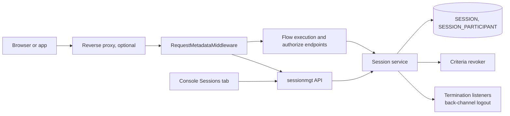
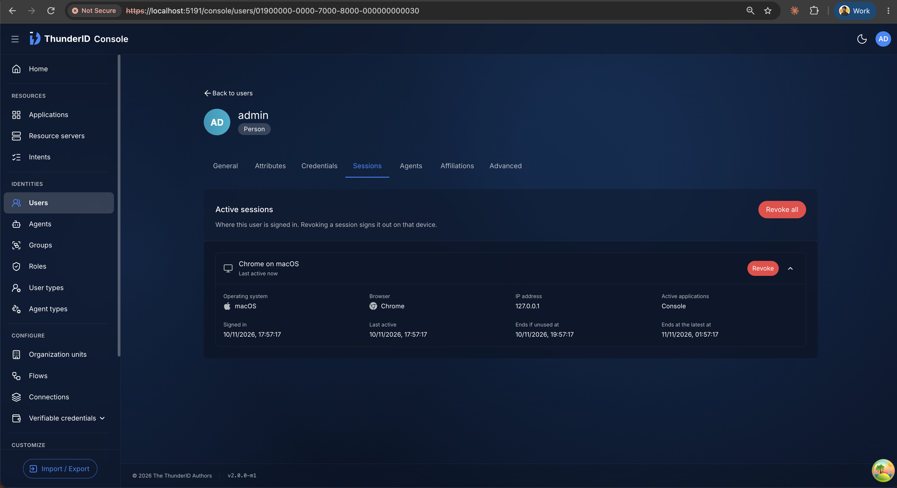
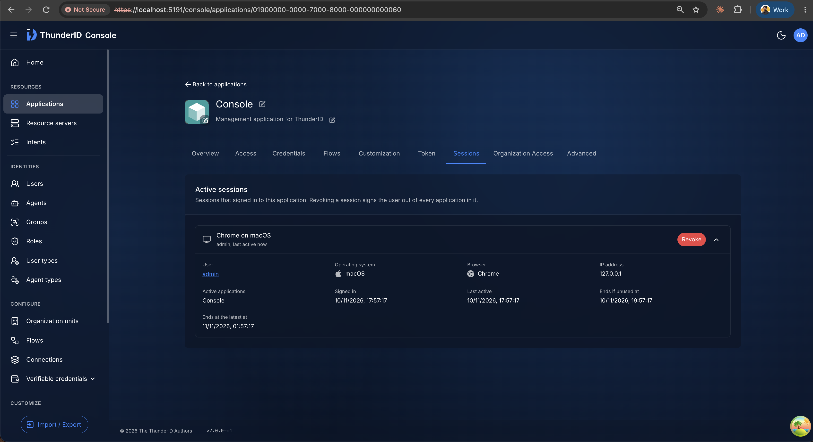
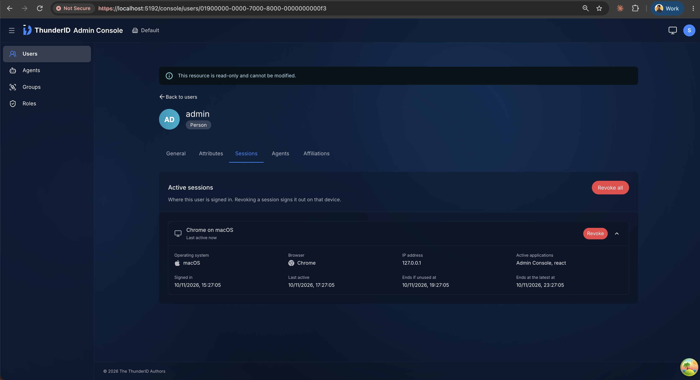

# SSO Session Management Specification

- **Status:** Draft
- **Version:** 0.1
- **Related documents:** [Feature issue #3400: Self-service and admin session management](https://github.com/thunder-id/thunderid/issues/3400), [Design discussion #4130: Session visibility](https://github.com/thunder-id/thunderid/discussions/4130), [Revised design: session visibility and revocation](https://github.com/thunder-id/thunderid/discussions/4130#discussioncomment-18580774), [Client IP design](https://github.com/thunder-id/thunderid/discussions/4130#discussioncomment-18771408), [Design discussion #6322: Session tracking, token lifecycle and session management](https://github.com/thunder-id/thunderid/discussions/6322), [OIDC back-channel logout specification](../back-channel-logout/spec.md)

## Summary

ThunderID keeps an SSO session for every sign-in through a flow with a session step, but gives nobody a way to see those sessions or end one on purpose. A user who signed in on a shared or lost device can't sign it out, and an administrator responding to a compromised account can't answer "where is this user signed in" or end those sessions without deleting the user. Session visibility and revocation are part of the session management epic (#3394).

This specification adds session management on top of the existing SSO session:

- Each session records the device and network it was used from: the User-Agent that created it, the IP it was created from, and the IP it was last used from.
- Administrators list the live sessions of a user or of an application, and revoke one session or all of a user's sessions.
- A signed-in user lists their own live sessions, sees which one they are using, and revokes one, all, or all but the current one.
- The Console shows a Sessions tab on a user and on an application.

Three decisions govern the rest:

> 1. Revoking a session ends it the same way sign-out does: the token families of its applications are revoked, the session is deleted, and the participating applications are notified through back-channel logout.
> 2. The current session is identified from the caller's access token, never from a value the client sends.
> 3. The recorded client IP is for display and logging only. No authentication, authorization, or rate limiting decision reads it.

Out of scope:

- Sign-ins through a flow without a session step, such as the client credentials grant. They create no session, so nothing is listed for them. [#6322](https://github.com/thunder-id/thunderid/discussions/6322) proposes recording such sign-ins as `DIRECT` sessions in the same table, with the same properties, so they can join these listings later.
- Approximate location from the IP, which needs a GeoIP dependency. It can be added later as a new key in `PROPERTIES`.
- Revoking an application's earlier grants in a session, and tracking access token use, which belong to the session and token policy in #3403.
- The SDK components that call the self-service API. They follow the [SDK development specification](../sdk-development/spec.md).

## Architecture

| Component | Responsibility |
|---|---|
| `clientip` package | Parses the trusted proxies once at startup and resolves the client IP of a request |
| `RequestMetadataMiddleware` | Runs right after `CorrelationIDMiddleware` on every request and puts the request metadata on the context: the resolved client IP and the User-Agent. The session and the access log read the same value on every path |
| Session step | Reads the client IP and the User-Agent from the request metadata, and passes both to the session service |
| Session service | Writes the client metadata, lists live sessions with their participants, and revokes sessions through the termination path that sign-out uses |
| Session store | Persists the metadata in `SESSION.PROPERTIES`, and pages and counts live sessions by subject or by application |
| `sessionmgt` package | The session management API under `backend/internal/flow/session/mgt`: routes, request validation, current session marking, and name resolution |
| Security middleware | Requires `system:session:view` or `system:session:delete` on the administrator routes, and only a signed-in user on the `/users/me/sessions` routes |
| `configure-sessions` package | The Sessions panel the Console and the Admin Console show on the user and application edit pages |
| Access log | Adds the resolved client IP as the last field of each line |

Ownership boundary: the session area owns sessions, their metadata, and termination. The `sessionmgt` package owns only the HTTP surface, and reaches sessions only through the session service. Token revocation and back-channel logout are reached through seams the session service already has, so the management API depends on the OAuth layer only for the name of the `tfid` claim it reads from the access token.

The feature uses these existing seams without changing their contracts:

| Seam | Use |
|---|---|
| Middleware chain in `createHTTPServer` | Hosts `RequestMetadataMiddleware` |
| Request context values in `internal/system/context` | `RequestMetadata` rides on `context.Context` next to the trace ID, and is never persisted with the flow context |
| Session participant record | Names the applications in a session and holds each one's current token family, which identifies the current session and the grants to revoke |
| Criteria revoker | Revokes the token families of a revoked session's participants |
| Termination topic | Notifies listeners, such as back-channel logout, after a revocation commits |
| User and application services | Resolve the user and application names shown in an administrator listing |



## Detailed design

### Client IP resolution

The resolver takes the request's connecting address (`RemoteAddr`) and the trusted proxy list.

- When the connecting address is not in any trusted range, it is the client IP.
- When it is in a trusted range, the header of the first matching entry is read.
  - `X-Forwarded-For` is read from right to left, with all header lines joined. The first address not in a trusted range is the client IP. Anything to its left could have been written by the client and is never read. An invalid address reached first rejects the header. When every address is trusted, the leftmost one is used.
  - Any other header is read as one IP. A header sent more than once is rejected, since only one line can have come from the proxy.
- When the header gives no valid IP, the connecting address is used, and the fallback is logged at debug level. Not a warning, since a client can send such a header and must not be able to fill the log.
- Addresses are stored in canonical form: an IPv4-mapped IPv6 address becomes IPv4, and an IPv6 zone is dropped.

The session reads the IP only from the request metadata, never from `RemoteAddr`, so a request that misses the middleware records no IP rather than a proxy's.

### Session metadata

The session step builds a `ClientInfo` from the request metadata, so every path that reaches it records the same values, the flow execution endpoint and a `prompt=none` authorization request alike. Invalid UTF-8 is dropped from the User-Agent, and it is cut to its first 512 characters.

| Property | Written |
|---|---|
| `userAgent` | Once, when the session is created |
| `creationIp` | Once, when the session is created |
| `lastActiveIp` | When the session is created, and again when a login flow reuses the session and refreshes `LAST_ACTIVE_AT`, or the subject authenticates again inside it |

When a login flow reuses the session with no client IP, the stored `lastActiveIp` is kept, so a reuse never erases a known address. A `refresh_token` grant also slides `LAST_ACTIVE_AT`, but leaves `PROPERTIES` as it is: that request reaches the token endpoint from the application, usually its backend, so its IP is not the user's.

The properties are display metadata. A `PROPERTIES` value that cannot be decoded loads as empty properties, so SSO reuse and sign-out keep working.

### Listing live sessions

A session is live when its state is `ACTIVE` and neither its idle nor its absolute deadline has passed. Only live sessions are listed, so an expired row that has not been cleaned up never appears.

- Sessions are ordered by `LAST_ACTIVE_AT` descending, then `SESSION_ID`, so the most recent session comes first and the order is the same on every request. Each page is read fresh, so a session that expires or becomes active between two requests can shift later pages by one.
- Paging uses `offset` and `limit`. `limit` is 1 to 100 and defaults to 30. The response carries `totalResults`, `startIndex` (the 1-based position of the first session on the page), `count`, and `first`, `prev`, `next` and `last` links.
- The participants of a page are read in one query for the whole page.
- An administrator listing resolves each user's display name and each application's name, once per page. A name that can't be resolved is left out rather than failing the listing.
- A session in the response never carries its handle, its checkpoint contexts, or its token family ids.
- `lastActiveAt` moves with the sign-ins the session backs and with `refresh_token` grants issued under it. Both writes are throttled, so it can lag the latest use by up to the activity refresh interval, 60 seconds by default. Access token use doesn't move it.

### The current session

The access token carries the token family id (`tfid`) of the grant it was issued from. A session is the caller's current session when one of its participants holds that token family.

- The self-service listing sets `isCurrent` on each session. The administrator listing leaves it out.
- `DELETE /users/me/sessions?exceptCurrent=true` keeps the session holding the token family. When no session of the caller holds it, for example a token issued without a session, nothing is revoked and the request fails with `SSM-1006`, so a caller asking to stay signed in is never signed out.

### Revoking sessions

A revocation runs the same termination as sign-out, in one transaction per call:

1. Read the session's participants.
2. Revoke each participant's current token family through the criteria revoker.
3. Delete the session row, its checkpoint contexts, and its participants.

After commit, termination listeners are notified with the reason `session_revocation`, only for sessions this call removed. Back-channel logout uses this to notify each participating application that registered an endpoint. Because revocation shares the sign-out path, Single Logout (#3399) and the session and token policy (#3403) apply to it once they land.

- Revoking a session signs it out: the next sign-in to its applications asks for credentials again.
- Revoking every session of a user, by an administrator or by the user, ends only the sessions' grants. It does not revoke every token the user holds.
- A self-service revocation of one session checks that the session belongs to the caller. A session that doesn't exist and a session of another user both return `404` with `SSM-1007`, so session ids can't be probed.
- An administrator revocation is idempotent: a session that is already gone returns `204`.

### Access log

Each access log line gets the resolved client IP as a new last field, or `-` when there is none. The connecting address stays the first field, since it cannot be spoofed and the client IP is only as reliable as the trusted proxy configuration.

```text
host - - [timestamp] method uri protocol status size elapsed_ms correlation_id client_ip
```

### Data model

The feature reuses `SESSION` and `SESSION_PARTICIPANT` and adds one nullable column:

| Column | PostgreSQL | SQLite | Content |
|---|---|---|---|
| `SESSION.PROPERTIES` | `JSONB` | `TEXT` | `{"userAgent": "...", "creationIp": "...", "lastActiveIp": "..."}`, with empty fields omitted. `NULL` when no property is set |

The column follows other JSON columns in ThunderID, such as `CONSENT.PURPOSES`, so a new property is a new key and needs no schema change. Listing by subject uses `idx_session_subject`, and listing by application uses `idx_session_participant_app`.

ThunderID does not migrate schemas on upgrade. The column is added to the `SESSION` table that [#6331](https://github.com/thunder-id/thunderid/pull/6331) introduced, so an existing installation applies that rename first, then adds the column before starting the new version:

```sql
-- PostgreSQL
ALTER TABLE "SESSION" ADD COLUMN PROPERTIES JSONB;

-- SQLite
ALTER TABLE "SESSION" ADD COLUMN PROPERTIES TEXT;
```

### API

| Specification | Change |
|---|---|
| `api/session.yaml` | New. The administrator and self-service session routes, the `Session` and `SessionListResponse` schemas, and the error responses |

| Method and path | Caller | Behavior |
|---|---|---|
| `GET /sessions?userId=` or `?appId=` | Administrator, `system:session:view` | One page of the user's live sessions, or of the live sessions the application has joined. Exactly one filter is required |
| `DELETE /sessions?userId=` | Administrator, `system:session:delete` | Revokes every session of the user. `204`, also when there were none |
| `DELETE /sessions/{sessionId}` | Administrator, `system:session:delete` | Revokes the session. `204`, also when it was already gone |
| `GET /users/me/sessions` | Any signed-in user | One page of the caller's live sessions, each with `isCurrent`. User names are not resolved |
| `DELETE /users/me/sessions` | Any signed-in user | Revokes the caller's sessions. `exceptCurrent=true` keeps the current one |
| `DELETE /users/me/sessions/{sessionId}` | Any signed-in user | Revokes one of the caller's sessions. `404` when the caller has no such session |

The administrator routes have their own permissions, as `/applications` and `/roles` do. A `session` resource with the actions `view` and `delete` is added under `system` on the System resource server, giving `system:session:view` for listing and `system:session:delete` for revoking. A role that holds `system`, such as the Administrator role, holds both. Only the Data Plane serves sessions, so the Control Plane declares no session permission and leaves the routes out. The self-service routes take the user from the access token and accept no user id. The permission table maps `GET /users/me/**` and the two `DELETE /users/me/sessions` routes to no permission, and the `DELETE` entries are narrow so they don't open `DELETE /users/me`.

Each session in a response carries `id`, `userId`, `userName` (administrator listing only), `userAgent`, `creationIp`, `lastActiveIp`, `authenticatedAt`, `createdAt`, `lastActiveAt`, `idleExpiresAt`, `absoluteExpiresAt`, `isCurrent` (self-service listing only), and `participants`, each with `appId`, `appName`, `firstJoinedAt` and `lastActiveAt`. A value that wasn't recorded or can't be resolved is left out.

Error codes, in the standard error envelope:

| Code | Status | Message key | When |
|---|---|---|---|
| `SSM-1001` | 400 | `error.sessionmgt.invalid_filter` | Neither or both of `userId` and `appId` given to `GET /sessions` |
| `SSM-1002` | 400 | `error.sessionmgt.invalid_limit` | `limit` is not an integer from 1 to 100 |
| `SSM-1003` | 400 | `error.sessionmgt.invalid_offset` | `offset` is not a non-negative integer |
| `SSM-1004` | 400 | `error.sessionmgt.missing_user_id` | `userId` missing from `DELETE /sessions` |
| `SSM-1005` | 400 | `error.sessionmgt.invalid_except_current` | `exceptCurrent` is not `true` or `false` |
| `SSM-1006` | 400 | `error.sessionmgt.current_session_unknown` | `exceptCurrent=true`, and the access token identifies no session of the caller |
| `SSM-1007` | 404 | `error.sessionmgt.session_not_found` | The caller has no session with the given id |

### UI

The `configure-sessions` package provides a Sessions panel, shown as a tab on the user and application edit pages.

| Page | Shows | Actions |
|---|---|---|
| User edit page | The user's live sessions | Revoke a session, Revoke all |
| Application edit page | The live sessions the application has joined, each naming its user | Revoke a session |







- The edit pages show the tab only when the host app passes the panel, so it appears only where sessions exist. The Console of a standalone server shows it on both pages, and the Admin Console on the user page, since it has no application pages. The Control Plane console shows no Sessions tab.
- The tab is hidden on an application with no grant type that lets users sign in.
- Each session shows the browser, operating system and device described from its User-Agent, its last-active IP, when it was last active, and its applications. The User-Agent the mobile SDKs send is recognized as a native app.
- The creation IP is shown as well when it differs from the last-active IP. On an application's panel, a user whose name can't be resolved is shown by their user id.
- A revocation asks for confirmation first, and the list refreshes after it.
- An administrator without `system:session:view` sees a message that they don't have permission to view the sessions, with no retry. A revocation refused for want of `system:session:delete` shows the same kind of message in the confirmation dialog.

### Configuration

| Key | Default | Level | Description |
|---|---|---|---|
| `server.trusted_proxies` | `[]` | Deployment | Reverse proxies allowed to report the client IP |
| `server.trusted_proxies[].cidr` | Required | Deployment | The range the proxy connects from, such as `10.0.1.0/24` |
| `server.trusted_proxies[].header` | `x-forwarded-for` | Deployment | The header the proxy sets the client IP in |

Validation runs at startup, and an invalid entry stops the server:

- `cidr` must parse as a CIDR range. An IPv4-mapped range shorter than `/96` is rejected, since it could never match.
- `header`, when set, must be a valid header field name.
- `header: forwarded` (RFC 7239) is rejected. Its value is not a plain IP, so reading it would fall back on every request.

The key is also exposed through the Helm chart as `configuration.server.trustedProxies`. The session timeouts that decide whether a session is live are unchanged.

## Requirements

### R1. Record the device and network a session was created from

**Requirement:** As a user reviewing my sessions, I want each one to show the device and network it started on, so that I can recognize the ones that are mine.

**Acceptance criteria:**

- **AC1.1:** Given a client with a User-Agent, when a login flow creates an SSO session, then `PROPERTIES` holds that `userAgent`, and `creationIp` and `lastActiveIp` equal the resolved client IP.
- **AC1.2:** Given a User-Agent longer than 512 characters, when a session is created, then the recorded value is its first 512 characters and is valid UTF-8.
- **AC1.3:** Given a request with no User-Agent and no client IP, when a session is created, then `PROPERTIES` is `NULL`.

### R2. Keep the last-active IP on the user's own sign-ins

**Requirement:** As a user, I want a session's last-active IP to be where I last signed in with it, not where an application refreshed its tokens, so that an unfamiliar address means something.

**Acceptance criteria:**

- **AC2.1:** Given an existing session, when a login flow reuses it from a new IP and `LAST_ACTIVE_AT` is refreshed, then `lastActiveIp` is the new IP and `userAgent` and `creationIp` are unchanged.
- **AC2.2:** Given an existing session, when the subject authenticates again inside it, then `lastActiveIp` is the IP of that request.
- **AC2.3:** Given an existing session, when a login flow reuses it with no client IP, then the stored `lastActiveIp` is kept.
- **AC2.4:** Given an existing session, when a `refresh_token` grant slides its idle deadline, then `PROPERTIES` is unchanged.
- **AC2.5:** Given an existing session, when a `prompt=none` authorization request reuses it from a new IP and `LAST_ACTIVE_AT` is refreshed, then `lastActiveIp` is the new IP.

### R3. Record the user's IP behind a reverse proxy

**Requirement:** As an operator running ThunderID behind a reverse proxy, I want the user's address recorded rather than the proxy's, and a forwarded header from anyone else ignored.

**Acceptance criteria:**

- **AC3.1:** Given no trusted proxies, when a request carries `X-Forwarded-For`, then the client IP is the connecting address.
- **AC3.2:** Given a trusted proxy range, when a request from that range carries `X-Forwarded-For: <client>, <proxy>`, then the client IP is the rightmost address outside the trusted ranges.
- **AC3.3:** Given a trusted proxy with a custom header, when the request from that proxy carries the header once with a valid IP, then that IP is the client IP.
- **AC3.4:** Given a trusted proxy, when its header is missing or invalid, then the client IP is the connecting address, and the fallback is logged at debug level only.
- **AC3.5:** Given an invalid `server.trusted_proxies` entry, when the server starts, then it exits with an error naming the entry.

### R4. Metadata never blocks a sign-in or a sign-out

**Requirement:** As a user, I want SSO and sign-out to keep working even if a session's metadata is damaged, since it is only there to be displayed.

**Acceptance criteria:**

- **AC4.1:** Given a session whose `PROPERTIES` cannot be decoded, when it is loaded, then it loads with empty properties and SSO reuse and sign-out succeed.

### R5. Trace a request to the user's IP

**Requirement:** As an operator investigating an incident, I want each access log line to show the user's IP next to the connecting address.

**Acceptance criteria:**

- **AC5.1:** Given any request, when it is logged, then the last field of the line is the resolved client IP, or `-` when there is none.

### R6. See where a user or an application has live sessions

**Requirement:** As an administrator, I want to list the live sessions of a user or of an application, so that I can answer where a user is signed in and who is using an application.

**Acceptance criteria:**

- **AC6.1:** Given a caller with the `system:session:view` permission, when they call `GET /sessions?userId=<id>`, then the response holds that user's live sessions, most recently active first, each with its participants and the resolved user and application names.
- **AC6.2:** Given an application that has joined sessions, when an administrator calls `GET /sessions?appId=<id>`, then the response holds only the live sessions that application has joined.
- **AC6.3:** Given a session past its idle or absolute deadline, when sessions are listed, then it is not in the response.
- **AC6.4:** Given neither or both of `userId` and `appId`, when `GET /sessions` is called, then it returns `400` with `SSM-1001`.
- **AC6.5:** Given a caller without `system:session:view`, when they call `GET /sessions`, then it returns `403`.

### R7. See my own sessions

**Requirement:** As a signed-in user, I want to list my own live sessions and see which one I'm using, so that I can tell which others to end.

**Acceptance criteria:**

- **AC7.1:** Given a signed-in user with sessions on two devices, when they call `GET /users/me/sessions`, then the response holds both sessions and no session of another user.
- **AC7.2:** Given the access token was issued in the latest grant of one of those sessions, when the user lists their sessions, then that session has `isCurrent: true` and the others `false`.

### R8. End a user's sessions as an administrator

**Requirement:** As an administrator responding to a lost device or a compromised account, I want to revoke one session or every session of a user.

**Acceptance criteria:**

- **AC8.1:** Given a live session, when an administrator calls `DELETE /sessions/{id}`, then it returns `204`, the session no longer appears in a listing, and the next sign-in to its applications asks for credentials.
- **AC8.2:** Given a user with several sessions, when an administrator calls `DELETE /sessions?userId=<id>`, then every session of the user is revoked.
- **AC8.3:** Given a session that is already gone, when an administrator revokes it, then it returns `204`.
- **AC8.4:** Given a caller with `system:session:view` but without `system:session:delete`, when they call `DELETE /sessions/{id}` or `DELETE /sessions?userId=<id>`, then it returns `403` and nothing is revoked.

### R9. End my own sessions

**Requirement:** As a signed-in user, I want to sign out one of my sessions, all of them, or all but the one I'm using, without being able to touch anyone else's.

**Acceptance criteria:**

- **AC9.1:** Given one of the caller's sessions, when they call `DELETE /users/me/sessions/{id}`, then that session is revoked.
- **AC9.2:** Given another user's session id, when the caller calls `DELETE /users/me/sessions/{id}`, then it returns `404` with `SSM-1007` and the session is not revoked.
- **AC9.3:** Given a caller with several sessions, when they call `DELETE /users/me/sessions?exceptCurrent=true`, then every session but the current one is revoked and the caller stays signed in.
- **AC9.4:** Given an access token that identifies no session of the caller, when they call `DELETE /users/me/sessions?exceptCurrent=true`, then it returns `400` with `SSM-1006` and nothing is revoked.

### R10. A revoked session is over everywhere

**Requirement:** As a user or an administrator, I want a revoked session to stop backing SSO, stop keeping the tokens of each application's latest grant in it alive, and its applications to be told, so that revoking means signed out.

**Acceptance criteria:**

- **AC10.1:** Given a revoked session, when one of its applications refreshes a token from its latest grant in that session, then the refresh fails.
- **AC10.2:** Given a participating application that registered a back-channel logout endpoint, when the session is revoked, then the application receives a logout token for that session.

### R11. Manage sessions from the Console

**Requirement:** As an administrator, I want to view and revoke sessions from a user's page and from an application's page, without calling the API myself.

**Acceptance criteria:**

- **AC11.1:** Given a user with live sessions, when an administrator opens the user's Sessions tab, then each session shows its device, last-active IP, last-active time and applications, with actions to revoke it and to revoke all.
- **AC11.4:** Given the Control Plane console, when an administrator opens a user or an application, then there is no Sessions tab.
- **AC11.2:** Given an application users sign in to, when an administrator opens its Sessions tab, then each session names its user and can be revoked.
- **AC11.3:** Given an application with no grant type that lets users sign in, when an administrator opens it, then there is no Sessions tab.

## Known limitations

- A revocation revokes only each application's latest grant in the session. Tokens from an earlier grant of the same application stay valid until they expire. Tracked in #3403.
- An access token from an earlier grant matches no session, so no session is marked current and `exceptCurrent=true` returns `SSM-1006` without revoking anything. Tracked in #3403.
- Access token use doesn't move `lastActiveAt`, so a session whose application only calls APIs with an unexpired access token looks idle until its next refresh or sign-in.
- Expired sessions stay in the database until they are cleaned up. On PostgreSQL, the cleanup procedure removes sessions past their absolute deadline when the operator schedules it.

## Open questions

- **App-native flows run from a backend.** When an application's server calls `/flow/execute` with a Flow-Secret, the connecting address and User-Agent are the application server's. Options are to record nothing for such requests, or to let the operator list the application server as a trusted proxy so it can forward the user's IP. Raised in [#4130](https://github.com/thunder-id/thunderid/discussions/4130#discussioncomment-19390574).

## Change log

| Version | Date | Change |
|---|---|---|
| 0.1 | 2026-11-04 | Initial specification, from design discussion #4130 and the session table in #6322, as built in #5575, #6150, #6152 and #6159. |
