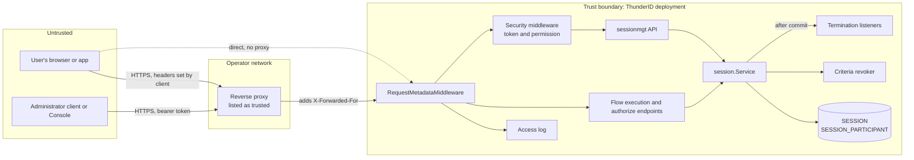
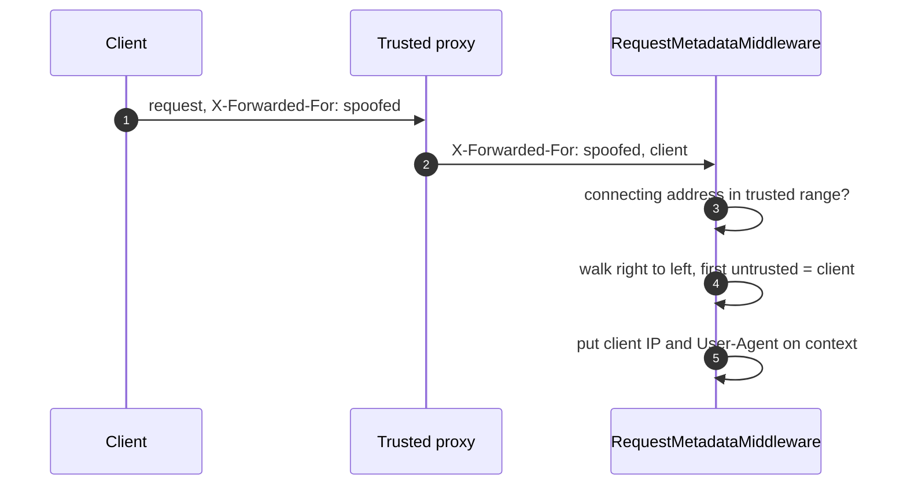
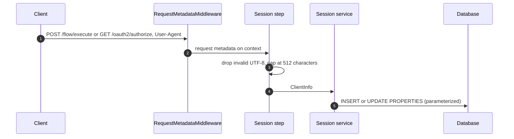
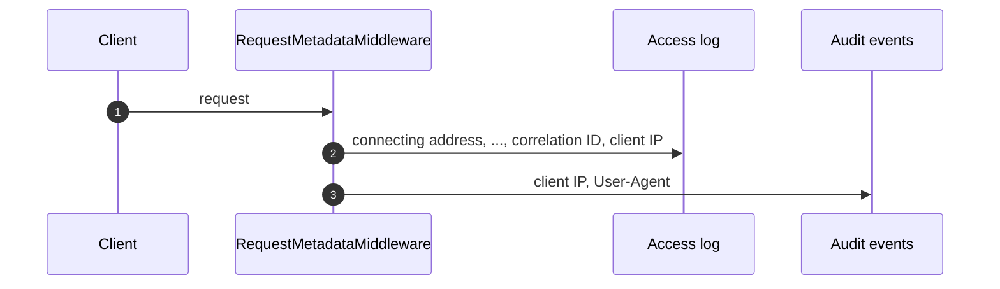
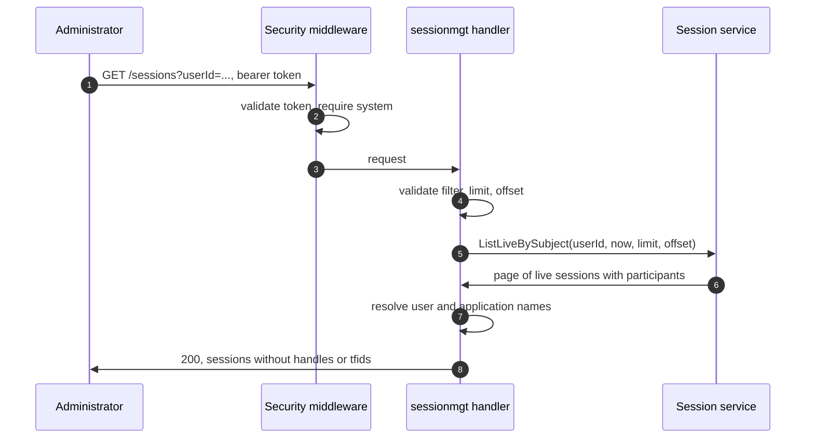
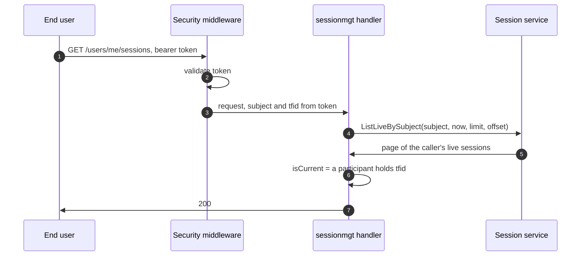
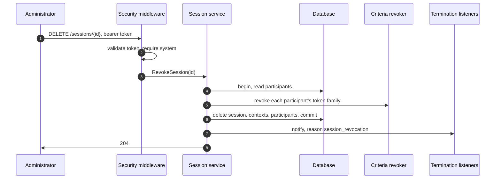
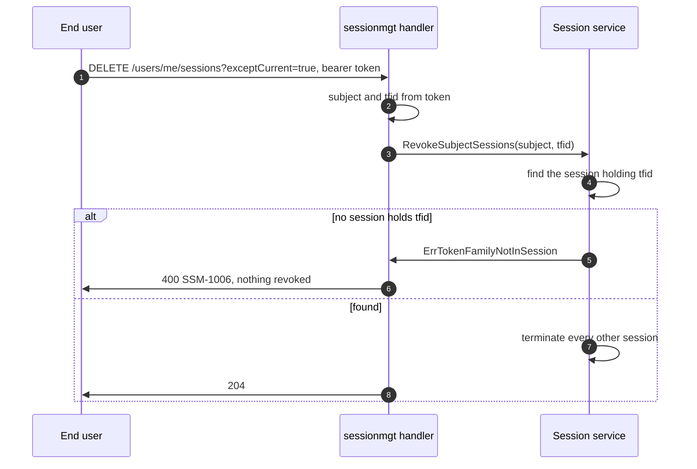
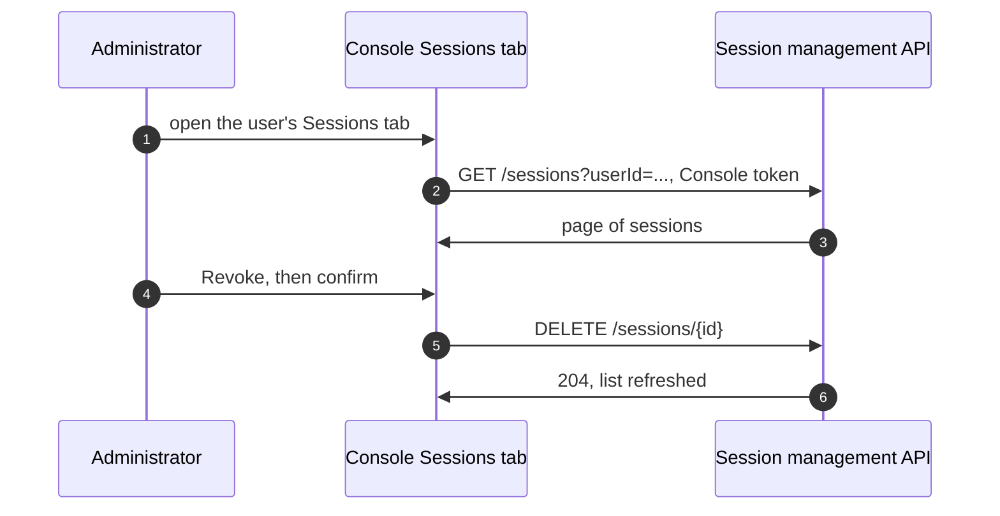

# SSO Session Management Threat Model

This model covers SSO session management in ThunderID: the device and IP recorded on each SSO session, the resolution of the client IP behind trusted proxies, the session management API for administrators and for signed-in users, and the Console Sessions views.

## Overview

Session management lets people see and end SSO sessions. Every session records the User-Agent and IP it was used from. Administrators list and revoke any user's sessions through `/sessions`, and a signed-in user lists and revokes their own through `/users/me/sessions`. A revocation runs the same termination as sign-out, so it revokes the session's grants, deletes the session, and triggers back-channel logout.

The security-relevant shift is that sessions, which no API exposed before, can now be read and ended by id. The self-service routes must never let one user see or end another user's session, the administrator routes must stay behind the `system` permission, and a revocation must leave nothing that can still back SSO or refresh a token. The recorded IP and User-Agent are client supplied and personal data, so they must not be trusted, injected into storage or logs, or kept longer than the session.

Cross-cutting concerns covered elsewhere: access token validation and the permission check in the security middleware, the login flow that creates and reuses sessions, the session cookie transport, token family revocation, and back-channel logout delivery. These are trust inputs here, not re-analysed.

## Scope

This model covers:

- Client IP resolution in `RequestMetadataMiddleware` and the `clientip` package, and validation of `server.trusted_proxies` at startup.
- Recording `userAgent`, `creationIp`, and `lastActiveIp` on a session.
- The client IP added to the access log and to audit events.
- `GET /sessions`, `DELETE /sessions`, and `DELETE /sessions/{sessionId}` for administrators.
- `GET /users/me/sessions`, `DELETE /users/me/sessions`, and `DELETE /users/me/sessions/{sessionId}` for signed-in users.
- The Console Sessions tab on the user and application pages.

Out of scope (see the referenced companion models or the owning area):

- Delivery of the logout token after a revocation. Owned by [back-channel-logout/threat-model.md](../back-channel-logout/threat-model.md), whose scope names the sign-out (`Terminate`) and subject revocation (`TerminateBySubject`) paths. Revocation through this API reaches the same listener with the reason `session_revocation`.
- Session establishment, reuse, the session cookie handle, the idle and absolute deadlines, and the cleanup procedures. Owned by the session area.
- Token family revocation itself. Owned by the token revocation area, and used here unchanged through the criteria revoker.
- Access token validation and the permission table. Trust inputs here.
- The SDK components that call the self-service API. Owned by [sdk-development/threat-model.md](../sdk-development/threat-model.md).

## Architecture



The trust boundary sits at the deployment edge. Two things cross it that matter here. Request headers come from the client and are untrusted. The one exception is the forwarding header set for a trusted proxy, which is read only when the request comes from that proxy's range. The User-Agent is always the client's, so it is cleaned and capped whatever the source. Session ids leave through the API and come back in revocation requests, so every self-service call is bound to the subject in the access token rather than to the id it names.

### Components

| Component | Task |
| --- | --- |
| `clientip` resolver | Matches the connecting address against the parsed trusted ranges and reads a forwarding header only for a match. Walks `X-Forwarded-For` right to left |
| `RequestMetadataMiddleware` | Puts the request metadata, the resolved IP and the User-Agent, on the request context for every request |
| Session step | Builds `ClientInfo` from the request metadata, dropping invalid UTF-8 and capping the User-Agent at 512 characters |
| Security middleware | Validates the access token, requires `system` on `/sessions`, and lets any signed-in user reach `/users/me/sessions` |
| `sessionmgt` handler | Validates the request, takes the self-service user from the token, marks the current session from the token's `tfid`, and resolves names for administrators |
| `session.Service` and store | List live sessions with parameterized queries, check ownership, and revoke sessions in one transaction |
| Criteria revoker | Revokes the token families of a revoked session's participants |
| Termination listeners | Called after a revocation commits, with the session id, subject id, and participants. Back-channel logout is one |
| Console Sessions panel | Calls the administrator API with the signed-in administrator's token |

### Actors

#### Actors

| Actor | Description | Roles or permissions |
| --- | --- | --- |
| End user | Signs in through a login flow, and manages their own sessions | A valid access token |
| Administrator | Lists and revokes any user's sessions, through the API or the Console | `system` permission |
| Attacker | Any caller able to reach ThunderID or a proxy, able to set any header. May hold a valid token for their own account | None, or their own access token |
| Trusted reverse proxy | Forwards requests and reports the client IP in a header | Listed in `server.trusted_proxies` |
| Operator | Configures `server.trusted_proxies`, and reads the access log and database | Deployment configuration |

#### Entitlement matrix

| Actor | Set the recorded client IP | Set the recorded User-Agent | List own sessions | List any user's sessions | Revoke own sessions | Revoke any user's sessions | Change trusted proxies |
| --- | --- | --- | --- | --- | --- | --- | --- |
| End user | [No] | [Yes], on their own sessions | [Yes] | [No] | [Yes] | [No] | [No] |
| Administrator | [No] | [No] | [Yes] | [Yes] | [Yes] | [Yes] | [No] |
| Attacker | [No], unless a trusted range covers the address they connect from (threat 4) | [Yes], on their own sessions | [Yes], their own account only | [No] | [Yes], their own account only | [No] | [No] |
| Trusted reverse proxy | [Yes] | [No] | [No] | [No] | [No] | [No] | [No] |
| Operator | [No] | [No] | [No] | [No] | [No] | [No] | [Yes] |

### External Dependencies (not owned)

| Dependency | Description (usage, purpose, authentication, authorization, security) |
| --- | --- |
| Reverse proxy | Operator owned. Must overwrite or append to the forwarding header so a client cannot place an address to the right of its own. ThunderID trusts it only by its connecting address |
| Runtime persistent database | Stores `SESSION` and `SESSION_PARTICIPANT`. Access control, encryption at rest, and scheduling the PostgreSQL cleanup procedure are the operator's |
| User and application services | Resolve display names for the administrator listing. A failed lookup leaves the name out |

## Threats and mitigations

### Out-of-scope interactions and risks

- Session hijacking through a stolen session cookie. Owned by the session transport. The recorded IP is not used to bind a session, so it neither helps nor hurts here.
- A stolen access token used against `/users/me/sessions`. The token is validated by the security middleware, and what it can do here is no more than it can already do over the account.
- Failure or delay of logout token delivery after a revocation. Owned by the back-channel logout model.
- The deployment's network path between the client and a trusted proxy, and between the proxy and ThunderID.

### Interactions

#### 01: Resolving the client IP

**Description**

`RequestMetadataMiddleware` resolves the client IP for every request. A forwarding header is read only when the connecting address is in a trusted range. `X-Forwarded-For` is walked right to left to the first untrusted address. A single-IP header must be sent exactly once. A missing header, or an invalid address reached before the first untrusted one, falls back to the connecting address. Addresses further left are never read, and if every address is trusted the leftmost one is used.

**Assets involved**

| Initiator | Intermediate | Target |
| --- | --- | --- |
| Client | Trusted reverse proxy, optional | `RequestMetadataMiddleware` |

**Data flow**



**Security considerations**

| Area | Response | Comments |
| --- | --- | --- |
| Data confidentiality | [C-Medium] | An IP address is personal data |
| Communication medium | [M-NT] | |
| Transport security | [TLS] | TLS ends at the proxy or at ThunderID, as deployed |
| Authentication | None | Applies to every request |
| Accessibility | [Public] | |
| Authorization and Access Control | Trusted ranges | Only a trusted connecting address may report a client IP |

**Threat assessment**

| ID | Category | Threat | Materializable | Mitigation / comment |
| --- | --- | --- | --- | --- |
| 1 | [Spoofing] | A client connecting directly sends `X-Forwarded-For` to record a chosen IP | [No] | Headers are read only when the connecting address is in a configured trusted range. The default list is empty |
| 2 | [Spoofing] | A client behind a trusted proxy prepends a fake address to `X-Forwarded-For` | [No] | The header is walked right to left and stops at the first untrusted address, which the proxy appended. Addresses to its left are never read |
| 3 | [Spoofing] | A client sends a single-IP header such as `X-Real-IP` twice, hoping its line is read | [No] | A single-IP header sent more than once is rejected, and the connecting address is used |
| 4 | [Security Risk] | An operator trusts a range that untrusted callers can connect from, or a proxy that passes the client's header through unchanged | [Yes] | Bounded: the IP is for display and logging only, so a spoofed value cannot grant access. The configuration reference asks for the narrowest ranges and for the proxy to set the header itself. Recorded as a residual |
| 5 | [Denial of Service] | A long `X-Forwarded-For` header costs parsing time on every request | [No] | The header is bounded by the server's header size limit, and parsing stops at the first untrusted or invalid address |
| 6 | [Operational Risk] | A trusted proxy is misconfigured and sends no header, so every request records the proxy's IP. Logging each fallback as a warning would let a client behind the proxy fill the log with headers that give no valid IP | [No] | The fallback is logged at debug level only, so a client cannot raise warnings, and an operator finds the proxy by turning on debug logging |
| 7 | [Operational Risk] | An invalid trusted proxy entry is ignored, so the operator believes a proxy is trusted when it is not | [No] | Invalid CIDRs, IPv4-mapped ranges shorter than `/96`, invalid header names, and `forwarded` fail at startup |

#### 02: Recording client metadata on a session

**Description**

The session step reads the client IP and the User-Agent from the request metadata and passes them to the session service, on every path that reaches it: the flow execution endpoint and a `prompt=none` authorization request. The session service writes `userAgent` and `creationIp` once on creation, and refreshes `lastActiveIp` when a login flow reuses the session or the user authenticates again inside it. A `refresh_token` grant leaves the properties as they are.

**Assets involved**

| Initiator | Intermediate | Target |
| --- | --- | --- |
| Client | `RequestMetadataMiddleware`, session step, session service | `SESSION.PROPERTIES` |

**Data flow**



**Security considerations**

| Area | Response | Comments |
| --- | --- | --- |
| Data confidentiality | [C-Medium] | IP addresses and User-Agent strings are personal data |
| Communication medium | [M-DB] | |
| Transport security | [TLS] | To the database, as configured by the operator |
| Authentication | Login flow | Metadata is written only by a flow that creates or reuses a session |
| Accessibility | [Internal] | Read back only through the session management API |
| Authorization and Access Control | N/A | |

**Threat assessment**

| ID | Category | Threat | Materializable | Mitigation / comment |
| --- | --- | --- | --- | --- |
| 8 | [Tampering] | A crafted User-Agent injects SQL into the session write | [No] | All writes use parameterized queries, and the value is JSON encoded |
| 9 | [Denial of Service] | A very large User-Agent grows the session row on every login | [No] | The User-Agent is capped at 512 characters |
| 10 | [Tampering] | Invalid UTF-8 in the User-Agent breaks JSON encoding or a later display | [No] | Invalid UTF-8 is dropped before the value is recorded |
| 11 | [Denial of Service] | A corrupted `PROPERTIES` value stops a session from loading, blocking SSO or sign-out | [No] | An unreadable value decodes to empty properties and the session loads normally |
| 12 | [Spoofing] | An app-native flow run from the application's backend records the application server's IP and User-Agent instead of the user's | [Yes] | Bounded: a display inaccuracy only. Recorded as an open question in the specification and as a residual |
| 13 | [Privacy Risk] | IP and User-Agent are kept longer than needed | [Yes] | Bounded: they are deleted with the session row on sign-out or revocation. An expired row stays until it is cleaned up. Recorded as a residual |

#### 03: Writing the client IP to the access log and audit events

**Description**

The access log adds the resolved client IP as the last field of each line, or `-` when there is none. The connecting address stays the first field. Audit events record the same resolved client IP as their client address, with the User-Agent cut to 256 characters.

**Assets involved**

| Initiator | Intermediate | Target |
| --- | --- | --- |
| Client | `RequestMetadataMiddleware` | Access log, audit events |

**Data flow**



**Security considerations**

| Area | Response | Comments |
| --- | --- | --- |
| Data confidentiality | [C-Medium] | The connecting address was already logged |
| Communication medium | [M-FS] | |
| Transport security | N/A | |
| Authentication | None | |
| Accessibility | [Restricted] | Operator only |
| Authorization and Access Control | Operator log access | |

**Threat assessment**

| ID | Category | Threat | Materializable | Mitigation / comment |
| --- | --- | --- | --- | --- |
| 14 | [Tampering] | A forged header injects text or new lines into the access log or an audit event | [No] | Only a value that parses as an IP is logged, in canonical form, so no header text reaches the log |
| 15 | [Repudiation] | A spoofed client IP misleads an investigation | [No] | The connecting address, which cannot be spoofed, stays the first field. An audit event records only the client IP, so the access log line with the same trace ID gives its connecting address |

#### 04: Listing sessions as an administrator

**Description**

An administrator calls `GET /sessions` with exactly one of `userId` and `appId`, directly or from the Console Sessions tab. The security middleware requires the `system` permission. The service returns one page of live sessions with their participants, and the handler resolves user and application names.

**Assets involved**

| Initiator | Intermediate | Target |
| --- | --- | --- |
| Administrator | Security middleware, `sessionmgt` handler, session service | `SESSION`, `SESSION_PARTICIPANT`, user and application services |

**Data flow**



**Security considerations**

| Area | Response | Comments |
| --- | --- | --- |
| Data confidentiality | [C-Medium] | User names, IPs, User-Agents, and application names |
| Communication medium | [M-NT] | |
| Transport security | [TLS] | |
| Authentication | Bearer access token | |
| Accessibility | [Restricted] | |
| Authorization and Access Control | `system` permission | Enforced by the security middleware before the handler runs |

**Threat assessment**

| ID | Category | Threat | Materializable | Mitigation / comment |
| --- | --- | --- | --- | --- |
| 16 | [Elevation of Privilege] | A user without `system` lists another user's sessions through `/sessions` | [No] | The route has no self-service permission entry, so the security middleware requires `system` and returns `403` |
| 17 | [Information Disclosure] | A listing leaks a value that lets the reader take over a session, such as its handle or token family id | [No] | The response model carries no handle, checkpoint context, or token family id. The session `id` is the internal `SESSION_ID`, the same value as the `sid` claim. No flow or SSO lookup accepts it, so it can name a session but not resume one |
| 18 | [Denial of Service] | A large page or a deep offset makes each listing expensive | [No] | `limit` is capped at 100, and the queries are backed by `idx_session_subject` and `idx_session_participant_app`. Participants for a page are read in one query |
| 19 | [Information Disclosure] | An expired session is shown as live, so an administrator misjudges what can still be used | [No] | Only `ACTIVE` sessions within both deadlines are listed |

#### 05: Listing my own sessions

**Description**

A signed-in user calls `GET /users/me/sessions`. The user is taken from the access token, and no user id is accepted from the request. Each session is marked `isCurrent` when one of its participants holds the token family in the access token's `tfid` claim.

**Assets involved**

| Initiator | Intermediate | Target |
| --- | --- | --- |
| End user | Security middleware, `sessionmgt` handler, session service | The caller's rows in `SESSION` and `SESSION_PARTICIPANT` |

**Data flow**



**Security considerations**

| Area | Response | Comments |
| --- | --- | --- |
| Data confidentiality | [C-Medium] | The caller's own IPs, User-Agents, and applications |
| Communication medium | [M-NT] | |
| Transport security | [TLS] | |
| Authentication | Bearer access token | |
| Accessibility | [Public] | Any signed-in user |
| Authorization and Access Control | Subject from the token | The route accepts no user id |

**Threat assessment**

| ID | Category | Threat | Materializable | Mitigation / comment |
| --- | --- | --- | --- | --- |
| 20 | [Information Disclosure] | A user lists another user's sessions by passing a user id | [No] | The handler reads the subject from the access token and ignores any user id. The query filters on that subject |
| 21 | [Spoofing] | A client marks a session of its choice as current, to steer a later `exceptCurrent` revocation | [No] | `isCurrent` comes from the token's `tfid` claim, which is signed into the token. The request carries no session id for it |
| 22 | [Information Disclosure] | The self-service listing reveals the names of other users or internal ids | [No] | User names are not resolved on this route, and the response carries no handle or token family id |

#### 06: Revoking sessions as an administrator

**Description**

An administrator calls `DELETE /sessions/{sessionId}` or `DELETE /sessions?userId=`, directly or from the Console. The service runs the sign-out termination for each session in one transaction: it reads the participants, revokes their token families, deletes the session, its contexts and its participants, and notifies termination listeners after commit.

**Assets involved**

| Initiator | Intermediate | Target |
| --- | --- | --- |
| Administrator | Security middleware, `sessionmgt` handler, session service | `SESSION`, `SESSION_PARTICIPANT`, token families, termination listeners |

**Data flow**



**Security considerations**

| Area | Response | Comments |
| --- | --- | --- |
| Data confidentiality | [C-Low] | No data is returned |
| Communication medium | [M-NT], [M-DB] | |
| Transport security | [TLS] | |
| Authentication | Bearer access token | |
| Accessibility | [Restricted] | |
| Authorization and Access Control | `system` permission | |

**Threat assessment**

| ID | Category | Threat | Materializable | Mitigation / comment |
| --- | --- | --- | --- | --- |
| 23 | [Elevation of Privilege] | A user without `system` revokes another user's sessions through `/sessions` | [No] | The security middleware requires `system` on `DELETE /sessions` and `DELETE /sessions/{id}` |
| 24 | [Security Risk] | A revoked session keeps working because its tokens stay valid, or a crash between steps leaves live tokens for a deleted session | [No] | Token families are revoked first, in the same transaction that deletes the session, so either both happen or neither does |
| 25 | [Security Risk] | An application keeps a local session after its SSO session is revoked | [Yes] | Bounded: termination listeners are notified after commit, and back-channel logout sends a logout token to each participant that registered an endpoint. A notification dropped on a full queue or at shutdown, and a participant that joins between the participant read and the delete, are recorded as residuals in the back-channel logout threat model |
| 26 | [Security Risk] | Tokens from an earlier grant of the same application, or tokens not issued through a session, survive the revocation | [Yes] | Bounded: only each application's latest grant in the session is revoked, and the earlier tokens expire on their own lifetime. Documented in the API reference, and tracked in #3403 |
| 27 | [Repudiation] | An administrator revokes a user's sessions without a record of who did it | [Yes] | Bounded: the access log records the request with its correlation ID, and termination listeners receive the `session_revocation` reason. Recorded as a residual |

#### 07: Revoking my own sessions

**Description**

A signed-in user calls `DELETE /users/me/sessions/{sessionId}`, or `DELETE /users/me/sessions` with an optional `exceptCurrent=true`. The user is taken from the access token. Revoking one session checks that it belongs to the caller. Keeping the current session uses the token's `tfid`, and when no session of the caller holds it, nothing is revoked.

**Assets involved**

| Initiator | Intermediate | Target |
| --- | --- | --- |
| End user | Security middleware, `sessionmgt` handler, session service | The caller's sessions, their token families, termination listeners |

**Data flow**



**Security considerations**

| Area | Response | Comments |
| --- | --- | --- |
| Data confidentiality | [C-Low] | No data is returned |
| Communication medium | [M-NT], [M-DB] | |
| Transport security | [TLS] | |
| Authentication | Bearer access token | |
| Accessibility | [Public] | Any signed-in user |
| Authorization and Access Control | Ownership | The session must belong to the subject in the token |

**Threat assessment**

| ID | Category | Threat | Materializable | Mitigation / comment |
| --- | --- | --- | --- | --- |
| 28 | [Elevation of Privilege] | A user revokes another user's session by guessing or reusing its id | [No] | The service revokes only a session whose subject matches the token's subject, so knowing an id is not enough (threat 33) |
| 29 | [Information Disclosure] | The response to revoking another user's session reveals that it exists | [No] | A session of another user and a session that doesn't exist both return `404` with `SSM-1007` |
| 30 | [Elevation of Privilege] | The self-service permission entries open a broader route, such as `DELETE /users/me` | [No] | Only `DELETE /users/me/sessions` and `DELETE /users/me/sessions/**` map to no permission. Tests confirm `DELETE /users/me` still needs the user permission |
| 31 | [Denial of Service] | A user asking to stay signed in is signed out of every session, because their token identifies no session | [No] | When no session holds the token's `tfid`, the request fails with `SSM-1006` and nothing is revoked |
| 32 | [Security Risk] | A stolen access token is used to sign the real user out of their other sessions | [Yes] | Bounded: the token already gives that reach over the account. The real user can sign in again, and revoking the stolen token's session ends its grant |
| 33 | [Elevation of Privilege] | A relying party learns the session id from the `sid` claim in its ID token, which equals the session `id` these routes accept, and uses it to end the user's session | [No] | The id alone authorizes nothing: `/sessions/{id}` needs `system`, and `/users/me/sessions/{id}` needs the user's own access token and checks ownership. With those, the relying party can only cause the sign-out it could already start through the end session endpoint |

#### 08: Managing sessions in the Console

**Description**

The Console's Sessions tab on a user or application page calls the administrator API with the signed-in administrator's token. It describes each session's device from its User-Agent, and asks for confirmation before a revocation.

**Assets involved**

| Initiator | Intermediate | Target |
| --- | --- | --- |
| Administrator | Console | Session management API |

**Data flow**



**Security considerations**

| Area | Response | Comments |
| --- | --- | --- |
| Data confidentiality | [C-Medium] | Shows user names, IPs, and devices |
| Communication medium | [M-NT] | |
| Transport security | [TLS] | |
| Authentication | The Console's access token | |
| Accessibility | [Restricted] | |
| Authorization and Access Control | `system` permission, enforced by the API | The Console grants no access of its own |

**Threat assessment**

| ID | Category | Threat | Materializable | Mitigation / comment |
| --- | --- | --- | --- | --- |
| 34 | [Tampering] | A crafted User-Agent injects markup or script into the Console | [No] | The User-Agent is parsed into fixed browser, OS, and device names, and React renders every value as text |
| 35 | [Elevation of Privilege] | Hiding the tab is relied on to keep sessions from a user without `system` | [No] | The API enforces the permission on every call. The tab is hidden on applications users can't sign in to only to avoid an empty view |
| 36 | [Process Risk] | An administrator revokes the wrong sessions by mistake | [No] | Each revocation asks for confirmation first, and the dialog says what it does: the user is signed out on that device, or on every device for Revoke All. Revoke All is offered only on a user's own page |

## Security Review Checklist

A review aid that complements the threat models and the self-assessment. Guidance follows the [OWASP Top 10 Proactive Controls](https://top10proactive.owasp.org/).

### Security considerations

| # | Consideration | State | Comments |
| --- | --- | --- | --- |
| 1 | Are all inputs and outputs validated (syntactic and semantic)? | [Yes] | IPs are parsed, the User-Agent is sanitized and capped, config is validated at startup, and filter, `limit`, `offset` and `exceptCurrent` are validated |
| 2 | Are rate limits in place where necessary? | [No] | The session management API has no dedicated rate limit. Listing is paged and capped, and revocation is idempotent |
| 3 | Are permissions, roles, and entitlements defined on the principle of least privilege and business need? | [Yes] | Administrators need `system`. Users reach only their own sessions |
| 4 | Are authentication and authorization validated at both the UI and API layers, front end and back end, before granting access to resources? | [Yes] | The API enforces them on every call. The Console relies on the API |
| 5 | Are proper isolations in place between components to ensure least-privilege access and reduce the blast radius against lateral movement? | [Yes] | The client IP is never read by a security decision. Self-service routes take the subject only from the token |
| 6 | Have any default credentials been changed, and are default superuser or root accounts not in use (when using third-party components)? | [N/A] | |
| 7 | Has the implementation followed best-practice guidelines (OWASP, Kubernetes, vendor, or technology provider)? | [Yes] | Right-to-left `X-Forwarded-For` parsing with a trusted proxy list, and object-level authorization on the self-service routes |
| 8 | Are secrets, credentials, and internal-only material kept out of the public source tree and its git history? | [Yes] | |
| 9 | Was a security-focused code review conducted for this change, and have the findings been addressed? | [Yes] | Reviews on #5575, #6150, #6152, and #6159 |
| 10 | Is Static Analysis (SAST) or IaC scanning conducted, and are findings addressed? | [Yes] | Repository CI |
| 11 | Is Software Composition Analysis (SCA) conducted or integrated into the repository, and are findings addressed (for example FOSSA, Trivy)? | [Yes] | Repository CI. No new dependency |
| 12 | Is Dynamic (DAST) or API scanning conducted on a non-production setup, and are findings addressed? | [No] | Covered by integration tests only |
| 13 | Are audit logs generated in a standardized format for critical functionality, and available to authorized users to trace critical events and aid incident response? Note the retention period in Comments. | [Partial] | The access log records each request with the client IP. No dedicated audit event is emitted for a revocation. Retention is the operator's |
| 14 | Do audit logs for critical configuration changes record the difference between the old and new versions? | [N/A] | Deployment config only |
| 15 | Are data in transit and at rest encrypted? | [Partial] | In transit with TLS. The properties are stored in plain text, so at rest depends on the operator's database encryption |
| 16 | Are sensitive values such as credentials and keys stored in a secret store or vault? | [N/A] | |
| 17 | Is personal, sensitive, or confidential data kept out of logs? | [Partial] | The access log gets the resolved client IP as a new field, and audit events record it instead of the connecting address. Behind a proxy that is the client's own IP, which was not logged before. Its retention and access are the operator's. The access log gets no User-Agent |
| 18 | Have users been given clear instructions for secure usage? | [Yes] | The configuration reference and the Docker production guide cover `server.trusted_proxies`, and the sessions guide covers revocation |

### Business impact and resilience

For an open-source component, most of these are shared with the operator who deploys it.

| # | Consideration | State | Comments |
| --- | --- | --- | --- |
| 1 | Has a business impact analysis been done to identify resilience requirements (maximum tolerable downtime, uptime, RPO, RTO)? | [N/A] | No new availability requirement. The upgrade SQL must add the `PROPERTIES` column before the new version starts, or session queries fail |

### Dependency and component health

| # | Consideration | State | Comments |
| --- | --- | --- | --- |
| 1 | Are dependencies, base images, and runtimes monitored for known vulnerabilities and kept current (for example automated dependency scanning), and are findings addressed? | [Yes] | Uses the standard library and the existing `golang.org/x/net` |
| 2 | Are any End-of-Life or End-of-Service components in use? | [No] | |
| 3 | Is hardening guidance published for operators who deploy the project (optional)? | [Yes] | Docker production guide |

### Privacy considerations

| # | Consideration | State | Comments |
| --- | --- | --- | --- |
| 1 | Is the purpose and legal basis for processing personal data clearly defined? | [Partial] | The purpose is defined: letting users and administrators recognize and end sessions. The legal basis is for the deploying organization to assess, and security is a possible legitimate interest (GDPR Recital 49) |
| 2 | Are the collection, storage, processing, sharing, archival, and disposal of personal data aligned with the data minimization principle? | [Yes] | Only the User-Agent and two IPs. No geolocation |
| 3 | Is personal data stored securely? | [Yes] | In the runtime persistent database, with the operator's access control |
| 4 | Are privacy notices updated to reflect any new processing or changes to purpose and legal basis? | [N/A] | The deploying organization's notice |
| 5 | Is access to personal data granted on a need-to-know basis? | [Yes] | Users see only their own sessions. Administrators need `system` |
| 6 | Are data retention requirements considered? | [Partial] | Deleted with the session on sign-out or revocation. Revoking all of a user's sessions also removes their expired rows. Otherwise expired rows are removed by the PostgreSQL cleanup procedure, when the operator schedules it |
| 7 | Is there a process to dispose of personal data on request in a timely manner while meeting retention requirements? | [Yes] | Revoking the user's sessions deletes the rows and the metadata on them |
| 8 | Are records of personal-data processing maintained in the project's data inventory or records of processing? | [N/A] | The deploying organization's records |

## Residual risks (open items)

- **A trusted range that is too wide lets a client choose the recorded IP.** So does a proxy that passes the client's header through. Bounded to display and logging, since no decision reads the IP. The configuration reference asks for the narrowest ranges.
- **Expired sessions keep their metadata until they are cleaned up.** On PostgreSQL, the cleanup procedure removes sessions past their absolute deadline when the operator schedules it. SQLite has no cleanup procedure, and an idle-expired session on either database waits for its absolute deadline. Expired sessions are never listed.
- **App-native flows called from an application backend record the backend's IP and User-Agent.** A display inaccuracy only, recorded as an open question in the specification (tracking: [#4130](https://github.com/thunder-id/thunderid/discussions/4130#discussioncomment-19390574)).
- **A revocation revokes only each application's latest grant in the session.** Tokens from earlier grants stay valid until they expire. Shared with sign-out, and tracked in #3403.
- **No dedicated audit event records who revoked a session.** The access log, with its correlation ID, and the termination reason are the only trace.
- **The session management API has no dedicated rate limit.** Listing is paged and capped, and revocation is idempotent, so repeated calls cost queries but change nothing more.

## Appendix

- Sample configuration:

  ```yaml
  server:
    trusted_proxies:
      - cidr: "10.0.1.0/24"
        header: "x-real-ip"
      - cidr: "172.28.0.10/32"
  ```

- References: [MDN X-Forwarded-For](https://developer.mozilla.org/en-US/docs/Web/HTTP/Headers/X-Forwarded-For), [RFC 7239](https://www.rfc-editor.org/rfc/rfc7239), [OWASP API Security Top 10, API1 Broken Object Level Authorization](https://owasp.org/API-Security/editions/2023/en/0xa1-broken-object-level-authorization/), [OWASP Top 10 Proactive Controls](https://top10proactive.owasp.org/), and the companion model [back-channel-logout/threat-model.md](../back-channel-logout/threat-model.md).
- Design discussions: [Session visibility](https://github.com/thunder-id/thunderid/discussions/4130), with the [revised design](https://github.com/thunder-id/thunderid/discussions/4130#discussioncomment-18580774) and the [client IP design](https://github.com/thunder-id/thunderid/discussions/4130#discussioncomment-18771408), and [Session tracking, token lifecycle and session management](https://github.com/thunder-id/thunderid/discussions/6322). Feature issue [#3400](https://github.com/thunder-id/thunderid/issues/3400).

## Change log

| Version | Date | Change |
|---|---|---|
| 0.1 | 2026-11-04 | Initial threat model, from design discussion #4130, as built in #5575, #6150, #6152 and #6159. |
