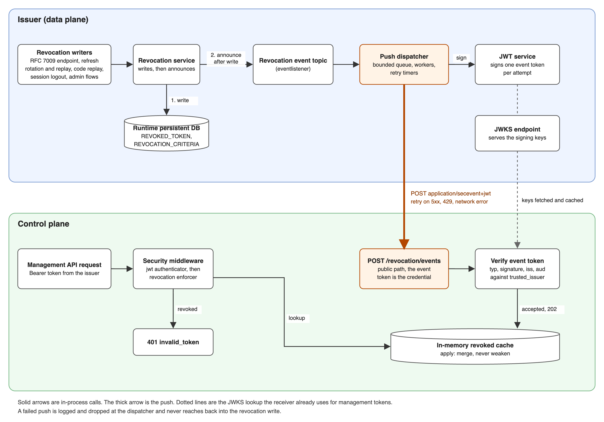
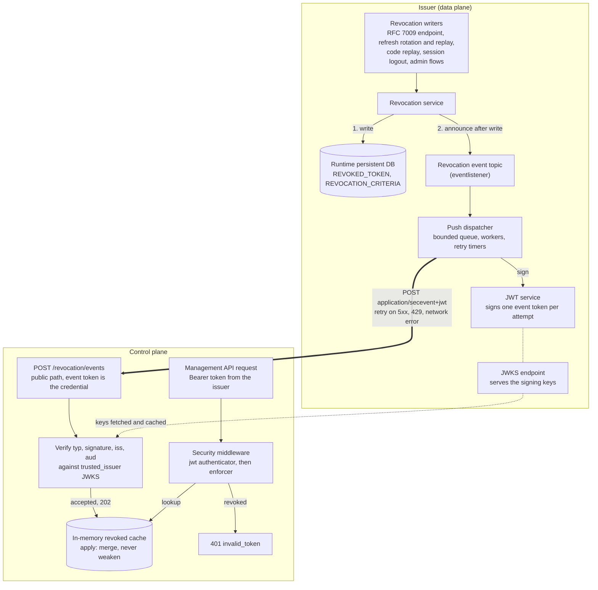

# Token Revocation Push Specification

- **Status:** Draft
- **Version:** 0.1
- **Related documents:** [RFC 8417 Security Event Token](https://datatracker.ietf.org/doc/html/rfc8417), [RFC 8935 Push-Based SET Delivery](https://datatracker.ietf.org/doc/html/rfc8935), [back-channel-logout spec](../back-channel-logout/spec.md)

## Summary

The Resource Server revocation cache reads its deny list from the runtime persistent database. A control plane has no such database: it accepts management tokens from a trusted issuer, another ThunderID deployment, and revocations are recorded at that issuer. Nothing told the control plane, so a revoked token kept working there until `exp`.

This specification adds a push path. The issuer announces each deny-list entry it records to configured receivers as a signed Security Event Token. A control plane running the `events` source verifies the token against its trusted issuer and adds the entry to its in-memory cache.

> The push is a notification of what the deny list already holds. It never decides whether a token is revoked, and a lost notification never changes the issuer's own enforcement.

Out of scope for this version: reconciling the control plane's cache with the issuer's deny list after a missed push or a restart, persisting pending events across a restart, pushing to several replicas of one receiver, and per-receiver credentials beyond the event token's signature.

## Architecture

| Component | Responsibility |
|---|---|
| Revocation event topic | The revocation service announces each entry after its write returns, through the generic `eventlistener` topic. Single-token revocations (RFC 7009, refresh rotation) and every criterion row are announced |
| Push dispatcher | A listener on that topic. Copies the event onto a bounded queue per receiver, signs a fresh event token per attempt, POSTs it, retries transient failures |
| Event receiver | `POST /revocation/events` on a plane whose revocation source is `events`. Verifies the token and applies the event to the revocation cache |
| Revocation cache `apply` | Merges one event into the cache the way the deny-list write does |

The same diagram as editable Mermaid:

Solid arrows are in-process calls. The thick arrow is the push. The dotted arrow is the JWKS lookup the receiver already uses for management tokens. A failed push is logged and dropped at the dispatcher and never reaches back into the revocation write.

The dispatcher follows the shape of the back-channel logout dispatcher: in process, asynchronous, bounded, no persistence, a stop method with a deadline.

## Detailed design

### Event token

A JWT with header `typ: secevent+jwt`, signed with the issuer's preferred key. Claims: `iss` (the issuer's JWT issuer), `aud` (the receiver's configured audience), `iat`, `nbf`, `exp` (five minutes), `jti`, and `events`, a single entry keyed by the event type.

| Event type | Payload |
|---|---|
| `urn:secevent:revocation:token` | `jti`, `reason`, `revoked_at`, `expiry_time` |
| `urn:secevent:revocation:criterion` | `criterion_type`, `criterion_value`, `reason`, `revoked_at`, `expiry_time` |

Times are Unix seconds. A token is built per attempt, so a retry never carries an expired token.

### Delivery

The dispatcher POSTs the token as `application/secevent+jwt`. `202` is delivery. `429` and `5xx`, and a network failure, are retried with a delay that starts at `retry_delay` and doubles, up to `max_attempts`. Any other status is a rejection and is not retried. A private-address refusal is not retried. A full queue, or an event arriving before start or after stop, is dropped and logged. The log carries the event type, the receiver audience and the reason, never the token, the URL or the revoked values.

### Receipt

The receiver answers `400` with `{"err", "description"}` (RFC 8935 §2.4) when the content type is not `application/secevent+jwt`, the body is not a JWT, `typ` is not `secevent+jwt`, the signature, `iss`, `aud` or time claims fail verification against `server.security.trusted_issuer`, or the event is malformed. It answers `202` otherwise, including for an event type it does not handle. The route is public to the bearer middleware because the event token is the credential. The body is capped at 16 KiB.

### Cache merge

`apply` mirrors the deny-list upsert: a terminal reason is never weakened to a bounded one, a bounded cutoff never moves back, an expiry is never shortened. Criterion types the cache does not enforce are ignored. Lapsed entries are pruned during `apply`, at most once a minute, since there is no periodic replace to drop them. Events only add to the cache, so a replayed token changes nothing and the receiver keeps no replay state.

### Configuration

| Key | Default | Notes |
|---|---|---|
| `oauth.token_revocation.push.enabled` | `false` | Issuer side |
| `oauth.token_revocation.push.receivers[]` | none | `url`, `audience`. Required when enabled |
| `oauth.token_revocation.push.request_timeout` | `5` | Seconds, at most 30 |
| `oauth.token_revocation.push.max_attempts` | `5` | At most 10 |
| `oauth.token_revocation.push.retry_delay` | `2` | Seconds, at most 60 |
| `oauth.token_revocation.push.queue_size` | `1024` | |
| `oauth.token_revocation.push.reject_private_addresses` | `true` | Also requires https |
| `server.security.token_revocation.source` | `db` | `events` on the receiving plane. Requires `trusted_issuer` with issuer, JWKS URL and audience |

The issuer's JWT issuer must equal the receiver's `trusted_issuer.issuer`, and the receiver's `audience` must equal its `trusted_issuer.audience`.

## Requirements

### R1. A revoked token is rejected at a push-fed control plane

**Requirement:** As an operator, I want a token revoked at the trusted issuer to stop working at the control plane without waiting for it to expire.

**Acceptance criteria:**

- **AC1.1:** Given a control plane with `source: events` and an issuer pushing to it, when the issuer records a revocation and the push is delivered, then a request carrying a token that revocation covers is rejected as an invalid token.
- **AC1.2:** Given the same setup, when a revocation covers one token only, then other tokens of the same user are still accepted.

### R2. Only the trusted issuer can add to the deny list

**Requirement:** As an operator, I want the control plane to accept revocations only from its trusted issuer.

**Acceptance criteria:**

- **AC2.1:** Given an event token whose signature does not verify against the trusted issuer's JWKS, when it is pushed, then the control plane answers `400 authentication_failed` and its deny list is unchanged.
- **AC2.2:** Given an event token whose `iss` or `aud` does not match `trusted_issuer`, or whose `typ` is not `secevent+jwt`, when it is pushed, then it is rejected the same way.
- **AC2.3:** Given `source: events` without a complete `trusted_issuer`, when the control plane starts, then startup fails.

### R3. A failed push never affects the issuer

**Requirement:** As an operator, I want a failing receiver to leave revocation at the issuer unaffected.

**Acceptance criteria:**

- **AC3.1:** Given a full queue, an unreachable receiver or a signing failure, when a revocation is recorded, then the revocation succeeds and the failure is logged without the token, URL or revoked values.
- **AC3.2:** Given a receiver answering `5xx` or `429`, when an event is pushed, then it is retried up to `max_attempts` with a doubling delay. Given `400`, it is not retried.

### R4. Federated tokens are enforced on every dimension the issuer pushes

**Requirement:** As an operator, I want a push-fed control plane to honor subject, client, scope and cutoff revocations for the trusted issuer's tokens, not only jti and token family.

**Acceptance criteria:**

- **AC4.1:** Given `source: events`, when a token from the trusted issuer is authenticated, then its subject, client, audiences and issue time are evaluated against the deny list.
- **AC4.2:** Given `source: db`, when a token from the trusted issuer is authenticated, then only its jti and token family are evaluated.

## Security considerations

| Threat | Mitigation |
|---|---|
| Forged event revokes tokens or causes denial of service | Signature verified against the trusted issuer's JWKS, `iss` and `aud` checked, body capped. An attacker who can sign as the issuer can already mint management tokens |
| Event token replay | Harmless: events only add entries, and `exp` bounds a token's use |
| Revocation entry flood fills receiver memory | Only the trusted issuer can add entries, entries lapse at their expiry and are pruned |
| Receiver URL used for SSRF from the issuer | URL comes from deployment config. https is required and private addresses are refused unless `reject_private_addresses` is `false` |
| Event token exposed in transit | https is required by default. The token carries identifiers, not credentials |
| Revocation recorded inside a transaction that later rolls back | The event is announced when the write returns, so a rollback leaves an entry the issuer does not hold. The effect is over-revocation, which fails closed |

Known gap: a lost push (receiver down past the retry budget, issuer restart with events queued, receiver restart, a second receiver replica) leaves a revoked token valid at the control plane until it expires. Reconciliation against the issuer's deny list is the planned follow-up.

## Change log

| Version | Date | Change |
|---|---|---|
| 0.1 | 2026-10-29 | Initial specification. |
