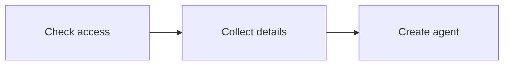

import Tabs from '@theme/Tabs';
import TabItem from '@theme/TabItem';
import {Bot, UserCheck} from '@wso2/oxygen-ui-icons-react';
import {AgentDocCards, AgentDocCard} from '@site/src/components/AgentDocCards';
import diagramStyles from '@site/src/components/AgentDiagram.module.css';

# Create and Manage Agents

Configure how administrators onboard agents, then create agents with their own credentials, attributes, and owners. The onboarding flow can also assign groups and roles when it creates the agent.

## Configure agent onboarding

Agent onboarding runs as an **Administration** flow in the signed-in administrator's Console session. It creates the agent and its credentials; it is not a user sign-in or registration flow. The built-in `default-agent-onboarding-flow` creates agents that act using their own identity.

The templates have three phases. The operating mode comes from the template, or from the administrator's choice in the Choose Mode flow.

<div className={diagramStyles.diagram}>



</div>

The flow checks administrator permissions, then resolves the agent type, organization unit, and owner. **Agent Details** collects schema attributes, including `name`, before the uniqueness check and any delegation settings. Provisioning creates the agent and its credentials, which appear on the completion screen.

In the supplied flows, a duplicate attribute value returns the administrator to **Agent Details**. Provisioning failures also return there so the administrator can review the submitted values and the error.

### Select a flow template

Select a template, or customize an existing agent onboarding Administration flow:

1. In the Console, navigate to **Flows**. Click **+ Create New Flow**.
2. Select **Administration** as the flow type.
3. Select the template for your onboarding process:

    | Template | Use when |
    |---|---|
    | **Agent Onboarding Flow (Own Identity)** | Every new agent acts using its own identity. |
    | **Agent Onboarding Flow (On Behalf of a User)** | Every new agent needs to act for signed-in users. |
    | **Agent Onboarding Flow (Choose Mode)** | Administrators select the operating mode during creation. |

4. Enter a flow name. Create the flow, then review its steps in the builder.
5. Save the flow and copy its handle.

For custom attributes, update the [Agent Schema](../agent-schema) first. Add the fields to the flow's attribute form, or connect Provisioning's incomplete output to a dynamic input prompt that submits back to Provisioning. The executor requests missing required attributes and, with `includeOptional: true`, optional attributes.

For node properties and connections, see [Build an agent onboarding flow](../../flows/build-a-flow#build-an-agent-onboarding-flow).

### Configure onboarding for agents that act on behalf of users

An on-behalf-of-user (OBO) onboarding flow needs both parts below. Create a flow from **Agent Onboarding Flow (On Behalf of a User)** to include both, then [make it active](#make-the-flow-active).

<AgentDocCards>
<AgentDocCard title="Collect delegation settings" icon={<UserCheck size={22} />}>

The **Delegated Agent Details** widget asks the administrator for **Authorized redirect URIs**, **Login flow**, and **User type**. It saves settings for later user sign-in; it does not sign in a user during onboarding.

</AgentDocCard>
<AgentDocCard title="Create a delegated agent" icon={<Bot size={22} />}>

Keep the **Agent Type** step before **Provisioning** so the flow resolves the agent category and type. On **Provisioning**, enable **Delegated mode** (`delegated: true`). This creates an agent that can act on behalf of users with the settings collected by the widget.

</AgentDocCard>
</AgentDocCards>

To adapt an existing own-identity Administration flow instead:

1. Open the flow in the builder. Keep the administrator permission check and the agent type, organization unit, owner, and attribute steps.
2. From **Widgets**, add **Delegated Agent Details** after **Validate Attribute Uniqueness** and before **Provisioning**. Connect the successful uniqueness check to the widget and its **Continue** action to **Provisioning**.
3. On the **Provisioning** node, enable **Delegated mode** (`delegated: true`). The widget collects the inputs; this property tells provisioning to create an OBO agent.
4. Connect the node's incomplete output to a dynamic input prompt that submits back to **Provisioning**. Save the flow, then [make it active](#make-the-flow-active).

To let the administrator select the mode for each agent, use **Choose Agent Mode** instead of **Delegated Agent Details**. Keep the **Agent Type** step before the uniqueness check and **Provisioning**. This widget submits `delegated` from **Act on behalf of a signed-in user**, overriding the node's fallback value. Leave the node's **Delegated mode** unchecked to default to own identity.

All three delegation fields are required when delegated mode is selected. **Login flow** selects an existing authentication flow for users who later sign in through the agent.

### Assign groups and roles during onboarding

Configure these assignments when every agent created by the flow needs the same access:

1. Create the required [groups](../../users/manage-groups) and [roles](../../users/manage-roles). Copy their IDs.
2. Open the flow's **Provisioning** node. Set **Assign group** (`assignGroup`) to the group IDs, separated by commas. Set **Assign role** (`assignRole`) to the role IDs in the same format.
3. Save the flow. Leave either property empty when no assignment is needed.

Provisioning creates the agent, then adds it to the configured groups and roles. These settings apply to both own-identity and OBO agents. Review the resulting assignments on the agent's **Access** tab.

### Make the flow active

Any agent onboarding Administration flow, including a custom flow, can be the Console default. Set `agentOnboardingFlow.defaultHandle` in the server's `flow` configuration to its saved handle. Obtain an administrator access token with the `system` scope and set `TOKEN` to that value. Set `CA_CERT` to the certificate that curl should trust for the server. A local setup uses its self-signed `<THUNDERID_HOME>/config/certs/server.cert`.

`PUT /server-config/flow` replaces the entire writable `flow` section. A request that carries only `agentOnboardingFlow` clears every other default handle, and the other expiries fall back to their built-in values. Read the current section, change the handle, and send the whole section back:

```bash
curl -s --cacert "$CA_CERT" -H "Authorization: Bearer $TOKEN" https://localhost:8090/server-config/flow \
  | jq '.writable | .agentOnboardingFlow.defaultHandle = "<your-flow-handle>"' \
  | curl -s --cacert "$CA_CERT" -X PUT https://localhost:8090/server-config/flow \
      -H "Authorization: Bearer $TOKEN" \
      -H "Content-Type: application/json" \
      -d @-
```

The change takes effect without a restart. The request returns `400` and changes nothing when the handle does not belong to an existing Administration flow. The `merged` object in a `GET /server-config/flow` response shows the handle in effect.

In the default `composite` store mode, setting the handle in `config/resources/server_configs/flow.yaml` has no effect. Bootstrap stores `default-agent-onboarding-flow` in the writable configuration, and the writable value takes precedence over the file, so the Console keeps running the built-in flow. The `mutable` store mode does not read the file at all. When `server_config.store` is `declarative`, the section is read-only and the file is the only place to set the handle. See [Flow Defaults](../../../deployment/configuration#flow-defaults).

The Console uses this flow for subsequent agent creation. A missing default or a handle that does not resolve to an Administration flow prevents the Console from starting onboarding. Direct `POST /agents` requests create agents through the management API without running this flow.

## Create an agent

Creating an agent gives that agent its own identity in <ProductName />, with its own owner, attributes, and lifecycle, separate from any user.

Every agent belongs to an **Organization Unit (OU)** and has an **agent type**. Each agent type belongs to a specific OU. An agent of that type can only be created under that OU or one of its descendants, and an update that moves the agent or changes its type must keep it there. Otherwise the request fails with error `AGT-1053`, and an agent type that does not exist, or that the caller cannot view, fails with error `AGT-1054`. Moving an agent type to another OU does not move its agents or check them again. The server checks agents that a resource file defines again when it starts, and the start fails if one is outside its agent type's OU. Because the check reads the agent type, creating an agent, or changing its OU or type, also needs permission to view agent types (`system:agenttype:view`) in addition to `system:agent`.

<Tabs groupId="agent-config">
<TabItem value="console" label="Console" default>

Select a creation path below. These instructions follow the supplied templates; custom flows can change the fields and their order. Selecting a card changes these instructions, not the Console's [configured onboarding flow](#make-the-flow-active).

:::note
On a Control Plane console, **Add agent** opens a form instead of an onboarding flow. Choose an **Owner** there, the person accountable for the agent: **Internal** for a user created on the Control Plane, or **External** for someone managed in another identity system, entered by their email address, mobile number, or user ID. If you signed in to the Control Plane through another deployment, choose an owner, because your account is not a user here.
:::

<AgentModeSelector />

<Mode value="own">

### Act using its own identity

Use the built-in `default-agent-onboarding-flow`, or create a flow from **Agent Onboarding Flow (Own Identity)** and [make it active](#make-the-flow-active). The template resolves the agent category and type through **Agent Type Resolver** and sets `delegated: false` on **Provisioning**.

1. Navigate to **Agents**. Click **Add agent**.
2. Select the organization unit when prompted. The template resolves the `default` agent type before this step.
3. Confirm the owner. The selection defaults to you when your account is a user on the deployment you add the agent on; choose another user to change it. The owner is the person accountable for the agent.
4. In **Agent Details**, fill in the schema attributes, including **Name**. The default schema requires a unique name; model provider, model, and function are optional.
5. Click **Create Agent**. If you use the Choose Mode template, leave **Act on behalf of a signed-in user** unchecked on the next screen and click **Continue**.
6. Copy the **Agent ID**, **Client ID**, and **Client Secret** from the completion screen. Store the secret before closing the flow; it is shown only once.

</Mode>
<Mode value="obo">

### Act on behalf of a user

Prepare the Administration flow in either of these ways:

- Create a flow from **Agent Onboarding Flow (On Behalf of a User)**. It includes the delegation form and sets `delegated: true` on Provisioning.
- Adapt an own-identity flow by adding **Delegated Agent Details** and enabling **Delegated mode** on Provisioning. Follow [Configure onboarding for agents that act on behalf of users](#configure-onboarding-for-agents-that-act-on-behalf-of-users) for the connections. Use **Choose Agent Mode** instead when administrators need to select the mode for each agent.

[Set the saved flow as the Console default](#make-the-flow-active), then create the agent:

1. Navigate to **Agents**. Click **Add agent**.
2. Select the organization unit when prompted. The template resolves the `default` agent type before this step.
3. Confirm the owner. The selection defaults to you when your account is a user on the deployment you add the agent on; choose another user to change it.
4. In **Agent Details**, fill in the schema attributes, including a unique **Name**, and click **Create Agent**. The agent is created after the next screen.
5. If you use the Choose Mode template, select **Act on behalf of a signed-in user**.
6. Enter **Authorized redirect URIs**, separated by commas. Select the agent's **Login flow** and **User type**, then click **Continue**.
7. Copy the **Agent ID**, **Client ID**, and **Client Secret** from the completion screen. Store the secret before closing the flow; it is shown only once.

The created agent has delegated mode and PKCE enabled. Onboarding saves the selected user sign-in settings on the agent; it does not sign in an end user or ask for their consent. See [Agent Access on Behalf of Users](../authentication/on-behalf-of-user) for using the agent after creation.

</Mode>

</TabItem>
<TabItem value="api" label="API">

```bash
curl -X POST https://localhost:8090/agents \
  -H "Authorization: Bearer $TOKEN" \
  -H 'Content-Type: application/json' \
  -d '{
    "type": "default",
    "ouId": "<organization-unit-id>",
    "owner": { "id": "<owner-user-id>" },
    "attributes": { "name": "Invoice Reconciler" }
  }'
```

Set `TOKEN` to an access token with permission to create agents. Replace the organization unit and owner placeholders with existing IDs. The top-level `type` field is required and names the agent type by its handle. <ProductName /> ships one agent type, `default`, and you can add others; see [Agent Schema](../agent-schema). The default agent schema also requires a unique `attributes.name` value.

Specify an organization unit with `ouId` or `ouHandle`, unless you pass `projectId` to use the project's root organization unit. See [Scope agents to a project](#scope-agents-to-a-project). Omit `owner` to use the authenticated caller. `validUntil` is optional and sets when the agent's lifespan ends; see [Set an Agent's Lifespan](../agent-lifespan).

This request creates an agent record directly and bypasses the onboarding flow. To issue OAuth credentials through the API, also supply `inboundAuthConfig` with an OAuth configuration. To create an agent that acts on behalf of users, add `"delegated": true`. When the request names no grant type other than `client_credentials`, <ProductName /> adds `authorization_code` and `refresh_token` and requires PKCE. See the [Agents API Reference](../../../apis#tag/agents) for the complete request and response.

</TabItem>
</Tabs>

:::note[Agents also get an OAuth profile]
An agent needs an OAuth profile before it can request tokens. The Console creates one at registration, issuing a **Client ID** and showing the **Client Secret** once on the confirmation screen. Copy the secret there, because it cannot be retrieved later, only regenerated.

That profile is configured on the **Credentials**, **Flows**, **Tokens**, and **Advanced** tabs, which appear only for an agent that has one, and are summarized under [Manage an agent](#manage-an-agent) below.
:::

## Manage an agent

In the Console, open the agent from the list. Edit its `name` value on the **Attributes** tab and its description in the header. Save changes from the unsaved-changes bar.

The Console label comes from the agent type's configured [display attribute](../agent-schema#display-attribute), which is `name` by default. If the type selects another attribute, edit that attribute to change the label. Without a display value, the Console shows the agent ID.

Through the API, update an agent with `PUT /agents/<AGENT_ID>`. The request replaces the agent, so send `type` and every field to keep, not only the ones being changed. Leaving out the OAuth profile fields removes the agent's OAuth profile. See the [Agents API Reference](../../../apis#tag/agents) for the full request and response.

### Identifiers and owner

Every agent has an **Agent ID**, its identity in <ProductName />, and an **Owner**, the person accountable for it. The owner is the contact point for what the agent does. Assigning one grants that user no access to the agent.

- **Console:** the **Overview** tab shows the Agent ID and owner under **Agent details**, and the **Advanced** tab is where the owner is changed.
- **API:** `GET /agents/<AGENT_ID>` returns both. Add `?include=display` to get the label resolved from the schema's display attribute. The label falls back to the agent ID if no display value is available.

The owner is an object with three fields:

| Field | Description |
|---|---|
| `id` | The owner's ID, up to 256 characters. Required. |
| `idType` | What the ID holds: `uuid` (the default), `email` (a bare email address), or `mobile` (an E.164 number such as `+94771234567`). |
| `isLocal` | Whether the owner is an entity of this deployment. Defaults to `true`. |

A local owner is a user, application, or agent of this deployment, identified by its `uuid`, and must exist when it is set. A user who owns agents cannot be deleted until those agents are deleted or given another owner.

An owner managed in another identity system is set with `"isLocal": false`. <ProductName /> stores it as given, so a configuration that names it can be applied to deployments that do not hold that person, and it does not block deleting a local user. It is never looked up in this deployment, even when its ID matches a user, application, or agent here.

```json
"owner": {
  "id": "<id-in-the-other-system>",
  "idType": "uuid",
  "isLocal": false
}
```

When no owner is given, the caller becomes the owner. The caller is a local owner when it is a user, application, or agent of this deployment, and an external owner otherwise, for example when it signed in through the [trusted issuer](../../trusted-issuer). An agent created with the management API key and no owner, such as one imported into a data plane, has no owner.

### Attribute values

The agent schema decides which attributes an agent carries, and each agent holds its own values for them.

- **Console:** set the values on the **Attributes** tab. The **Overview** tab previews them under **Attributes**, alongside the agent's organization unit under **Agent details**.
- **API:** send `attributes` in the `PUT` request.

### Groups and roles

The onboarding flow can [assign groups and roles during creation](#assign-groups-and-roles-during-onboarding). Use the following options to review or change access afterward.

An agent should reach only the resources its task needs. What its tokens are allowed to carry comes from the groups and roles assigned to it, so the agent's reach is controlled separately from its credential, and changing what an agent can do never rotates its secret.

The scopes an agent can hold, the permissions that travel in the token's `scope` claim, are defined by the resource it will call, not by the agent. Register the API and its scopes as a [Resource Server](../../resource-servers) first, then grant the matching scopes to the agent. An agent can never be granted a scope the resource has not declared.

- **Console:** the **Access** tab is a read-only view of the groups the agent belongs to and the roles assigned to it, directly or through its groups. Assign them from the Console **Roles** and **Groups** pages; see [Manage Roles](../../users/manage-roles) and [Manage Groups](../../users/manage-groups). A role carries a set of scopes, and a group can carry roles and inherit from parent groups.
- **API:** assign the agent to roles and groups through the roles and groups APIs. To read what an agent can already reach, call `GET /agents/<AGENT_ID>/roles` and `GET /agents/<AGENT_ID>/groups`. See the [Agents API Reference](../../../apis#tag/agents).

Group membership is transitive: scopes inherited from a parent group are included.

### Credentials

The credential the agent authenticates with, either a client secret or a signed key, along with any sensitive credential attributes it carries. [Rotate the secret](../authentication#use-a-client-secret) or switch to a [private key JWT](../authentication#use-a-private-key-jwt) here.

### Flows

Applies only when the agent signs users in with the authorization code or CIBA grant. An agent that holds only token exchange or JWT bearer never starts a sign-in, so these settings stay frozen. Pick the authentication and registration flows that decide how users authenticate through the agent. The flows themselves are built in the flow builder, [Login and Registration Flows](../../flows/build-a-flow); this tab only selects which one the agent uses. See [Agent Access on Behalf of Users](../authentication/on-behalf-of-user).

### Tokens

What the agent's tokens carry and how long they last, set independently for each audience: the **Agent** token it uses on its own, and the **User** token it holds when acting for a user. Without the authorization code or CIBA grant, the **User** token shows only the access token settings, since the other delegated grants issue no ID or refresh token. See [Agent Token](../authentication/agent-own-token) for the agent token and [Agent Access on Behalf of Users](../authentication/on-behalf-of-user) for the user token. When the agent issues identity assertions, they carry the attributes selected for the **User** ID token too, except `roles` and `groups`. See [Issue Identity Assertions (ID-JAG)](../../protocols/oauth-oidc/identity-assertion-grant/issue-identity-assertions#identity-claims).

### Advanced

The **Advanced** tab gathers the agent's OAuth and operational settings:

- **Operating mode** has a **Delegated mode** toggle that sets whether the agent acts only on its own or is extended to also act for a signed-in user. On its own it uses its own credentials (`client_credentials`); with Delegated mode on, it can also act for a user, and turning it on adds the authorization code (`authorization_code` with PKCE) and refresh token grants by default. Turning it off removes every grant that depends on it and turns off identity assertions. See [Agent Access on Behalf of Users](../authentication/on-behalf-of-user).
- **Owner** is changed here. Choose **Internal** to pick a user of this deployment, or **External** to enter the **ID type** (**Email**, **Mobile number**, or **User ID**) and value of someone managed in another identity system. An email address must be a bare address and a mobile number must start with `+` and the country code. See [Identifiers and owner](#identifiers-and-owner) for what it means.
- **Allowed user types** restricts self-service registration to the selected user types. Once the authorization code grant is on, you must select at least one user type before **Save** is enabled. Users of the selected types can register through the agent. See [Agent Access on Behalf of Users](../authentication/on-behalf-of-user).
- **Agent sign-in** controls whether other agents can sign in to this agent. Turn it on to let agents of any agent type sign in, and leave it off to block every agent. If the agent allows only specific agent types, set through the API, the card lists them. This setting does not affect users.
- **Grant types** are the OAuth grants the agent may use. Acting on its own (`client_credentials`) is always on. The other grants stay locked until the agent is extended to act for users: signing users in (`authorization_code`), keeping that access without a new sign-in (`refresh_token`), out-of-band approval (CIBA), handing a task to another agent (**Token exchange**), and redeeming an ID-JAG from an external identity provider (**JWT bearer**). See [Agent Token](../authentication/agent-own-token) and [Agent Access on Behalf of Users](../authentication/on-behalf-of-user).
- **Authorized redirect URIs** are the callback URLs allowed for the `authorization_code` grant. See [Agent Access on Behalf of Users](../authentication/on-behalf-of-user).
- **Client authentication method** is how the agent authenticates to the token endpoint, with a client secret or a private key JWT. See [Agent Authentication](../authentication).
- **Security** covers **Require PKCE** and **Require Pushed Authorization Requests (PAR)**, which apply to the `authorization_code` grant. Require PKCE turns on automatically when the `authorization_code` grant is on and cannot be turned off here; PAR is optional.
- **Default audience** is the `aud` the agent's own token carries when a request names no `resource` and no scopes. See [Agent Token](../authentication/agent-own-token).
- **Identity assertions (ID-JAG)** lets the agent issue an Identity Assertion JWT Authorization Grant for the signed-in user that an external authorization server accepts. The card appears after the grant settings, only while Delegated mode is on. Set the **Allowed audiences** and the **Assertion validity**. Turning it on also enables the token exchange grant, which you cannot remove while identity assertions are on. See [Issue Identity Assertions (ID-JAG)](../../protocols/oauth-oidc/identity-assertion-grant/issue-identity-assertions).

## Agent schema

The custom attributes an agent carries come from its agent type's schema. Each agent type has its own schema, shared by the agents of that type. See [Agent Schema](../agent-schema) to view the default attributes and change what an agent holds.

## Set a lifespan

Give an agent an end date, its `validUntil`, to stop it authenticating and obtaining tokens automatically once its work is done. Set it on the agent's **Attributes** tab or through the API. Tokens issued to the agent or for it expire no later than the `validUntil` in force when they are issued; moving it earlier does not revoke tokens already issued. See [Set an Agent's Lifespan](../agent-lifespan).

## Suspend or unlock an agent

An agent locks automatically after repeated failed sign-in attempts, but its client secret never locks. To stop an agent while you investigate, suspend it. Suspending revokes the agent's tokens, including user tokens issued through its OAuth client, and ends its sessions.

- **Console:** open the agent, click **Actions** in its header, and select **Suspend**, **Unsuspend**, or **Unlock**. The menu offers only the operations that apply to the agent's **Status**.
- **API:** `GET /agents/<AGENT_ID>` returns the agent's `status`. Suspend, unsuspend, and unlock run as administration flows; there is no direct endpoint.

To find agents that no longer authenticate, set `accountAccess.agent.recordLastLogin` to `true`. `GET /agents/<AGENT_ID>` then returns `lastLoginAt`, the time the agent was last granted access, and every `client_credentials` token the agent obtains records it too. The value is absent until the first recorded grant, and it can lag the latest grant by up to `lastLoginResolutionSeconds`, one hour by default. See [Account Access](../../../deployment/configuration#account-access).

For what each operation does, see [Suspend and Restore Accounts](../../account-protection/suspend-and-restore-accounts). For the agent lock policy, see [Configure Account Lockout](../../account-protection/configure-account-lockout).

## Delete an agent

- **Console:** on the **Advanced** tab, in the **Danger zone** section, click **Delete agent**.
- **API:** call `DELETE /agents/<AGENT_ID>`. See the [Agents API Reference](../../../apis#tag/agents) for details.

:::warning
Deletion is permanent and revokes the agent's credentials. Tokens the agent was already issued stay valid until they expire, so keep agent token lifetimes short.
:::

## Scope agents to a project

Every project on the control plane includes the system organization unit, and an agent in a project is placed there. When you manage agents through the REST API on the control plane, pass a project ID to work within a project.

- **List**: `GET /agents?projectId=<project-id>` returns the project's agents, followed by the ones shared into it. To narrow the list to one organization unit, add `filter=ouId eq "<ou-id>"`. That is the only filter accepted with `projectId`; any other filter fails with `AGT-1020`. A project that does not exist, or an organization unit outside the project, returns an empty list.
- **Create**: set `projectId` in the request body of `POST /agents`. Without `ouId` or `ouHandle`, the agent is placed in the system organization unit. With either one, it must be the system organization unit, even when the project has organization units of its own.
- **Update**: set `projectId` in the request body of `PUT /agents/<AGENT_ID>` to check that the agent stays in the project. The request still replaces the whole agent, as described in [Manage an agent](#manage-an-agent). The organization unit checked is the one the request names with `ouId` or `ouHandle`, or the agent's current one when the request names none. A project ID never moves the agent on its own.

A project that does not exist fails a create or update with `AGT-1047`, and any organization unit other than the system organization unit fails it with `AGT-1048`. An organization unit that does not exist, or a create request with none of `ouId`, `ouHandle`, and `projectId`, fails with `AGT-1005`.

A data plane has no projects. It rejects a `projectId` in a create or update request with `AGT-1047`, and returns an empty list for `GET /agents?projectId=<project-id>`.

## Related Guides

- [Agent Schema](../agent-schema)
- [Advanced Configurations](../../flows/advanced-configurations)
- [Agent Access on Behalf of Users](../authentication/on-behalf-of-user)
