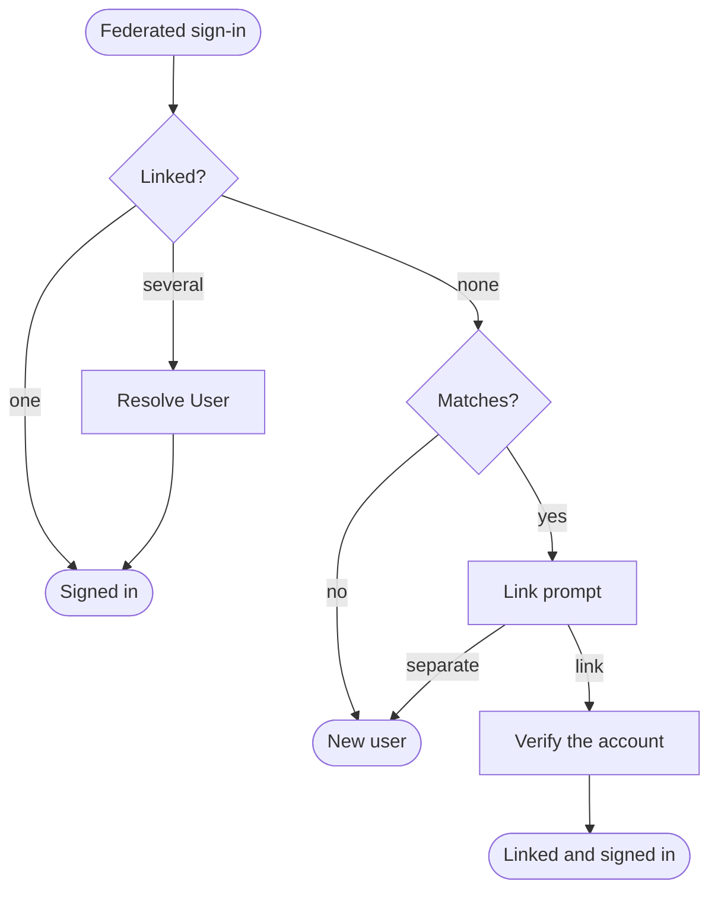

# Link Federated Accounts

Link a federated identity to an existing account, so a person who signs up with a password and later clicks **Continue with Google** keeps one account. <ProductName /> never links on a matching attribute alone. The user signs in to the matched account first, so a provider that lets anyone claim any email address cannot hand over someone else's account.

## How Account Linking Works

A link ties a local user to one subject at one connection. One identity can link to several users, such as a person with an account in each of two organization units. With no recorded link, <ProductName /> matches the connection's linking attributes against existing users.

When several users hold the link, a **Resolve User** step asks the user which account to continue with. The flow's provisioning configuration decides whether to create a new user. In a registration flow, a verified link completes registration as the existing account.

## Prerequisites

- A connection to the provider. See [What are Identity Providers?](../overview).
- An authentication flow that signs in through that connection. See [Connect an IdP to an Application](../connect-idp-to-application).
- A second authentication flow the existing account can sign in with, such as username and password. The link prompt runs it to verify the account.

## Step 1: Configure the Linking Attributes

1. In the Console, navigate to **Connections** and open the connection.
2. On the **Attribute configuration** tab, under **Account linking**, click **Add attribute** and enter an external attribute, such as `email`. Every attribute the provider sends a value for must match. An attribute the provider omits is skipped.
3. Click **Save changes**.

Use attributes the provider verifies and that identify one person. If more than 10 users match, the sign-in fails. The [Account Linking](../add-oidc-provider#account-linking) section of the OIDC guide has the matching rules, and they apply to every connection type.

## Step 2: Add Linking to the Flow

1. In the Console, navigate to **Flows** and open the authentication flow that signs in through the connection.
2. From the resource panel, drag a linking widget onto the canvas. It connects itself after the federated sign-in step.
    - Use **Account Linking with Verification** when each identity links to at most one user.
    - Use **Account Linking with Verification and Account Selection** when an identity can link to users in several organization units. It adds the account picker.
3. Select the widget's **Call** step, then select the verification flow.
4. Connect the **Account Linking** failure output to a View that shows the error.
5. Click **Save**.

To wire the steps by hand or in JSON, see [Account Linking](../../flows/advanced-configurations#identity-and-user-resolution) in the flow reference.

## Step 3: Test the Flow

1. Create a local user whose email matches an account at the provider.
2. Sign in to the application through the provider.
3. On the link prompt, click **Link account**, then sign in as the local user.

<ProductName /> signs you in as the existing user. Your next sign-in through the provider skips the prompt.

A user who clicks **No, I want a separate account** continues as a new user. That account cannot reuse a unique value, so if `email` is unique, provisioning rejects the same address. If the user verifies with an account that did not match, <ProductName /> links nothing and shows the prompt again.

To change the prompt text, edit the `forms.link_prompt.*` and `forms.link_picker.*` keys in the `elements` namespace. See [Manage Translations](../../i18n/manage-translations).

## Use a Provider With a Stable Subject

A recorded link signs the user in with no prompt, so it trusts the provider's subject to identify one person permanently. Connect only providers whose subject meets these conditions:

- The provider never reassigns the subject to another person. OpenID Connect requires this. If the provider reassigns a subject, the new holder signs in to the earlier holder's account.
- The provider returns the subject with the same characters and case on every sign-in. <ProductName /> compares subjects exactly, so `Admin` and `admin` are different links.

<ProductName /> reads the subject from the ID token `sub`, or from the profile `sub` or `id` for an OAuth connection. Attribute mappings do not change it. For an OAuth connection, confirm that the provider's `sub` or `id` is a permanent opaque identifier, not a username or email address that its owner can give up. GitHub, for example, uses the numeric account ID, which stays the same when the user renames their account.

A link cannot be removed without deleting the user, so verify the provider before you enable linking.

## Troubleshoot Account Linking

| Symptom | Cause |
|---------|-------|
| A matching user never sees the link prompt | No linking attributes are configured, the provider sent none of them, or the flow has no **Account Linking** step. |
| Sign-in fails for an identity linked to several accounts | The flow uses **Account Linking with Verification**. Use the account selection widget instead. |
| Registration fails with **User already exists** | The identity was linked before this sign-in, and the federated sign-in step does not allow registration with an existing user, or several users hold the link. See [Provisioning](../../flows/advanced-configurations#user-provisioning-and-attributes). |
| The direct authentication API does not link users | It cannot show a prompt, so it signs in only users with recorded links. |

## Next Steps

- [Add an OIDC Identity Provider](../add-oidc-provider#account-linking): How linking attributes match.
- [Identity Sources](../../../use-cases/b2c/identity-sources#account-linking): Decide whether linking fits your consumer application.
