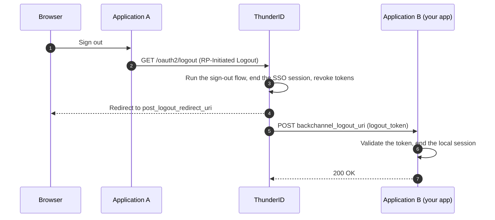

# Back-Channel Logout

**OpenID Connect Back-Channel Logout 1.0** ([Back-Channel Logout](https://openid.net/specs/openid-connect-backchannel-1_0.html)) lets the OpenID Provider tell a relying party (your application) that a user's session has ended, directly from server to server. <ProductName /> implements it as the sender. When a [Single Sign-On session](../../../../key-concepts/authentication/sessions) ends, <ProductName /> posts a signed **logout token** to every application that took part in the session and registered a **back-channel logout URI**.

[RP-Initiated Logout](../rp-initiated-logout) ends the session at <ProductName />. It does not clear what each application remembers about the user. Back-channel logout closes that gap: every participating application hears about the termination and can end its own session, including applications that did not start the sign-out, and including sessions that an administrator ended or that ended because the user was deleted. The message does not depend on the browser, so it arrives when the browser is closed, when frames are blocked, and when the user is on another device.

## How It Works



1. The user signs out of Application A.
2. Application A sends the browser to the end session endpoint of <ProductName /> ([RP-Initiated Logout](../rp-initiated-logout)).
3. <ProductName /> runs the sign-out flow, then ends the SSO session and revokes the tokens issued in it, in one transaction.
4. <ProductName /> redirects the browser to the `post_logout_redirect_uri`. It does not wait for any delivery first.
5. After the transaction commits, <ProductName /> generates one logout token per participating application that registered a back-channel logout URI, and posts it to that URI in the background.
6. Application B validates the token and ends the local session the token names.
7. Application B answers `200`. A delivery that fails with a retryable response is tried again with a fresh token. A delivery that is rejected is recorded and not retried.

RP-Initiated Logout is one trigger. A sign-out flow run through the Flow Execution API, and an administrative action such as revoking a user's sessions or deleting the user, end the session in the same way and send the same notifications from step 5 on.

<details>
<summary>How <ProductName /> Implements It</summary>

| Aspect | Behavior |
|---|---|
| Trigger | Every path that terminates an SSO session: RP-Initiated Logout, a sign-out flow, and subject-wide revocation such as user deletion. Session expiry does not send a notification |
| Who is notified | Every application that joined the session and has a `backchannelLogoutUri`. An application without one is skipped |
| Ordering | <ProductName /> does not wait for deliveries before redirecting the browser after RP-Initiated Logout |
| Discovery | Advertised as `backchannel_logout_supported` and `backchannel_logout_session_supported`, both `true` while the feature is enabled, see [Server Metadata](../server-metadata) |
| Encrypted tokens | A client configured for ID token encryption receives an encrypted logout token, with `iss` replicated in the JWE header |
| Observability | One `BACKCHANNEL_LOGOUT_DELIVERED` or `BACKCHANNEL_LOGOUT_FAILED` event per participant, carrying the client id, the session id, the attempt number and the HTTP status. The token, the subject and the request body are never recorded |

</details>

## Register a Back-Channel Logout URI

Set the URI on the application's OAuth configuration. In the Console, open the application, go to **Advanced** → **OAuth 2 Configuration**, and set **Back-Channel Logout URI**. Through the `/applications` API or a [declarative configuration](../../../declarative-configurations/what-is-import-and-export), the field is `backchannelLogoutUri`; Dynamic Client Registration uses `backchannel_logout_uri`. An agent that is an OAuth client carries the same `backchannelLogoutUri` field through the `/agents` API, and is notified like an application when a person signs in through it.

```yaml
backchannelLogoutUri: https://app.example.com/backchannel-logout
```

| Rule | Behavior |
|---|---|
| Empty | The application is not notified |
| Format | An absolute URI with a scheme and a host. No user credentials, no fragment, no `*` |
| Scheme | `https`, or `http` for a confidential client only. A public client must register an `https` URI |
| Host | `localhost`, `*.localhost` and loopback, link-local, private or unspecified IP literals are rejected by default. Set `reject_private_addresses` to `false` for relying parties on a private network, see [Configuration](#configuration) |

Use `https` for any endpoint outside a private network. Plain `http` exists for confidential clients on an internal network and for local development.

The whole OAuth configuration is validated on every write, so a change elsewhere in it, such as making a confidential client public, can make a previously accepted `http` URI invalid.

## SDK Support

The <ProductName /> SDKs that run on a server implement the receiving side. Each validates the token as described in [Validate the Token](#validate-the-token), ends the local session it names, and answers with the status codes in [Respond](#respond). The Express, Node, Next.js and Nuxt SDKs do not decrypt a JWE (step 2), so they reject the encrypted logout token a client configured for ID token encryption receives.

| SDK | What to add | Reference |
|---|---|---|
| Express | `app.post('/backchannel-logout', handleBackchannelLogout())` | [`handleBackchannelLogout()`](../../../sdks-and-tools/express/apis/middleware/handle-backchannel-logout.mdx) |
| Node | `client.handleBackchannelLogout(logoutToken)` behind a route of the application's own | [`ThunderIDNodeClient`](../../../sdks-and-tools/node/apis/clients/thunderid-node-client.mdx#handlebackchannellogoutlogouttoken) |
| Next.js | `export const {POST} = backchannelLogout()` in a route handler | [`backchannelLogout()`](../../../sdks-and-tools/nextjs/apis/backchannel-logout.mdx) |
| Nuxt | `thunderid: {backchannelLogout: {enabled: true}}` in `nuxt.config.ts` | [Module Configuration](../../../sdks-and-tools/nuxt/apis/configuration/module-configuration.mdx#backchannellogout) |
| Spring Security | `.oidcLogout(logout -> logout.backChannel(Customizer.withDefaults()))` | [Spring Security](/sdks-and-tools/spring-security) |

The Express and Node SDKs keep sessions on the server and delete the session the token names. The Next.js and Nuxt SDKs keep the session in a cookie, which the server cannot delete, so they record the logout and refuse every later request that presents a matching cookie. In every SDK the default record lives in the memory of one process; a deployment with more than one instance needs the shared store each SDK's reference describes.

Browser SDKs (`@thunderid/browser`, `@thunderid/react`, `@thunderid/vue`) and mobile SDKs cannot receive the request and rely on token revocation instead.

The rest of this page is for an application that receives the notification without one of these SDKs.

## The Logout Token

The logout token is a signed JWT (JWS). <ProductName /> signs it with the same key and algorithm it uses for the client's ID tokens.

| Claim or header | Value |
|---|---|
| `typ` header | `logout+jwt` |
| `iss` | The issuer, the same value the client's ID tokens carry |
| `aud` | The client id of the application this token is for |
| `sub` | The subject identifier, the same value the client's ID tokens carry |
| `sid` | The identifier of the session that ended. Always present. It matches the `sid` claim of the ID tokens issued in that session |
| `events` | An object with one member, `http://schemas.openid.net/event/backchannel-logout`, whose value is an empty object |
| `jti` | Unique per token, so a replayed token can be detected |
| `iat`, `exp` | Issued at, and expiry. The default lifetime is 120 seconds |
| `nonce` | Never present |

Because `sid` is always present, an application can end exactly the local session that joined the terminated <ProductName /> session. `backchannel_logout_session_required` is therefore not a registration parameter: every token carries `sid`.

## Receive the Notification

The request <ProductName /> sends:

```http
POST /backchannel-logout HTTP/1.1
Host: app.example.com
Content-Type: application/x-www-form-urlencoded

logout_token=eyJhbGciOiJSUzI1NiIsInR5cCI6ImxvZ291dCtqd3QiLCJraWQiOiIuLi4ifQ...
```

### Validate the Token

Reject the request with `400` unless every check passes:

1. The body is `application/x-www-form-urlencoded` and carries one `logout_token`.
2. If the client is configured for ID token encryption, the token is a JWE. Decrypt it with the client's key, and run the remaining checks on the JWS inside.
3. The token is a JWS whose `typ` header is `logout+jwt`, signed with an algorithm the application accepts.
4. The signature verifies against a key from <ProductName />'s [JWKS](../jwks), selected by `kid`.
5. `iss` equals the issuer the application was configured with, exactly.
6. `aud` contains the application's client id.
7. `iat` is not in the future and `exp` has not passed, within a small clock tolerance.
8. `events` contains `http://schemas.openid.net/event/backchannel-logout` with an object value.
9. `nonce` is absent. This check, with the `typ` and `events` checks, is what stops an ID token from being replayed as a logout token.
10. `jti` is present and has not been seen before.
11. `sid` or `sub` is present.

Cache the JWKS, and bound how often an unknown `kid` triggers a refetch. The endpoint is unauthenticated, so an attacker who can reach it must not be able to make the application fetch keys on every request.

### End the Local Session

- A token with a `sid` ends the local sessions that joined that <ProductName /> session. To make this possible, record the `sid` of the ID token against the local session at sign-in.
- A token with only a `sub` ends that subject's sessions that began before the token was issued. Allow for the clock tolerance here too: end a session that began within the tolerance after `iat`, since ending one session too many is the safer mistake. A session the user started later stays.
- Ending the session is local. Do not call the revocation or end session endpoint, which <ProductName /> has already handled, and do not redirect.
- A valid token that names no session the application holds is still a success. Answer `200`, so a retry is harmless.

### Respond

| Response | What <ProductName /> does |
|---|---|
| `200` or `204` | Records the delivery as done |
| `5xx`, `429`, a connection error or a timeout | Retries with a fresh token. `429` with a `Retry-After` header sets the wait, up to the longest wait of the backoff schedule, 4 seconds with the defaults |
| Any other status, including `201`, `202`, any `3xx` and any other `4xx` | Records the delivery as failed and does not retry. Redirects are never followed |

Answer `5xx` only when the logout could not be recorded, for example because a session store was unreachable. Answer `400` for a token that fails validation. Send `Cache-Control: no-store` on every response.

### What Ends and What Does Not

- Back-channel logout ends the session the application manages. An access token the application already handed to a browser or to another service stays valid until it expires. <ProductName /> has revoked the tokens issued in the session, so a refresh fails, and a resource server that checks tokens with [Token Introspection](../token-introspection) sees them as inactive.
- A browser-only application has no endpoint that can receive the request. It learns that the session ended when its next token refresh or API call fails.
- An application with several instances receives the notification on one of them. Keep whatever records the logout in a store the instances share.

## Failure Behavior

| Setting | Default | Behavior |
|---|---|---|
| Timeout per attempt | 5 seconds | A slow endpoint is treated as unreachable for that attempt |
| Attempts | 3 | One delivery and two retries. Each attempt mints a fresh token with a new `jti` |
| Wait between attempts | 2 seconds, doubled | 2 seconds, then 4 seconds |
| Redirects | Never followed | A `3xx` is a final failure |
| Response body | Discarded | Only the status code matters |

A failing endpoint affects nobody else: deliveries to other applications proceed, and the session termination itself never waits for a delivery. Every outcome is published as an observability event and, on failure, written as a warning log line with the client id, the session id and a reason code: `unreachable`, `server_error`, `rejected`, `private_address`, `client_not_found`, `queue_full` or `shutdown`.

Make the endpoint idempotent. A retry can arrive after the first delivery succeeded but its response was lost, and a token that names a session already ended must still get a `200`.

## Configuration

Every key is deployment level, in the server's `deployment.yaml`.

```yaml
oauth:
  logout:
    backchannel:
      enabled: true
      token_validity_period: 120
      request_timeout: 5
      max_attempts: 3
      retry_delay: 2
      max_in_flight: 16
      queue_size: 1024
      reject_private_addresses: true
```

| Key | Default | Description |
|---|---|---|
| `enabled` | `true` | Turns delivery on and off. Also drives both discovery flags. Registering a URI is the per-application opt-in, so enabling the feature starts no traffic by itself |
| `token_validity_period` | `120` | Lifetime of a logout token, in seconds |
| `request_timeout` | `5` | Seconds per delivery attempt. At most `30` |
| `max_attempts` | `3` | Attempts per participant. `1` disables retry. At most `10` |
| `retry_delay` | `2` | Seconds before the second attempt, doubled for each later one. At most `60` |
| `max_in_flight` | `16` | Concurrent deliveries across all terminations |
| `queue_size` | `1024` | Terminations waiting for delivery before new ones are dropped and recorded as `queue_full` |
| `reject_private_addresses` | `true` | Rejects URIs that name `localhost` or a private, loopback, link-local or unspecified IP literal, and refuses to connect to such an address at delivery time. Set to `false` when relying parties run on a private network |

## Try It in <ProductName />

1. Pick two server-side applications that sign in through the same authentication flow, and add the **Check SSO Session** and **Save / Load Session** nodes to that flow, see [Single Sign-On for Flows](../../flows/single-sign-on.mdx). The default authentication flow has no session nodes, so it records no session and sends no notification.
2. In the first application, add the receiving route. For an app built with the [Express quickstart](../../../getting-started/connect-your-application/express.mdx), add `app.post('/backchannel-logout', handleBackchannelLogout())` after `thunderID()`, and register `http://localhost:3000/backchannel-logout` as its back-channel logout URI.
3. A `localhost` URI is rejected by default. For local testing only, set `reject_private_addresses: false` in the server's `deployment.yaml` and restart the server.
4. Sign in to the first application. Then sign in to the second application in the same browser, so both join one <ProductName /> session.
5. Sign out of the second application. The first application's next request finds its session ended.

To watch a delivery, send a `400` from a test endpoint and look for the `BACKCHANNEL_LOGOUT_FAILED` event with reason `rejected`, or a `200` and the `BACKCHANNEL_LOGOUT_DELIVERED` event.

## Related Guides

- [RP-Initiated Logout](../rp-initiated-logout), the sign-out request that most often triggers a notification
- [Sessions and Single Sign-On](../../../../key-concepts/authentication/sessions), the session model and the `sid` that ties a logout token to a session
- [Server Metadata](../server-metadata), where the capability is advertised
- [JWKS](../jwks), the keys that verify the logout token's signature
- [Token Revocation](../token-revocation) and [Token Introspection](../token-introspection), how tokens issued in the ended session are invalidated
