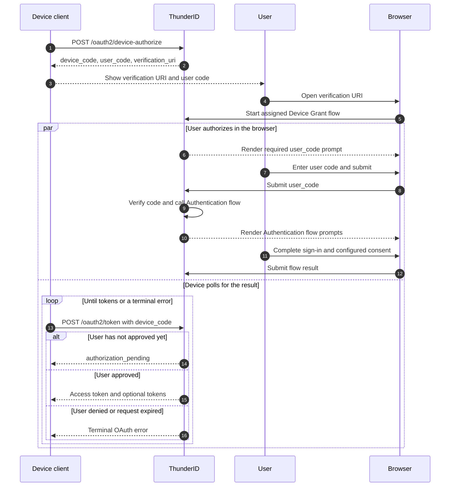

# Device Authorization Grant

The **Device Authorization** grant ([RFC 8628 §3](https://datatracker.ietf.org/doc/html/rfc8628#section-3)) is designed for clients that cannot use a browser or have limited input, such as TVs and command-line tools. The device client for an OAuth application requests a device code and user code from <ProductName />, asks the user to open a verification page on another device, and polls the token endpoint while the user completes authorization.

The device client keeps the `device_code` secret and displays the `user_code` and verification URI to the user. The user enters the code in a browser, signs in, and completes any consent step in the application's Authentication flow. After approval, the device client receives tokens from its next poll.

## How It Works



## How <ProductName /> Implements It

| Aspect | Behavior |
|---|---|
| Device authorization endpoint | `POST /oauth2/device-authorize` |
| Token endpoint | `POST /oauth2/token` |
| Grant type | `urn:ietf:params:oauth:grant-type:device_code` |
| Client | An OAuth application configured to use the Device Code grant. Public applications identify themselves with `client_id`; confidential clients authenticate using their configured token endpoint authentication method. |
| Browser verification | <ProductName /> returns a Gate verification URI with the client context. The complete URI can include the user code for prefill. The user must still submit it. |
| Device Grant flow | Each application has an assigned Device Grant flow. The Console selects the default flow when you enable the grant; you can assign a compatible custom flow. |
| Authentication and consent | The Device Grant flow calls the application's configured Authentication flow. That flow controls sign-in and whether consent is shown. |
| Default request lifetime | 600 seconds. |
| Default polling interval | 5 seconds. |
| Polling responses | `authorization_pending` while approval is in progress; on an early poll, <ProductName /> returns `slow_down` and adds five seconds to the request's stored minimum polling interval; terminal errors for denied, expired, failed, or consumed requests |
| Token response | An access token after approval, an ID token when `openid` is authorized, and a refresh token when the application allows the `refresh_token` grant. |

## Configure the Device Grant Flow

The Flow Designer includes a **Device authorization** template. It verifies the submitted user code with a Device Code executor, prompts for the code through a required `user_code` input, and calls an Authentication flow after verification. Configure the **Call** node to reference this application's Authentication flow. A successful code check must come before the Call node.

The Authentication flow controls sign-in and consent. Add a Consent step there when users must review requested permissions. See [Build a Flow](../../../flows/build-a-flow) to create and edit flows.

## Try It in <ProductName />

Before configuring an application, ensure the deployment serves Device Code. If `oauth.allowed_grant_types` is explicitly configured, include `urn:ietf:params:oauth:grant-type:device_code`. An empty allow-list permits all grant types, and the shipped default includes Device Code.

### Configure an application

1. Open **Applications** in the <ProductName /> Console and select an OAuth application.
2. Open **Advanced** and add the Device Code grant type.
3. Open **Flows** and confirm that a Device Grant flow is assigned. The Console selects the default flow when you enable the grant.
4. Ensure the Device Grant flow's **Call** node targets this application's configured Authentication flow. This is required to save the application. If the default Device Grant flow targets a different Authentication flow, assign a compatible custom Device Grant flow.
5. Save the application.

The Authentication flow determines whether the user sees a consent page. The device client uses the application's OAuth client credentials when requesting and polling for tokens.

## Run the Flow

The examples use HTTP Basic authentication for a confidential client. For a public client, omit `--user` and add `--data-urlencode "client_id=$CLIENT_ID"` to both requests. For other confidential client authentication methods, use the corresponding request format.

### Request a Device Code

```bash
curl -sS -X POST "https://{{productSlug}}.example.com/oauth2/device-authorize" \
  --user "$CLIENT_ID:$CLIENT_SECRET" \
  -H "Content-Type: application/x-www-form-urlencoded" \
  --data-urlencode "scope=openid profile" \
  | jq -r
```

Response:

```json
{
  "device_code": "<device-code>",
  "user_code": "ABCD-EFGH",
  "verification_uri": "https://{{productSlug}}.example.com/gate/device?applicationId=<application-id>",
  "verification_uri_complete": "https://{{productSlug}}.example.com/gate/device?applicationId=<application-id>&user_code=ABCD-EFGH",
  "expires_in": 600,
  "interval": 5
}
```


### Poll for Tokens

Poll `/oauth2/token` using the interval returned by `/oauth2/device-authorize`. If <ProductName /> returns `slow_down`, add five seconds to your polling interval before polling again. <ProductName /> also raises the request's stored minimum interval by five seconds.

```bash
curl -X POST "https://{{productSlug}}.example.com/oauth2/token" \
  -u "$CLIENT_ID:$CLIENT_SECRET" \
  -H "Content-Type: application/x-www-form-urlencoded" \
  -d "grant_type=urn:ietf:params:oauth:grant-type:device_code" \
  -d "device_code=$DEVICE_CODE"
```

After the user approves, the response contains an access token and may also contain an ID token when the request included the `openid` scope and a refresh token when the application allows the `refresh_token` grant. Stop polling after a token response or terminal error.

## Related Guides

- [Manage Applications](../../../applications/manage-applications): create an OAuth application
- [Application Settings](../../../applications/application-settings): configure grant types and application flows
- [Build a Flow](../../../flows/build-a-flow): create and configure authentication flows
