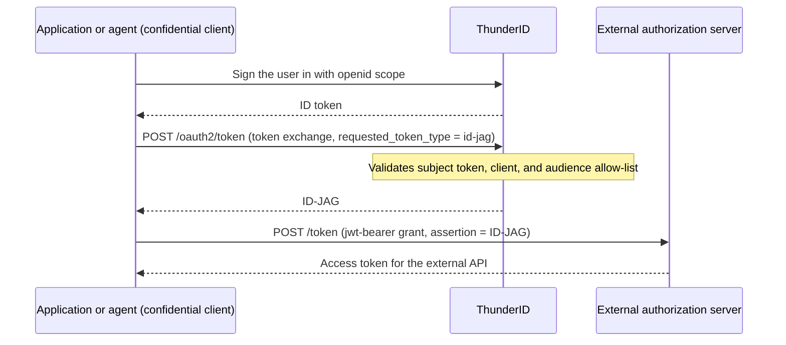

import Tabs from '@theme/Tabs';
import TabItem from '@theme/TabItem';

# Issue Identity Assertions (ID-JAG)

Configure your <ProductName /> application or agent so it can exchange a signed-in user's ID token for an **Identity Assertion Authorization Grant (ID-JAG)**, a signed JWT that an external authorization server accepts as proof of the user's identity when issuing its own access token. This guide walks through the full flow: enabling ID-JAG issuance on the client, obtaining an ID token, exchanging it, and presenting the resulting assertion to an external server.

## When to Use This

Use this when your application's or agent's users need to access an external, ID-JAG-aware service, such as an MCP server or a partner API, without signing in there a second time. The external authorization server trusts the assertion your application or agent obtained from <ProductName /> and issues its own access token based on it.

## Prerequisites

- A running <ProductName /> deployment. See [Get Started](../../../../../getting-started/get-thunderid).
- Console access.
- ID-JAG issuance allowed on the deployment. It is on by default. If `oauth.id_jag.issuance.enabled` is `false`, no client can request an ID-JAG. The token exchange grant, `urn:ietf:params:oauth:grant-type:token-exchange`, must also be in `oauth.allowed_grant_types`. See the [server configuration](../../../../../deployment/configuration).
- A client that signs the user in and uses a confidential client type. Public clients cannot issue identity assertions. Use one of the following:
    - [An application](../../../../applications/manage-applications) that supports the authorization code grant. An application registered from a [Client ID Metadata Document](../../../../mcp/mcp-clients/client-id-metadata-document) can issue them only when its document declares the `private_key_jwt` authentication method. For such a client, token exchange serves only identity assertion requests.
    - [An agent](../../../../agents/manage-agents) with Delegated mode on and a grant that signs the user in: authorization code or CIBA. The subject token for the exchange is the user's ID token issued to this agent, so an agent that holds only token exchange or JWT bearer cannot obtain one, because neither grant yields an ID token.

## How Issuance Works

An application or agent that has signed a user in to <ProductName /> exchanges the user's ID token for an ID-JAG, then presents that ID-JAG to an external authorization server to obtain an access token for an external API.



## Enable Identity Assertions

If the deployment's discovery document does not list the token exchange grant, the Console shows a hint and does not let you turn on the **Identity assertions (ID-JAG)** toggle. You can still turn off one that is already on. The Console cannot detect `oauth.id_jag.issuance.enabled: false`, so it still lets you turn the toggle on in that case, and identity assertion requests then fail with `invalid_target`.

<Tabs groupId="idjag-client">
<TabItem value="application" label="Application" default>

1. In the Console, navigate to **Applications**.
2. Select the application.
3. Open the **Advanced** tab.
4. Find the **Identity assertions (ID-JAG)** card and turn on the toggle.
5. Under **Allowed audiences**, add the identifiers of the external authorization servers this application can request assertions for. Each assertion targets exactly one of these audiences, and the entries must exactly match the `audience` value your application sends in the exchange request.
6. Set **Assertion validity** in seconds. The default is `300`.

:::note
The toggle is disabled for public clients. Turn off **Public client** on the application first.
:::

</TabItem>
<TabItem value="agent" label="Agent">

1. In the Console, navigate to **Agents**.
2. Select the agent.
3. Open the **Advanced** tab.
4. Under **Operating mode**, turn on **Delegated mode**. This adds the authorization code and refresh token grants. The agent needs a grant that signs the user in, authorization code or CIBA, so keep authorization code on or add **CIBA (Client-Initiated Backchannel Authentication)** in **Grant types**. With authorization code on, **Save** stays disabled until the agent has at least one entry under **Authorized redirect URIs** and at least one **Allowed user types** selection.
5. Find the **Identity assertions (ID-JAG)** card, which appears after the grant settings only while Delegated mode is on, and turn on the toggle.
6. Under **Allowed audiences**, add the identifiers of the external authorization servers this agent can request assertions for. Each assertion targets exactly one of these audiences, and the entries must exactly match the `audience` value your agent sends in the exchange request.
7. Set **Assertion validity** in seconds. The default is `300`.

Turning on identity assertions keeps the token exchange grant selected in **Grant types**, so you cannot remove it until you turn identity assertions off. Turning Delegated mode off also turns identity assertions off.

To configure the agent through the API, update it with `PUT /agents/{id}`. The update replaces the agent, so start from the agent's current definition. Send `delegated: true`, and in the `oauth2` entry of `inboundAuthConfig`, include the token exchange grant and the `token.idJag` settings. Keep the grant that signs the user in:

```json
{
  "delegated": true,
  "inboundAuthConfig": [
    {
      "type": "oauth2",
      "config": {
        "grantTypes": [
          "client_credentials",
          "authorization_code",
          "refresh_token",
          "urn:ietf:params:oauth:grant-type:token-exchange"
        ],
        "token": {
          "idJag": {
            "enabled": true,
            "allowedAudiences": ["https://external-as.example.com"],
            "validityPeriod": 300
          }
        }
      }
    }
  ]
}
```

See the [Agents API Reference](../../../../../apis#tag/agents) for the full request.

</TabItem>
</Tabs>

:::note
Turning on identity assertions also enables the token exchange grant type on the client. When you configure the client through the API, a declarative resource, or an import instead, include the `urn:ietf:params:oauth:grant-type:token-exchange` grant type and at least one allowed audience, with no blank values. <ProductName /> rejects an enabled configuration that lacks either with `400 Bad Request`.
:::

## Get an ID Token

Run the authorization code flow with the `openid` scope to obtain an ID token for the signed-in user. An agent runs the same flow with its own client ID and client secret, through its authentication flow. An agent that uses authorization code always requires PKCE, so its authorization request must also send `code_challenge` with `code_challenge_method=S256`, and its token request must send the matching `code_verifier`. The authorize endpoint rejects the request with `invalid_request` otherwise. See [Agent Access on Behalf of Users](../../../../agents/authentication/on-behalf-of-user) for the agent sign-in call. An agent that holds the CIBA grant can instead request the ID token through [Backchannel Authentication (CIBA)](../../backchannel-authentication) with the `openid` scope.

Export the `client_id`, `client_secret`, and registered redirect URI from your application's or agent's Console entry, since the following steps need them:

```bash
export CLIENT_ID=<your client id>
export CLIENT_SECRET=<your client secret>
export REDIRECT_URI=<your registered redirect uri>
```

:::note
These examples authenticate the client with a client secret. A client that uses `private_key_jwt`, such as one registered from a Client ID Metadata Document, sends `client_id`, `client_assertion_type` and `client_assertion` in each token request instead of `-u`. See [Client Authentication Methods](../../client-authentication-methods). A client registered from a Client ID Metadata Document also uses PKCE: it sends `code_challenge` and `code_challenge_method=S256` to the authorize endpoint, and `code_verifier` with the code. See [PKCE](../../pkce).
:::

1. Send the user's browser to the authorize endpoint:

```text
https://thunderid.example.com/oauth2/authorize?response_type=code&client_id=$CLIENT_ID&redirect_uri=$REDIRECT_URI&scope=openid&state=xyz
```

Replace `$CLIENT_ID` and `$REDIRECT_URI` with their real values before pasting this URL into a browser; shell variables do not expand there. For an agent, append `&code_challenge=<code challenge>&code_challenge_method=S256` to the URL.

2. After the user signs in (and consents, if consent is enabled for the application), <ProductName /> redirects the browser to `$REDIRECT_URI` with a `code` query parameter. Capture it from the callback URL and export it:

```bash
export CODE=<code from the callback URL>
```

3. Exchange the code for an ID token:

```bash
curl -X POST https://thunderid.example.com/oauth2/token \
  -u "$CLIENT_ID:$CLIENT_SECRET" \
  -H 'Content-Type: application/x-www-form-urlencoded' \
  -d 'grant_type=authorization_code' \
  -d "code=$CODE" \
  -d "redirect_uri=$REDIRECT_URI"
```

For an agent, add `-d "code_verifier=$CODE_VERIFIER"` to this request, using the verifier that produced the code challenge.

4. Export the ID token from the response:

```bash
export ID_TOKEN=<id_token from the response>
```

## Exchange It for an ID-JAG

Send the ID token to the token endpoint with the token exchange grant type, requesting an ID-JAG for the external authorization server's audience:

```bash
curl -X POST https://thunderid.example.com/oauth2/token \
  -u "$CLIENT_ID:$CLIENT_SECRET" \
  -d grant_type=urn:ietf:params:oauth:grant-type:token-exchange \
  -d requested_token_type=urn:ietf:params:oauth:token-type:id-jag \
  -d subject_token="$ID_TOKEN" \
  -d subject_token_type=urn:ietf:params:oauth:token-type:id_token \
  -d audience=https://external-as.example.com
```

A successful response returns the ID-JAG:

```json
{
  "access_token": "eyJhbGciOi...",
  "token_type": "N_A",
  "expires_in": 300,
  "issued_token_type": "urn:ietf:params:oauth:token-type:id-jag"
}
```

:::note
`token_type` is `N_A` per RFC 8693: the returned token is a grant to present to the external authorization server, not a Bearer token to call an API with directly.
:::

Export the `access_token` value as the ID-JAG for the next steps:

```bash
export ID_JAG=<access_token from the response>
```

## Inspect the Assertion

The `access_token` field is a JWT. Decode its payload to see the claims:

```bash
python3 -c 'import base64,sys;s=sys.argv[1].split(".")[1];print(base64.urlsafe_b64decode(s+"="*(-len(s)%4)).decode())' "$ID_JAG"
```

The header sets `typ` to `oauth-id-jag+jwt`:

```json
{
  "alg": "RS256",
  "kid": "isP0lckl...",
  "typ": "oauth-id-jag+jwt"
}
```

The payload carries the assertion's claims:

```json
{
  "aud": "https://external-as.example.com",
  "client_id": "my_client_id",
  "exp": 1780000300,
  "iat": 1780000000,
  "iss": "https://thunderid.example.com",
  "jti": "f47ac10b-...",
  "nbf": 1780000000,
  "sub": "a1b2c3d4-..."
}
```

- `iss`: the <ProductName /> issuer that signed the assertion.
- `sub`: the local user id of the signed-in user.
- `aud`: the single audience requested in the exchange.
- `client_id`: the application or agent that requested the assertion.
- `exp`, `iat`, `nbf`, `jti`: standard timing and uniqueness claims.

The assertion also carries a `scope` claim when the exchange request included a `scope` parameter, and a `resource` claim when it included one or more `resource` parameters, as a string for a single value or an array for several.

## Present It to the External Server

Send the ID-JAG to the external authorization server's token endpoint using the `jwt-bearer` grant. The external server validates the assertion and issues its own access token, governed entirely by that server's own configuration and policy:

```bash
curl -X POST https://external-as.example.com/token \
  -d grant_type=urn:ietf:params:oauth:grant-type:jwt-bearer \
  -d assertion="$ID_JAG"
```

## Request Parameters

| Parameter | Required | Value |
|---|---|---|
| `grant_type` | Yes | `urn:ietf:params:oauth:grant-type:token-exchange` |
| `requested_token_type` | Yes | `urn:ietf:params:oauth:token-type:id-jag` |
| `subject_token` | Yes | An ID token issued by <ProductName /> to the requesting application or agent. Access tokens, refresh tokens, external ID tokens, and ID-JAGs are rejected. |
| `subject_token_type` | Yes | `urn:ietf:params:oauth:token-type:id_token` |
| `audience` | Yes, exactly one | Identifier of the external authorization server. Must exactly match an entry in the client's allowed audiences (string equality, no wildcards or URL normalization). |
| `resource` | No, repeatable | Absolute URI without a fragment. Embedded verbatim in the grant's `resource` claim. |
| `scope` | No | Space-delimited. Embedded verbatim in the grant's `scope` claim. Not checked against the client's or subject token's scopes; the external server enforces its own policy. |

## Response

| Field | Value |
|---|---|
| `access_token` | The ID-JAG JWT |
| `token_type` | `N_A` (RFC 8693: the value is not a usable access token type; the ID-JAG must not be sent as a Bearer token) |
| `expires_in` | The configured assertion validity, default 300 seconds |
| `scope` | The scope embedded in the grant |
| `issued_token_type` | `urn:ietf:params:oauth:token-type:id-jag` |

No refresh token is issued.

## The Issued JWT

The header sets `typ` to `oauth-id-jag+jwt`.

| Claim | Value |
|---|---|
| `iss` | <ProductName /> issuer |
| `sub` | Local user id |
| `aud` | The single requested audience |
| `client_id` | The requesting client |
| `exp` / `iat` / `nbf` / `jti` | Standard timing and uniqueness claims |
| `scope` | Optional, present when a scope was requested |
| `resource` | Optional, present when a resource was requested |

## Troubleshooting

| Error | Description text | Cause |
|---|---|---|
| `invalid_request` | Missing required parameter: subject_token (or subject_token_type) | Parameter absent |
| `invalid_request` | ID-JAG requests require subject_token_type urn:ietf:params:oauth:token-type:id_token | Wrong subject token type |
| `invalid_request` | subject_token must be an ID token issued to this client | Subject token is not a valid self-issued ID token |
| `invalid_request` | subject_token audience does not match the authenticated client | ID token was issued to a different client |
| `invalid_target` | The client is not permitted to request ID-JAGs | ID-JAG issuance turned off for the deployment (`oauth.id_jag.issuance.enabled` is `false`), ID-JAG disabled on the client, or no allowed audiences |
| `invalid_target` | The audience parameter is required for ID-JAG requests / Exactly one audience is required for ID-JAG requests / The requested audience is not permitted for this client | Audience missing, repeated, or not in the allow-list |
| `invalid_target` | Invalid resource parameter: must be an absolute URI (or must not contain a fragment component) | Malformed resource |
| `invalid_client` | ID-JAG requests require a confidential client | Public client |
| `unauthorized_client` | The client is not authorized to use this grant type | Token exchange grant not enabled on the client |
| `unsupported_grant_type` | Unsupported grant type | The token exchange grant is not in the deployment's `oauth.allowed_grant_types` |
| `server_error` | Failed to process token request | Internal failure, including unavailable revocation status |

## Related Guides

- [Accept Identity Assertions](../accept-identity-assertions) - Configure <ProductName /> to accept ID-JAGs issued by an external identity provider
- [Identity Assertion Authorization Grant (ID-JAG)](..) - Overview of both ID-JAG roles
- [Enterprise-Managed Authorization for MCP](../../../../../use-cases/ai-agents/mcp-authorization/enterprise-managed-authorization) - Use ID-JAG to authorize MCP clients without a second sign-in
