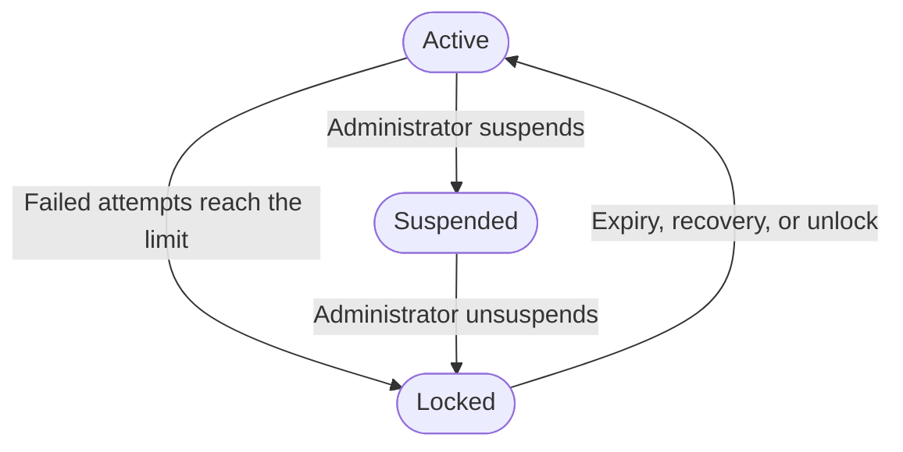

# Protect Accounts from Sign-In Attacks and Compromise

Repeated failed sign-ins and an unfamiliar booking alert the support team at a travel-booking service to possible account misuse. Some customers are checking in; others may have lost control of their accounts.

## When Account Access Is at Risk

Support needs to decide which access to stop and how its owner can return:

- **Repeated guesses.** Block failed password and one-time-code attempts while keeping a customer's existing session active.
- **Existing access.** End sessions and revoke access tokens used to call APIs when an account may be compromised.
- **Account recovery.** Replace exposed credentials before restoring access, preserving the account's profile and permissions.
- **Automated access.** Apply the same response to an agent or application whose credentials have been exposed.

## How Locks and Suspensions Work

<ProductName /> uses automatic **locks** to limit repeated failed sign-ins and administrator-controlled **suspensions** to stop access during an investigation. Unlocking an account leaves any suspension in place.

For a customer account, the controls have different effects:

| | Automatic lock | Suspension |
| --- | --- | --- |
| Use it for | Repeated failed sign-ins | A reported compromise or an investigation |
| New sign-ins | Blocks the affected method by default | Blocks every method |
| Existing access | Sessions and tokens keep working | The default suspend flow ends sessions and revokes tokens |
| Restore access | Wait for expiry, complete recovery, or unlock the account | Unsuspend the account, then complete recovery or unlock it |

The account status changes as attempts fail and support responds:



Support can also suspend an account that is already locked. The account shows **Suspended** while both apply. Unsuspending a user leaves every sign-in method locked until the user completes recovery or an administrator unlocks the account.

## Block Repeated Sign-In Attempts

When failed attempts reach the limit, <ProductName /> locks password sign-in on the affected customer's account. Their current session stays active, so they can finish checking in. With the default policy, they can also sign in through another configured method, such as a passkey.

By default, password sign-in locks after 5 failed attempts with no more than 1 hour between them. Successive locks last 5 minutes, 15 minutes, 30 minutes, and then 1 hour. The 50th consecutive failed attempt triggers a lock that requires recovery or an administrator to release it.

For an attempt through a locked method, the default sign-in flow reports **Sign-in is locked. Try again later or contact an administrator.** The customer can wait for a timed lock to expire or complete the default account recovery flow. Recovery releases the lock after the customer sets a new password. Support can also select **Unlock** from the account's **Actions** menu.

Failed password and one-time-code attempts count toward automatic locks. Failed attempts with passkeys or an external identity provider do not count toward a lock. Under **Settings** > **Account security**, you can change the limits or set **Lockout applies to** to **All sign-in methods**. This blocks new sign-ins through every method, including passkeys and external providers.

<ProductName /> can also email the customer when a lock occurs. See [Configure Account Lockout](../../../guides/account-protection/configure-account-lockout) to configure the policy and email notifications.

### Inspect Account Lock Status

Support can check the **Status** column in the Console's account list. On the account's page, a banner shows which sign-in methods are locked and when each lock expires. The management API returns these details for support tools. This response excerpt shows the customer's first password lock:

```json
{
  "status": {
    "value": "LOCKED",
    "details": {
      "reason": "FAILED_ATTEMPTS",
      "lockedMethods": [
        { "method": "credential", "expiresAt": "2026-11-02T10:20:00Z" }
      ]
    }
  }
}
```

In this example, `credential` identifies the locked password sign-in method, and `expiresAt` gives its expiry time. Without `expiresAt`, the lock requires recovery or an administrator's unlock. See the [API Reference](../../../apis#tag/users) for the full user response.

## Contain a Suspected Account Compromise

To investigate the unfamiliar booking, support selects **Actions** > **Suspend** on the customer's record. An optional operator note records the reason. Only administrators and other callers authorized to read the record can see this note. It never appears at sign-in.

The default suspend flow checks the administrator's permission, revokes the account's tokens, ends its sessions, and suspends the account. If token revocation or session termination fails, the flow stops before applying the suspension. Support can correct the failure and try again.

While suspended, the customer cannot sign in, reuse a session, refresh a token, or complete self-service recovery. The default sign-in flow reports **This account is suspended. Contact an administrator**. Support can still update the account's details and replace exposed credentials.

The travel-booking API must also check whether access tokens have been revoked. Checking only a token's signature and expiry does not detect revocation, so the API continues accepting it until it expires. See [Where Revocation Is Enforced](../../../guides/protocols/oauth-oidc/token-revocation#where-revocation-is-enforced) and [Token Introspection](../../../guides/protocols/oauth-oidc/token-introspection).

Suspend, unsuspend, and unlock each run an administration flow, a configurable sequence of steps for the operation. You can customize these flows and their email notifications to match your support process. See [Customize the Lifecycle Flows](../../../guides/account-protection/suspend-and-restore-accounts#customize-the-lifecycle-flows).

## Restore Account Access Safely

After investigating the booking, support selects **Unsuspend**. The suspension is removed, but every sign-in method remains locked until recovery or an administrator's unlock. This lock does not expire. With the default recovery flow, the customer follows an emailed link and sets a new password to release it.

If support has already replaced the exposed credentials, **Unsuspend and unlock** removes the suspension and then releases the lock. If unlocking fails, the suspension is removed and the account stays locked. Previously revoked sessions and tokens remain revoked, so the customer must sign in again.

## Protect Agents and Applications

The travel-booking service also runs a reservation agent. If the agent or application has exposed credentials, support can suspend it while replacing them. This blocks the agent's authentication or sign-ins through the application.

The default suspend flow ends sessions and revokes tokens issued to the account or through its OAuth client, including tokens obtained on behalf of users. Suspending the application leaves its user accounts active.

After replacing the credentials, support selects **Unsuspend** to restore access. Agents have their own automatic lock policy, and any lock still in force survives unsuspension. Applications support suspension only. Failed OAuth client secret authentication never triggers an automatic lock for either category.

## Related Guides

- [Account Protection](../../../guides/account-protection/overview): Understand how locks and suspensions interact and what each account status means.
- [Configure Account Lockout](../../../guides/account-protection/configure-account-lockout): Set the lock policy and configure lock notifications.
- [Suspend and Restore Accounts](../../../guides/account-protection/suspend-and-restore-accounts): Manage access from the Console or run administration flows from automation.
- [Account Recovery](../../b2c/try-it-out/account-recovery): Set up self-service recovery. Custom recovery flows need an unlock step after the password is set; changing a password alone does not release a lock.
- [Observability](../../../deployment/observability): Monitor lock, suspension, and unlock events.
- [Configure Rate Limiting](../../../deployment/production-guidelines#configure-rate-limiting): Limit request volume alongside account locks.
