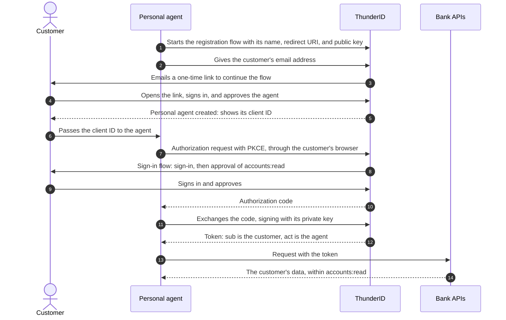

# Solve It with Personal Agents

The bank cannot vet the agent, and it has nobody to ask about it except the customer who brought it in. So
every answer to the questions in [the overview](../overview) has to trace back to that customer.

Two shortcuts are tempting here, and both lose something. Register it as one of the bank's own agents and
it can act with nobody behind it. Hand it the customer's password and nothing tells the agent's actions
apart from the customer's. What the bank wants is an identity for the agent that only ever acts for the
customer who brought it in.

Each section links to the [Personal Agents](../../../../guides/agents/personal-agents) guide that sets that part up.

## The Personal Agent

A personal agent is an agent with an identity of its own, owned by one customer. The owner is
set when the agent is created and never changes, and every token the agent gets is for that owner.

That ownership is what answers whose agent it is and for whom it can act. There is no token for the agent
alone, and it cannot exchange a token it was handed for one of its own. Every token traces back to the owner
signing in and approving, in a browser or on their own device.

The agent still proves which agent it is with a credential of its own. With a key pair, the agent
keeps the private key and the bank only ever holds the public key.

See [What the agent gets](../../../../guides/agents/personal-agents/register#what-the-agent-gets).

## Registration Flow

The customer registers the agent, not a bank employee, so registration has to run without the bank in the
loop and still prove who the customer is. A **registration flow** of one of the bank's applications does both. It
collects the agent's details, such as its name, redirect URI (the address the customer's browser returns to after sign-in), and public key, signs the customer in, and
creates the personal agent with the customer as its owner.

Either side can start it, and the customer signs in either way:

- **The customer** starts it from the bank's portal, where they are already signed in.
- **The agent** starts it through the [Flow Execution API](../../../../apis#tag/flow-execution), and the flow brings the customer in to sign in and
  approve it.

How the customer signs in is up to the bank, because the bank builds the flow. Whichever method it picks should
keep the customer's sign-in away from the agent. The bank can build a flow that moves the sign-in out of the
agent's run, or give agents an SDK that hands the sign-in to the customer. Here, the bank takes the first
way: the flow emails the customer a one-time link that continues it in their browser. There, the customer signs
in, approves the agent, and receives its identifiers to pass back.

Values that belong to the bank, such as the sign-in flow the agent uses, are fixed in the registration flow,
so nobody running it can change them.

See [Register Personal Agents](../../../../guides/agents/personal-agents/register).

## The Sign-In Flow

Registering the agent granted it nothing. Access starts when the owner approves, and the bank wants the owner
to see each request rather than approve once and forget.

The agent's **sign-in flow** runs on every authorization. It signs the owner in, works out which of
the requested permissions the owner holds, and asks the owner to approve them. The owner can approve all of them
or only some. Only the owner can sign in through it: anyone else is refused, and no token is issued. By default,
when the agent requests permissions, consent is asked on every authorization, so an earlier approval is never
reused without the owner seeing it.

<ProductName /> ships a sign-in flow for personal agents that does all of this. The bank can build its own, for
example with passkeys. Its own flow needs the permission step, or the token carries no permissions, and
should keep the consent step.

See [The sign-in flow](../../../../guides/agents/personal-agents/sign-in-and-tokens#the-sign-in-flow).

## What the Token Carries

When the owner approves, the agent receives a token. This is what the bank's APIs see:

```json
{
  "iss": "https://localhost:8090",
  "sub": "<customer-user-id>",
  "act": { "sub": "<agent-id>" },
  "aud": "https://api.bank.example.com",
  "scope": "accounts:read",
  "exp": 1793000000
}
```

- **`sub`** is the customer, so the APIs apply the customer's own permissions.
- **`act`** is the agent, so the APIs and the audit trail record that the agent made the call.
- **`aud`** is the bank's API the token is for.
- **`scope`** holds only what the customer approved.

See [What the token carries](../../../../guides/agents/personal-agents/sign-in-and-tokens#what-the-token-carries).

## Owner Self-Service

The customer brought the agent in, so the customer decides what happens to it next. The bank's portal gives
them that control through the **self-service API**, which reaches only the signed-in customer's own agents.

From the portal, the customer sees their agents and changes how each one gets access, for example letting
it ask for approval on their phone, when the bank fixed a sign-in flow that reaches them there. They can suspend one agent or all of them at
once, and delete one.

See [Owner Self-Service](../../../../guides/agents/personal-agents/owner-self-service).

## Oversight

The bank's security team hears that a version of the agent has a flaw. It has to find the affected
agents and stop them without touching the customers' accounts.

**Administrators** list every personal agent by its owner or name, and suspend any of them with a note the owner
can read. Suspending an agent revokes its tokens, and the customer cannot lift the bank's suspension. When a
customer's account is suspended or deleted, their agents are suspended or deleted with it.

Administrators can also update an agent's registration, but they cannot get a token through it. Every token
still needs the customer to sign in and approve.

See [Oversee Personal Agents](../../../../guides/agents/personal-agents/oversight).

## How It All Runs

Here is one registration and one authorization, with the agent starting the registration itself and the
customer signing in through an emailed link.



When the customer starts from the portal instead, they enter the agent's details there while signed in. No
link is needed, and the portal shows them the client ID, the identifier the agent signs in with, to pass to the agent.

## What You Have Solved

- Every agent belongs to one customer, its owner.
- It acts only for that customer, and every token comes from the customer's own sign-in and approval.
- The customer sees what the agent asks for, and can approve less.
- Every token names both the customer and the agent, and carries only what the customer approved.
- The customer can pause or remove an agent, and the bank can find and stop any of them without locking a
  customer out.

## Next Steps

For the reasoning behind these choices, and what to pick when the bank's constraints differ, see
[Design Decisions & Alternatives](../design-decisions). To set up registration, see
[Register Personal Agents](../../../../guides/agents/personal-agents/register).
