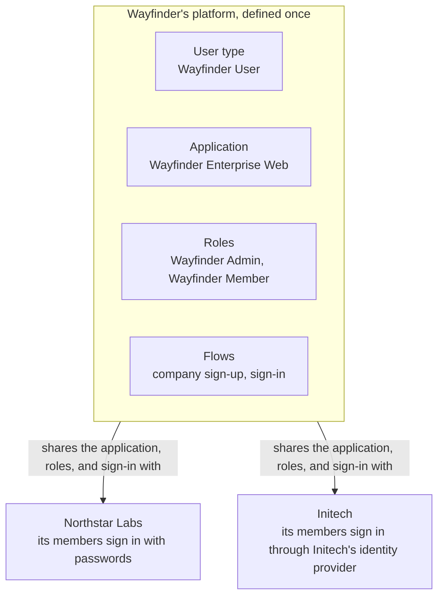

# Learn the B2B Model

This page builds the B2B model in <ProductName /> at a conceptual level: what each concept is, why it exists, and how
each one builds on the last. The running example is Wayfinder Enterprise, a corporate travel-booking platform with
two customer companies: Northstar Labs, whose employees sign in with passwords, and Initech, whose employees must sign
in through Initech's own identity provider. Its sign-in and sign-up journeys run
as [flows](../../guides/flows/what-are-flows.mdx): the sequence of screens and checks one journey runs, built in a visual
designer. You create each of these through the Console, the management APIs, or declarative YAML files. The [quick start](./quick-start.mdx) and the journey pages
give the exact steps.

Here is what sits inside the identity layer once Wayfinder Enterprise is running. Each section below builds one piece:



## Organizations

A B2B application needs a container for each customer: something that holds a company's people and settings and keeps
them apart from every other company's. In <ProductName />, that container is an
[organization unit (OU)](../../guides/organization-units/manage-organization-units.mdx). OUs form a tree, and this
section calls an OU that represents a customer company an **organization**.

Wayfinder Enterprise uses two levels:

- **The platform organization**, `Wayfinder Enterprise` (handle `wayfinder-enterprise`), belongs to Wayfinder's own
  team. Everything every customer shares, the application, its roles, and its sign-in journeys, reaches the customers
  through it.
- **Customer organizations**, such as Northstar Labs (`northstar`) and Initech (`initech`), sit directly beneath it.
  Each one is created the moment a company signs up, so Wayfinder's team does not have to provision customers by hand.

Every OU has a **handle**, a short URL-safe name that is unique among its siblings, so `northstar` names one
organization under `wayfinder-enterprise`. A handle path joins the handles from the top of the tree down, such as
`default/wayfinder-enterprise/northstar` in the quick start setup. An employee who signs in through their company's
identity provider types the company's own handle, `northstar`, to say which company they work for.

**Build it:** create the platform organization in
[B2B Quick Start with React](./quick-start.mdx#create-the-platform-organization).

## Members

An organization is empty until people belong to it. Before anyone can sign up, <ProductName /> needs to know what a
Wayfinder account looks like, and that definition is a [user type](../../guides/users/user-types.mdx): the schema of
attributes every account of one kind carries. A user type belongs to one OU and is available in every OU beneath it, so
Wayfinder defines one `Wayfinder User` type in the platform organization and every customer organization uses it.

A person can belong to an organization in two ways, and the difference decides whether they can ever work for a second
company:

| | Lives in the organization | Shared into the organization |
|---|---|---|
| **Where the account is stored** | In the customer organization itself | In the platform organization, which owns the user type |
| **Organizations it can reach** | Only that one | Every organization it is shared into |
| **Typical person** | An employee of one company | A consultant, an agency, or staff of a parent company |
| **Created by** | The **Organization Sign-up** template, or an organization admin | The **Organization Sign-up with Shared Account** template, or an invitation |

In the Console, sharing appears as affiliation, on the user's **Affiliations** tab. Through the API, a list of an
organization's users returns the people who live there first, then the people shared into it, and each entry's
`isOwnedByOU` says which kind it is. A
sign-up or invitation flow shares an account only into a direct child of the OU that owns it, so a shared account lives
in the platform organization and reaches the customer organizations directly beneath it.

See [Users and Organization Units](../../guides/users/manage-users.mdx#users-and-organization-units) for the full rules.

**Build it:** define the user type in
[B2B Quick Start with React](./quick-start.mdx#define-the-account), then choose how members join in
[Let Companies Sign Up](./journeys/organization-sign-up.mdx) and [Invite People In](./journeys/invite-members.mdx).

## Shared Resources

A new organization has members but nothing to sign in to. Copying the application, its roles, and its flows into each
customer organization would mean a deployment step for every new customer. Instead, each resource stays in the platform
organization and carries a **sharing policy**: a rule naming the other OUs that can use it.

Wayfinder shares its application and its two roles with **all child organization units**, and later its sign-in flow,
so each company can set its own identity provider. That policy reaches every organization beneath the platform
organization, including the ones that sign up tomorrow, so a new company works the moment its sign-up finishes.

A shared resource can be owned by the platform organization or by an OU above it. In the quick start, the application,
roles, and flows belong to the Control Plane project's own OU, `Default`, which sits above `Wayfinder Enterprise`, and
sharing them with all child organization units reaches every company the same way.

The resource types you can share are applications, roles, flows, connections to identity providers, users, and agents.
Groups are never shared: a group belongs to one organization, and its members must live in or be shared into that
organization.

See [Resource Sharing Across Organization Units](../../key-concepts/resource-sharing.mdx) for every policy mode,
including exclusions and resharing.

**Build it:** share the roles and the application in
[B2B Quick Start with React](./quick-start.mdx#create-the-shared-roles).

## Roles in an Organization

A shared role still grants nothing until someone holds it, and in a B2B application holding a role always happens
inside one organization. A **role assignment** names the person, the role, and the organization the assignment is made
in. Northstar's office manager is a `Wayfinder Admin` in Northstar Labs, and that assignment means nothing in Initech.

This is why Wayfinder defines its roles once, in the platform organization, and shares them:

- **One definition.** `Wayfinder Admin` and `Wayfinder Member` mean the same thing for every customer, so the
  application checks the same role names everywhere.
- **Assignments stay local.** Each organization assigns the shared roles to its own people. A sharing policy keeps
  assignments on by default, so the sign-up flow can make a new company's first user its `Wayfinder Admin`.

A role can also hold the permissions of a resource server, the API that the permissions protect. See
[Roles](../../guides/users/manage-roles.mdx) for permissions, and for turning assignments off in some organizations.

## A Sign-In Lands in One Organization

With organizations, members, and shared roles in place, a sign-in has one more decision to make: which organization
the person is signing in to. Every sign-in lands in exactly one OU, and only in an OU where both the person and the
application are found. The person must live in it or be shared into it, and the application must be owned by it or
shared with it.

The application or the sign-in flow decides the organization in one of three ways:

- **The application names it** in the request, by sending the sign-in to `/ou/{ouId}/oauth2/authorize`. An
  organization switcher works this way.
- **The person types the handle first.** A **Resolve OU** step asks for the organization's handle before the person
  signs in. Enterprise sign-in uses this, because the handle decides which identity provider to send the person to.
- **The flow decides after sign-in.** A **Resolve OU** step after the password step picks the one organization the
  person belongs to, or asks them to choose when there are several.

See [Sign Users In to Organization Units](../../guides/organization-units/sign-in-to-organization-units.mdx) for each
option and the errors a refused sign-in returns.

**Build it:** set where the sign-in flow looks for companies in
[B2B Quick Start with React](./quick-start.mdx#build-the-sign-in-flow).

## Organization-Aware Tokens

The organization a sign-in lands in becomes part of the tokens it issues. A sign-in returns an **ID token**, which tells
your application who signed in, and an **access token**, which your application sends to its APIs. Each token carries
**claims**, named pieces of information such as `sub` for the person. The organization claims are what let every API
call after sign-in know which company it acts for:

- **Organization claims.** `ouId`, `ouHandle`, and `ouName` name the organization the sign-in landed in, when the
  application asks for them.
- **Roles from that organization only.** The `roles` claim lists only the roles assigned in that organization, so a
  consultant who is an admin in Northstar Labs and a member in Initech gets a different token for each.
- **Groups from that organization only.** The `groups` claim lists only the groups that organization owns.

### A Decoded Token

Decoded, an access token issued when Northstar's office manager signs in to Wayfinder carries these claims, among the
standard ones:

```json
{
  "sub": "019f0c7a-41d2-7c3e-9b8a-2f6d1e0a7c55",
  "ouId": "019f0c79-8e10-7f2b-a3c4-5b6d7e8f9012",
  "ouHandle": "northstar",
  "ouName": "Northstar Labs",
  "roles": ["Wayfinder Admin"]
}
```

`ouId` is the value Wayfinder's APIs key every booking and travel policy by, so a request carrying this token can only
reach Northstar's data. See [Token Formats](../../guides/protocols/oauth-oidc/token-formats.mdx) for the standard
claims.

**Build it:** add the organization claims to the application's tokens in
[B2B Quick Start with React](./quick-start.mdx#register-the-application).

## Enterprise Sign-In per Organization

Initech's employees cannot use a Wayfinder password. They must sign in through Initech's own identity provider, while
Northstar's employees keep their passwords, and both use the same application and the same sign-in flow.

The shared sign-in flow makes that possible with two additions:

- **A connection owned by the organization.** A connection holds the details <ProductName /> needs to send a person to
  an external OpenID Connect identity provider. Initech's connection belongs to the Initech organization, so it is
  Initech's alone.
- **A flow variable each organization sets.** The shared sign-in flow declares a variable, `enterpriseIdp`, that names
  the connection to use. Its sharing policy lets each organization set its own value, so Initech points it at its
  connection and Northstar leaves it unset.

The first time an Initech employee signs in this way, the flow creates their account inside Initech. Nobody has to
create Initech's employees in advance.

**Build it:** [Plug In an Enterprise IdP](./journeys/enterprise-sso.mdx).

## Who Does What

The model has three kinds of people, and each one reaches a different part of it:

| Person | Reaches | Typical tasks |
|---|---|---|
| **Platform team** (Wayfinder's own staff) | Every organization | Defines the application, the roles, and the flows. Supports any customer. |
| **Organization admin** (Northstar's office manager) | Their own organization only | Adds and invites people, forms groups, assigns the shared roles, and connects the company's identity provider. |
| **Member** (a Northstar employee) | Their own account, in the organizations they belong to | Signs in, switches between organizations, and uses the application. |

An organization admin acts through your application, not the <ProductName /> Console. Your application's backend pins
every management call to the organization the admin's token names, so an admin of Northstar Labs never sees Initech's
people. See [Let Organization Admins Manage Teams](./journeys/delegated-administration.mdx) for the recommended
design.

## Terms Used in This Section

| Term | Meaning here |
|---|---|
| **Organization** | A customer company, modeled as an organization unit beneath the platform organization. |
| **Platform organization** | The organization unit your team owns, with every customer organization beneath it. It holds the user type, and the shared application, roles, and flows reach every company through it. |
| **Handle** | An organization's short URL-safe name, unique among its siblings, such as `northstar`. |
| **Member** | A person who lives in an organization or is shared into it. |
| **Shared into** | Given access to an organization while the account lives elsewhere. The Console calls this affiliation. |
| **Sharing policy** | The rule on a resource that names the other organization units that can use it. |
| **Role assignment** | A person holding a role in one specific organization. |
| **Connection** | The configuration of an external identity provider, owned by one organization unit. |
| **Flow** | The sequence of screens and checks that one journey runs, such as sign-in or company sign-up. |
| **ID token** | The token that tells your application who signed in and to which organization. |
| **Access token** | The token your application sends to its APIs. It names the organization and the roles held there. |
| **Claim** | One named piece of information in a token, such as `ouId` or `roles`. |
| **Root `system` permission** | The top management permission. It includes every `system:*` permission and, unlike them, reaches every organization unit, so only a trusted backend holds it. |
| **Control Plane** | Where your team authors configuration, such as flows, roles, and applications. |
| **Data Plane** | Where people sign in and their accounts live. It receives its configuration from the Control Plane. |

## Next Steps

<NextSteps>
  <NextStepsCard
    title="B2B Quick Start with React"
    description="Build the platform organization, the shared roles, and a React application that companies sign up to."
    href="../quick-start"
  />
  <NextStepsCard
    title="Let Companies Sign Up"
    description="Choose where a new company's first account lives, and run the sign-up from your sign-in page."
    href="../journeys/organization-sign-up"
  />
  <NextStepsCard
    title="Design Decisions"
    description="The reasoning behind these defaults, and what to pick when your constraints differ."
    href="../architecture-decisions"
  />
</NextSteps>
