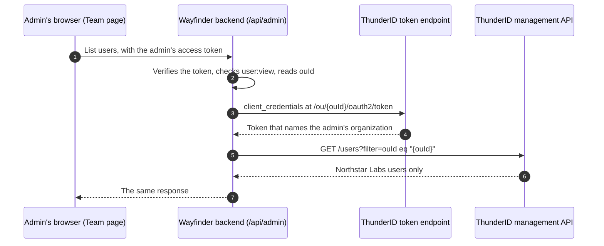

# Let Org Admins Manage Teams

Give each organization's admin a Team page inside your application, where they add people, organize them into groups, and hand out roles for their own organization and nothing beyond it. In Wayfinder Enterprise, the Northstar Labs admin onboards a new hire, adds them to a group, and makes a teammate a `Wayfinder Member`. Initech's people never appear on that page, and no call the page makes can reach them.

## Prerequisites

- The platform organization, the shared `Wayfinder Admin` and `Wayfinder Member` roles, and the shared application from [B2B Quick Start with React](../quick-start.mdx).
- An application with a server side, such as a Next.js application. The pattern on this page keeps management calls on your server.

## How the Organization Boundary Works

Each organization is an organization unit (OU), a node in the hierarchy that owns its own users, groups, and roles. See [Manage Organization Units](../../../guides/organization-units/manage-organization-units.mdx). <ProductName /> confines its management permissions to OUs in the following ways:

- **Permissions stay in one organization.** A management permission such as `system:user:view` or `system:role:update` acts only on the resources of the OU the caller's token names, and a list returns only that OU's resources. The root `system` permission is the exception: it reaches every OU. See [System Permissions](../../../guides/users/manage-roles.mdx#system-permissions).
- **Lists filter by organization.** `filter=ouId eq "<ou-id>"` lists one organization's resources. Users come back owned first, then shared into the organization. Roles come back the same way. Groups come back owned only, because groups are never shared.
- **Group members stay inside the organization.** A group accepts a member only when the member lives in the group's OU or is shared into it. See [Organization Unit Boundary for Members](../../../guides/users/manage-groups.mdx#organization-unit-boundary-for-members).
- **You grant only what you hold.** Assigning a role or adding a group member that would grant more permissions than the caller holds fails with `403` and `SAZ-4030`. Holders of the root `system` permission are exempt. See [Permission Requirements](../../../guides/users/manage-roles.mdx#permission-requirements).

## Keep Management Calls on Your Server

The SDK's management components call the <ProductName /> management API. Route those calls through your own backend instead of sending the admin's token straight to <ProductName />:

- **The admin's token stays small.** It carries only your application's own permissions, such as `user:manage`, and never a <ProductName /> management permission.
- **Audience checks keep working.** When a deployment sets [`server.security.rest.audience`](../../../deployment/configuration.mdx), the management API accepts only tokens issued for that audience, and a token issued for your application's API is refused.
- **The root permission never reaches an admin.** A token that carries `system` acts in every organization, so it must never be issued to an organization admin.

The backend checks the admin's own permission, pins the call to the admin's organization, and forwards it with a token of its own:



## Build the Backend Proxy

<Stepper stepNode="h3" as="h3">

### Create the Backend Client

Create a confidential client for your backend that signs no one in. Share it with every child organization, so it can get a token for any of them, and give it a role that holds the management permission it calls with. The role is assigned in the client's own OU, Wayfinder Enterprise, and only roles assigned there count when the client gets a token for an organization.

```yaml title="wayfinder-enterprise-backend.yaml"
resource_type: role
id: 019f0a10-0000-7000-8000-000000000013
name: Wayfinder Enterprise Backend
ouHandle: wayfinder-enterprise
permissions:
  - resourceServerId: 01900000-0000-7000-8000-000000000020   # The System resource server
    permissions:
      - system
assignments:
  - id: 019f0a10-0000-7000-8000-000000000032
    type: app
---
resource_type: application
id: 019f0a10-0000-7000-8000-000000000032
ouHandle: wayfinder-enterprise
name: Wayfinder Enterprise Backend
type: m2m
sharingPolicies:
  - id: wayfinder-backend-all-companies
    childUnits:
      mode: all
inboundAuthConfig:
  - type: oauth2
    config:
      clientId: WAYFINDER_ENTERPRISE_BACKEND
      clientSecret: <client-secret>
      grantTypes:
        - client_credentials
      tokenEndpointAuthMethod: client_secret_basic
      publicClient: false
      token:
        accessToken:
          clientConfig:
            attributes:
              - ouId
              - ouHandle
              - ouName
```

`01900000-0000-7000-8000-000000000020` is the ID of the System resource server in a default deployment. See [Machine-to-Machine (M2M) Access for Organization Units](../../../guides/organization-units/machine-to-machine-access.mdx) for sharing policies on clients.

### Give Admins Your Application's Own Permissions

The admin's token carries your application's permissions, not <ProductName />'s. Declare them on your application's resource server, then add them to the `Wayfinder Admin` role you already created: in the Console, open **Roles**, select `Wayfinder Admin`, and add them on the **Permissions** tab. Do not create a second role. If you manage the role as a declarative resource, these are the permissions to add to it:

```yaml title="Excerpt: permissions of the Wayfinder Admin role"
permissions:
  - resourceServerId: <wayfinder-enterprise-api-id>
    permissions:
      - user:view
      - user:manage
      - group:view
      - group:manage
      - role:view
      - role:manage
```

The application requests these scopes when the admin signs in, and the backend reads them from the admin's access token.

### Request a Token for the Admin's Organization

For each call, request a token at the admin's organization's own token endpoint. Name the System resource server in `resource`, so the token carries its permissions. `https://localhost:8090/mcp` is the System resource server's identifier in a default deployment:

```bash
curl -X POST https://localhost:8090/ou/<admin-ou-id>/oauth2/token \
  -u 'WAYFINDER_ENTERPRISE_BACKEND:<client-secret>' \
  -d 'grant_type=client_credentials' \
  -d 'scope=system' \
  -d 'resource=https://localhost:8090/mcp'
```

The token's `ouId`, `ouHandle`, and `ouName` claims name the admin's organization. An organization the client is not shared with gets `400 unauthorized_client`. Cache one token per organization until it nears expiry.

### Pin Every Call to the Caller's Organization

Expose one backend route that the management components call. The following sketch shows its shape for users. Extend the same pattern to groups, roles, and user types:

```ts title="app/api/admin/[...path]/route.ts (sketch)"
export async function GET(request: Request, {params}: {params: Promise<{path: string[]}>}) {
  const admin = await verifyAccessToken(request); // Signature, issuer, audience, expiry, ouId
  if (!admin) return Response.json({error: 'Sign in again.'}, {status: 401});

  const [collection, id] = (await params).path;
  if (collection !== 'users' || id !== undefined) return new Response(null, {status: 404});
  if (!admin.scopes.includes('user:view')) return new Response(null, {status: 403});

  const query = new URLSearchParams({filter: `ouId eq "${admin.ouId}"`});
  const token = await getBackendToken(admin.ouId); // /ou/{ouId}/oauth2/token, cached
  return fetch(`https://localhost:8090/users?${query}`, {
    headers: {Authorization: `Bearer ${token}`},
  });
}
```

The route replaces any filter the browser sends with the admin's own organization, and sets `ouId` on every body it forwards, such as a new user or a role assignment. The SDK's `GroupList` and `RoleList` take no organization filter, so this rewrite is what limits them to one organization. Allow only the calls your Team page makes, and return `404` for everything else.

### Point the SDK Components at the Proxy

Override the management `endpoints` in `ThunderIDProvider`, so the components call your backend route instead of <ProductName />. `UserCreate` also lists user types, so route `userTypes` too:

```tsx title="app/layout.tsx"
import {ThunderIDProvider} from '@thunderid/nextjs/server';

const appUrl = process.env.WAYFINDER_APP_URL;

export default function RootLayout({children}: {children: React.ReactNode}) {
  return (
    <html lang="en">
      <body>
        <ThunderIDProvider
          signInOptions={{resource: 'urn:wayfinder-enterprise:api'}}
          preferences={{user: {fetchUserProfile: false}}}
          endpoints={{
            users: `${appUrl}/api/admin/users`,
            groups: `${appUrl}/api/admin/groups`,
            roles: `${appUrl}/api/admin/roles`,
            userTypes: `${appUrl}/api/admin/user-types`,
          }}
        >
          {children}
        </ThunderIDProvider>
      </body>
    </html>
  );
}
```

`fetchUserProfile: false` makes the SDK read the signed-in user's profile from the ID token, so the admin's token is never sent to `/users/me` either.

### Build the Team Page

Pass the admin's organization to each component. The list, create, and assignment components then show and change only that organization:

```jsx title="components/TeamManagement.jsx"
'use client';

import {GroupCreate, GroupList, GroupMembers, RoleAssignments, UserCreate, UserList} from '@thunderid/nextjs';
import {useState} from 'react';

export default function TeamManagement({ouId, adminRoleId, memberRoleId}) {
  const [groupId, setGroupId] = useState();

  return (
    <>
      <UserList filter={`ouId eq "${ouId}"`} title="People in your company" />
      <UserCreate ouId={ouId} title="Add a user" />

      <GroupList title="Groups" onSelect={(group) => setGroupId(group.id)} selectedGroupId={groupId} />
      {groupId && <GroupMembers groupId={groupId} ouId={ouId} editable />}
      <GroupCreate ouId={ouId} title="Create a group" />

      <RoleAssignments roleId={adminRoleId} ouId={ouId} editable title="Wayfinder Admin" />
      <RoleAssignments roleId={memberRoleId} ouId={ouId} editable title="Wayfinder Member" />
    </>
  );
}
```

Read `ouId` from the admin's session, for example `currentOrganizationUnit?.id` from `useThunderID()`. When `ouId` is omitted, `UserCreate`, `GroupCreate`, and `RoleCreate` fall back to the `ouId` in the signed-in user's profile. With `fetchUserProfile: false`, as here, the profile comes from the ID token, so that is the organization the admin signed in to.

</Stepper>

## What the Server Still Checks

The proxy decides which organization a call acts in, and <ProductName /> still checks the data itself:

- A group member, or a role assignee, must live in the organization or be shared into it.
- A role can be assigned only in an organization the role is owned by or shared with, with assignments left on. See [Share a Role With Other Organization Units](../../../guides/users/manage-roles.mdx#share-a-role-with-other-organization-units).
- An organization the backend client is not shared with gets no token.

:::warning Allow-list the roles
The backend client holds the root `system` permission, so the rule that you grant only what you hold never stops it. Let the proxy assign only the roles your Team page offers, such as `Wayfinder Admin` and `Wayfinder Member`, and refuse every other role ID.
:::

## Next Steps

<NextSteps>
  <NextStepsCard
    title="Invite People In"
    description="Bring people who already have an account into an organization."
    href="../invite-members"
  />
  <NextStepsCard
    title="Plug In an Enterprise IdP"
    description="Let the admin connect their company's identity provider from the same application."
    href="../enterprise-sso"
  />
  <NextStepsCard
    title="B2B SDK Components"
    description="Every component the Team page uses, with the API and permission each needs."
    href="../../sdk-components"
  />
</NextSteps>
