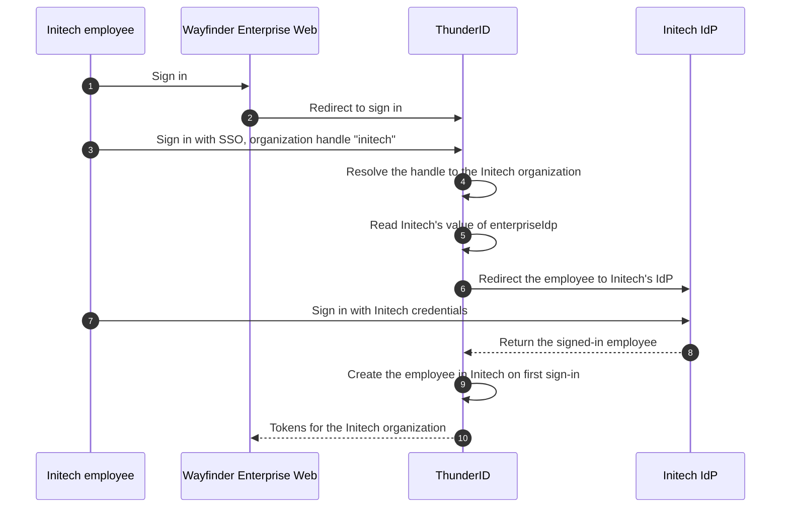

# Plug In an Enterprise IdP

Initech already manages its employees in its own identity provider (IdP), the corporate directory every Initech application signs in through. Its IT team will not create a second password for every employee in Wayfinder Enterprise, and it wants a person who leaves Initech to lose access to Wayfinder on the same day. So an Initech employee who signs in to Wayfinder should be sent to Initech's IdP, and come back signed in to the Initech organization. Northstar Labs, meanwhile, keeps signing in with passwords.

One sign-in flow serves both. Your team defines it once and shares it with every company, and each company sets which IdP its own employees use.

## Prerequisites

- The platform organization, the shared roles, and the shared application from [B2B Quick Start with React](../quick-start.mdx).
- For connecting a company's IdP through the API, the backend client and its token for one organization, from [Let Organization Admins Manage Teams](./delegated-administration.mdx#create-the-backend-client).

## How It Works

Three pieces make an IdP per organization:

- **A connection owned by the organization.** An OpenID Connect (OIDC) connection holds the client ID, secret, and endpoints of Initech's IdP. Every connection belongs to exactly one organization unit (OU), set when it is created and never changed afterward, so Initech's connection is Initech's own. See [Organization Unit Ownership](../../../guides/identity-providers/manage-identity-providers.mdx#organization-unit-ownership).
- **A shared sign-in flow with a variable.** The **Basic + Enterprise SSO** template declares a variable, `enterpriseIdp`, that holds a connection. Its sign-in step reads the connection from that variable, so the same flow uses a different IdP for each organization.
- **A value per organization.** The flow's sharing policy lets each company set its own value of `enterpriseIdp`. Initech sets its connection. Northstar sets nothing and keeps signing in with passwords.

An employee reaches the right IdP by typing their organization's handle:



The handle resolves only to a direct child of the platform organization, so an employee cannot reach an organization outside Wayfinder Enterprise. A company that has not set a connection cannot use the SSO path: its employees see "No identity provider has been set up for your organization. Contact your administrator" (`FES-1022`).

## Set Up the Shared Sign-In Flow

Your team does this once, for every company.

<Stepper stepNode="h3" as="h3">

### Create the Flow From the Template

If you followed the quick start, open `Wayfinder Sign-in`: it is already this flow, with both parent organizations set, so continue at [Give First-Time Employees a Role](#give-first-time-employees-a-role). Otherwise, navigate to **Flows**, click **Create new flow**, select **Sign-in** as the flow type, and select the **Basic + Enterprise SSO** template.

### Set the Parent Organization

The template has two **Resolve OU** steps, one for the SSO path and one after a password sign-in. On both, set **Parent OU ID** to the ID of Wayfinder Enterprise.

### Give First-Time Employees a Role

The template creates an employee in the organization on their first SSO sign-in, but assigns no role. To give them one, select the **Provisioning** step on the SSO path and select **Wayfinder Member** in **Assign role**. The role must be shared with the company's organization. Click **Save**.

### Let Each Company Set Its IdP

Share the flow so that it reaches every company, and make `enterpriseIdp` editable in the policy. In the Console, open the flow and click **Share**. Grant **All child organization units**, then turn on **Editable** for `enterpriseIdp`.

Through the API, send the same policy to the server where you manage flows. In the quick start setup, that is the Control Plane at `https://localhost:8095`. A Data Plane that runs on its own manages its own flows. `$TOKEN` is an administrator's access token with the `system` scope:

```bash
curl -X POST https://localhost:8095/flows/<flow-id>/sharing-policies \
  -H "Authorization: Bearer $TOKEN" \
  -H "Content-Type: application/json" \
  -d '{
    "childUnits": {
      "mode": "all",
      "overlayRules": {
        "variables.enterpriseIdp": { "editable": true }
      }
    }
  }'
```

See [Share a Flow](../../../guides/flows/share-a-flow.mdx) for the other terms a policy can set, such as limiting the connections a company may choose.

### Attach the Flow to the Application

Navigate to **Applications**, open `Wayfinder Enterprise Web`, and select the **Flows** tab. Set **Sign-in flow** to this flow, then save the tab.

</Stepper>

When an IdP signs a first-time employee in, the provisioning step creates the account in the employee's organization with the application's allowed user type that has self-registration turned on. Allow only one such user type on the application, or provisioning fails. If the IdP does not return an attribute the user type requires, such as `username` in the `Wayfinder User` type, the flow asks the employee for it.

## Connect a Company's IdP

Either your team connects the IdP for the company, or the company's admin does it from inside your application. Both write the same two things: a connection owned by the company, and the company's value of `enterpriseIdp`.

Start on the company's side. In Initech's IdP, register an OIDC application with the authorization code grant, and add the callback of the Gate as its redirect URI. The Gate is the set of hosted sign-in pages <ProductName /> serves under `/gate`, so on a local server the redirect URI is `https://localhost:8090/gate/callback`. Note the client ID, client secret, and the IdP's endpoints.

### Your Team Connects It

A company's connection and its value of `enterpriseIdp` belong to that company, so write them on the Data Plane, where the company's sign-ins run. Use `$INITECH_TOKEN`, the backend client's token for Initech from [Request a Token for the Admin's Organization](./delegated-administration.mdx#request-a-token-for-the-admins-organization).

Create the connection in Initech's organization through the Connections API, with Initech's ID as `ouId`:

```bash
curl -X POST https://localhost:8090/connections/oidc \
  -H "Authorization: Bearer $INITECH_TOKEN" \
  -H "Content-Type: application/json" \
  -d '{
    "name": "Initech Directory",
    "ouId": "<initech-ou-id>",
    "clientId": "<client-id-from-initech>",
    "clientSecret": "<client-secret-from-initech>",
    "redirectUri": "https://localhost:8090/gate/callback",
    "authorizationEndpoint": "https://idp.initech.example/oauth2/authorize",
    "tokenEndpoint": "https://idp.initech.example/oauth2/token",
    "userInfoEndpoint": "https://idp.initech.example/oauth2/userinfo",
    "jwksEndpoint": "https://idp.initech.example/oauth2/jwks",
    "issuer": "https://idp.initech.example",
    "scopes": ["openid", "profile", "email"]
  }'
```

Then set Initech's value of the variable to the new connection's `id`:

```bash
curl -X PUT https://localhost:8090/flows/<flow-id>/variables \
  -H "Authorization: Bearer $INITECH_TOKEN" \
  -H "Content-Type: application/json" \
  -d '{
    "ouId": "<initech-ou-id>",
    "values": { "enterpriseIdp": "<connection-id>" }
  }'
```

See [Add an OIDC Identity Provider](../../../guides/identity-providers/add-oidc-provider.mdx) for every connection field, including attribute mapping.

### The Company's Admin Connects It

Self-service lets Initech's admin connect the IdP the day they need it, without a support ticket to your team. Build an **Enterprise SSO** page in your application with two parts:

1. **A form for the connection.** The SDKs have no form for creating a connection yet, so build one that collects the fields above. Send it to your application's backend, which creates the connection with `POST /connections/oidc` and sets `ouId` to the admin's own organization, never to a value from the browser.
2. **A picker for the connection.** The React SDK's `FlowVariablesForm` shows the variables a shared flow opens to an organization, offers the connections the organization owns or was shared, and saves the organization's values:

```jsx title="src/EnterpriseSso.jsx" showLineNumbers
import { FlowVariablesForm, useThunderID } from '@thunderid/react'

export default function EnterpriseSso({ signInFlowId }) {
  const { currentOrganizationUnit } = useThunderID()

  return (
    <FlowVariablesForm
      flowId={signInFlowId}
      ouId={currentOrganizationUnit?.id}
      title="Enterprise SSO connection"
    />
  )
}
```

`FlowVariablesForm` takes `flowId`, `ouId`, and an optional `onSaved` callback. Two optional props help the admin:

- `ouName` with `showScopeNotice` tells the admin that the setting applies to their organization only.
- `onCreateConnection` adds a link to your own connection form under the connection picker.

The form calls the flow and connection management APIs, which need management permissions that an admin's token never carries. Send these calls through your backend instead. The backend checks the admin's permission and pins `ouId` to the admin's organization, which matters because the backend client's root `system` permission reaches every organization. Point the SDK's `endpoints.flows` and `endpoints.connections` at that backend route, as [Let Organization Admins Manage Teams](./delegated-administration.mdx) describes.

## Next Steps

<NextSteps>
  <NextStepsCard
    title="Switch Organizations"
    description="How a sign-in lands in one organization, and how a person moves between them."
    href="../switch-organizations"
  />
  <NextStepsCard
    title="B2B SDK Components"
    description="FlowVariablesForm and the other components, with the API and permission each needs."
    href="../../sdk-components"
  />
  <NextStepsCard
    title="Design Decisions"
    description="When your team should connect a company's IdP, and when its admin should."
    href="../../architecture-decisions"
  />
</NextSteps>
