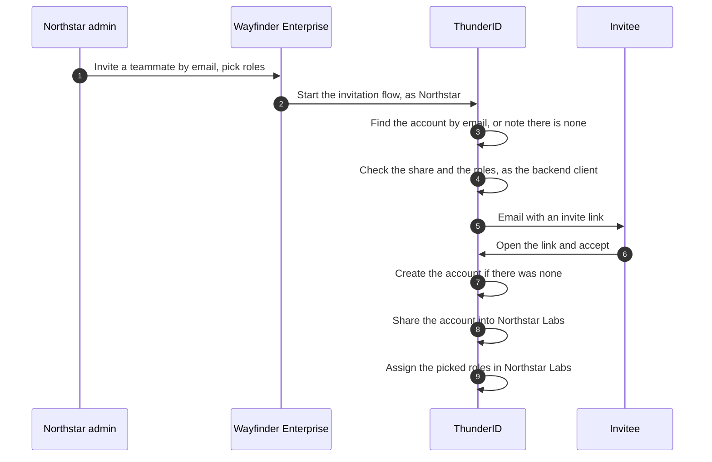

# Invite People In

Northstar's admin has signed Northstar Labs up and now wants the team on board. Some of them are new to Wayfinder Enterprise. One of them, a consultant, already has a Wayfinder account from working with another customer. Both should end up in Northstar's organization with the role Northstar picks, without a second account for the consultant and without Wayfinder's staff doing the work.

An invitation does this. The admin names a person by email and picks their roles, and the person accepts from a link. Accepting **shares** the person into the organization: the account stays where it lives and becomes usable in Northstar too. The Console calls this an affiliation. See [Resource Sharing Across Organization Units](../../../key-concepts/resource-sharing.mdx).

## Prerequisites

- The platform organization, its shared roles, and the shared application from [Wayfinder Enterprise sample](../try-it-out/index.mdx).
- The backend client and the token it gets for one organization, from [Let Organization Admins Manage Teams](./delegated-administration.mdx#create-the-backend-client). Your backend starts each invitation with it.
- An email provider for the invitation emails. See [Configure an Email Provider](../../../guides/notifications/email-providers.mdx).
- A user type with an `email` attribute. The invitation finds an existing account by its email and creates a new account with it, so an account without an email cannot be found. The **Organization Sign-up** templates collect only a username and a password, so add an email field to your sign-up flow if those accounts should be invitable later.

## Choose How People Join

| Situation | Use | Email sent |
|---|---|---|
| The person already has an account on the platform | The **Invite into Organization** flow, existing-user branch | Yes |
| The person has no account yet | The **Invite into Organization** flow, new-user branch | Yes |
| You manage the account yourself and need no acceptance | A sharing policy on the user | No |

A sign-up or invitation flow shares an account only into a direct child of the OU that owns it. Accounts created by the **Organization Sign-up with Shared Account** template, and accounts the invitation itself creates, live in the platform organization, so they can be invited into any company. See [Let Companies Sign Up](./organization-sign-up.mdx).

## How an Invitation Runs

One invitation is a single flow run in two parts. The admin's part runs on your backend, with the backend client's token for the admin's organization. The invitee's part continues the same run from the link in the email and needs no token.



On acceptance, the flow assigns the roles as the caller that started the invitation, so it assigns only roles that caller may still grant. Declining writes nothing. See [Invitations and User Onboarding](../../../guides/flows/advanced-configurations.mdx#invitations-and-user-onboarding) for each step.

## Build the Invitation Flow

<Stepper stepNode="h3" as="h3">

### Create the Flow From the Template

In the Console, navigate to **Flows** and click **Create new flow**. Select **Invitation** as the flow type, then select the **Invite into Organization** template.

### Name the User Type

Select the **User Type Resolver** step and set **Allowed User Types** to `wayfinder-user`. An invitation flow is bound to exactly one user type and fails with `FET-1135` otherwise. A person whose account has another user type cannot be invited with this flow.

### Set the Email Provider

The **Send Email** steps use the `invitation` email template, which asks the person to accept or decline joining the organization. Select each **Send Email** step and set **Email provider** to the provider you configured. Without one, the invitation cannot send its email and fails with `FET-1038`. See [Notifications](../../../guides/flows/advanced-configurations.mdx#notifications).

### Share the Flow With Every Company

An invitation runs for the organization in the caller's token, and that organization must own the flow or have it shared with it. Share the flow so that it reaches every company: in the Control Plane console, open the flow, click **Share**, and grant **All child organization units**. Through the API, call `POST /flows/<flow-id>/sharing-policies`. See [Share a Flow](../../../guides/flows/share-a-flow.mdx).

</Stepper>

## Start an Invitation

Start the flow by its ID on `POST /flow/execute` on the Data Plane. It cannot be started by flow type. The caller's access token must carry the root `system` permission and name an organization in its `ouId` claim, and the invitation acts for that organization. An `ouId` sent as an input does not change it.

### Start It From Your Backend

The root `system` permission reaches every organization in the deployment, so never put a token that holds it in a company admin's browser. Let your application's backend start the invitation instead:

1. The backend checks that the signed-in admin may invite, using your application's own permission, such as `user:manage` on the Wayfinder Enterprise API.
2. It checks every role ID the admin picked against the roles your application lets admins grant, such as `Wayfinder Admin` and `Wayfinder Member`.
3. It requests a token for the admin's organization from that organization's token endpoint, `POST /ou/{ouId}/oauth2/token`, with the `client_credentials` grant. The token names the organization in its `ouId` claim.
4. It starts the flow with that token, pinning the organization to the admin's own.

The backend client from [Create the Backend Client](./delegated-administration.mdx#create-the-backend-client) does this: it is shared with every company and holds `system` through a role assigned in its own OU. See [Machine-to-Machine (M2M) Access for Organization Units](../../../guides/organization-units/machine-to-machine-access.mdx) for the token request.

### Send the Invitation

To skip the email and role prompts, send `email` and `roles` (role IDs separated by spaces) as inputs with the action `action_submit_email` on the request that starts the flow. `$NORTHSTAR_TOKEN` is the backend client's token for Northstar Labs, from [Request a Token for the Admin's Organization](./delegated-administration.mdx#request-a-token-for-the-admins-organization):

```bash
curl -X POST https://localhost:8090/flow/execute \
  -H "Authorization: Bearer $NORTHSTAR_TOKEN" \
  -H "Content-Type: application/json" \
  -d '{
    "flowId": "<invitation-flow-id>",
    "action": "action_submit_email",
    "inputs": {
      "email": "new.teammate@northstar.example",
      "roles": "<wayfinder-member-role-id>"
    }
  }'
```

The roles are checked as they are on the prompt, as the caller of `/flow/execute`. The backend client holds the root `system` permission, so that check limits nothing, and the allow-list in your backend is what keeps an admin to the roles your application offers. An email that names no account still stops once at the **No Account Found** confirmation before the new-user branch continues.

| Refusal | Cause |
|---|---|
| `403` with `FES-1027` | The token names no organization in `ouId` |
| `403` with `FES-1029` | The organization in the token neither owns the flow nor has it shared with it |
| `FET-1133` | A role is not one the caller may assign in the organization |

### Accept the Invitation in Your Application

By default, the invite link opens the invite page of the Gate, the hosted sign-in and sign-up pages <ProductName /> serves under `/gate`. The link carries `executionId` and `inviteToken` in its query string. To accept inside your own application instead, set the `inviteBaseURL` property on the **Generate Invite** steps to a page of your application, and render the React SDK's `AcceptInvite` component there. It reads `executionId` and `inviteToken` from the URL and continues the flow without a token:

```jsx title="src/AcceptInvitePage.jsx" showLineNumbers
import { AcceptInvite } from '@thunderid/react'

export default function AcceptInvitePage() {
  return <AcceptInvite onGoToSignIn={() => (window.location.href = '/')} />
}
```

:::note
The SDK's `InviteUser` component starts a `USER_ONBOARDING` flow, the flow an administrator uses to create or invite users in the Console. It does not start the **Invite into Organization** flow.
:::

## Share an Existing Account Directly

To give a person access to an organization without an email or an acceptance step, share their account. In the Console, open the user and select the **Affiliations** tab, or call `POST /users/<user-id>/sharing-policies`. The target organization must sit beneath the OU that owns the account, here Wayfinder Enterprise.

A share can also **mandate roles**: it assigns the person the roles you list in the organization the share names, and that organization cannot remove them. Mandating roles needs `system:user`, not the permission to manage roles, but the caller must also hold every permission each mandated role grants, or the call fails with `403` and `SAZ-4030`. `$TOKEN` is an access token that holds `system:user` in Wayfinder Enterprise, the OU that owns the account:

```bash
curl -X POST https://localhost:8090/users/<user-id>/sharing-policies \
  -H "Authorization: Bearer $TOKEN" \
  -H "Content-Type: application/json" \
  -d '{
    "childUnits": {
      "mode": "selected",
      "units": [
        {
          "ouId": "<northstar-ou-id>",
          "reach": "unit",
          "overlayRules": {
            "roles": {
              "editable": false,
              "value": ["<wayfinder-member-role-id>"]
            }
          }
        }
      ]
    }
  }'
```

An OU keeps one sharing policy per user. When the account already has one, for example from a sign-up that shared it
into the company, the `POST` fails with `409` and `USR-1031`. Read the policy with `GET /users/<user-id>/sharing-policies`,
then replace it with `PUT /users/<user-id>/sharing-policies/<policy-id>`: send its current `version`, and list every unit
the account keeps along with the new ones.

A roles rule is accepted only on a unit listed under `childUnits` in `selected` mode with `reach: unit`. See [Mandate Roles on a Shared User](../../../guides/users/manage-users.mdx#mandate-roles-on-a-shared-user) for every rule and error.

Once the person belongs to more than one company, their sign-in lands in one company at a time. See [Switch Organizations](./switch-organizations.mdx).

## Next Steps

<NextSteps>
  <NextStepsCard
    title="Plug In an Enterprise IdP"
    description="Let a company sign its employees in through its own identity provider."
    href="../enterprise-sso"
  />
  <NextStepsCard
    title="Switch Organizations"
    description="Let a person who belongs to several companies move between them."
    href="../switch-organizations"
  />
  <NextStepsCard
    title="See It in a Sample App"
    description="Run Wayfinder Enterprise and manage a company's people from its Team page."
    href="../../try-it-out"
  />
</NextSteps>
