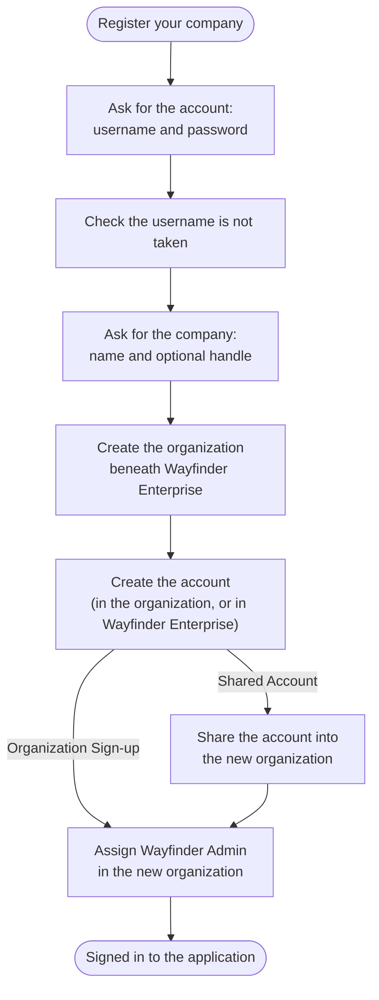

# Let Companies Sign Up

A travel manager at Northstar Labs finds Wayfinder Enterprise and wants to try it for the whole company. Nobody at Wayfinder should have to create anything by hand. One sign-up has to create the travel manager's account and create Northstar as an organization beneath Wayfinder Enterprise. It also has to make that first account Northstar's admin, then land the admin in the application already signed in.

Build that sign-up from one of two flow templates. Each creates the organization as an [organization unit (OU)](../../../guides/organization-units/manage-organization-units.mdx), a container for one customer's users, groups, and settings. The new OU sits beneath the OU that owns the user type.

## Choose Where the First Account Lives

The two templates differ only in where the new admin's account is stored:

| | **Organization Sign-up** | **Organization Sign-up with Shared Account** |
|---|---|---|
| Where the account lives | Inside the new organization | In the platform organization, the OU that owns the user type, shared into the new organization |
| Can it join more organizations later | No, it belongs only to the organization it created | Yes, it can be shared into other organizations beneath the platform organization |
| Suits | Customers whose people work for one company, such as Northstar's employees | People who work across several customers, such as consultants or a reseller's staff |

A sign-up or invitation flow shares an account only into a direct child of the OU that owns it, so the shared-account template always creates the organization directly beneath the user type's OU. See [Resource Sharing Across Organization Units](../../../key-concepts/resource-sharing.mdx) for how shares work.

## Prerequisites

- The platform organization, **Wayfinder Enterprise** (`wayfinder-enterprise`). See the [B2B Quick Start with React](../quick-start.mdx).
- A user type owned by Wayfinder Enterprise with **Allow self registration** turned on, such as **Wayfinder User** (`wayfinder-user`). A user type is usable in the OU that owns it and every OU beneath it, so one user type covers every company. See [User Types](../../../guides/users/user-types.mdx).
- The roles a new admin gets, such as **Wayfinder Admin**, owned by Wayfinder Enterprise and shared with all of its child OUs with their assignments editable. A role shared this way covers an organization the sign-up has only just created. See [Share a Role With Other Organization Units](../../../guides/users/manage-roles.mdx#share-a-role-with-other-organization-units).
- An application owned by Wayfinder Enterprise and shared with its child OUs. See [Sign Users In to Organization Units](../../../guides/organization-units/sign-in-to-organization-units.mdx).

## Build the Sign-Up

<Stepper stepNode="h3" as="h3">

### Create the Flow From a Template

In the Console, navigate to **Flows** and click **+ Create New Flow**. Select **Wayfinder Enterprise** as the organization unit that owns the flow, then select **Self sign-up** as the flow type. Choose **Organization Sign-up**, or **Organization Sign-up with Shared Account** if the account should live outside the organization. Name the flow and click **Create**.

The template names values only your deployment has, so the canvas opens it unsaved.

### Set the Roles the New Admin Gets

Select the **Assign Roles** step. Set **Roles** to the ID of **Wayfinder Admin**. To assign more than one role, separate the IDs with spaces. The flow cannot be saved without a role here.

In the shared-account template, the **Share** step before **Assign Roles** already shares the new account into the new organization, so leave it as it is. Click **Save**.

### Attach the Flow to the Application

Navigate to **Applications**, open the Wayfinder Enterprise application, and select the **Flows** tab. Under **Registration Flow**, turn on the toggle and select the sign-up flow. Click **Save**.

### Offer Sign-Up From the Sign-In Screen

A sign-up started on its own has no application to return the new admin to, so offer it from the sign-in flow instead. Open the application's sign-in flow. Add a **Register your company** button to its first screen, and connect it to a **CALL** step whose flow is the sign-up flow.

Connect the success path of the **CALL** step to the step that picks the organization after a password sign-in, the **Resolve OU** step in the **Basic + Enterprise SSO** template. The new admin then belongs to exactly one organization, so the step picks it without asking, and the sign-in finishes as it would for a returning user. See [Call Node](../../../guides/flows/advanced-configurations.mdx#call-node).

</Stepper>

## What Happens at Sign-Up

Both templates run the same sequence, with one extra step in the shared-account template:



The organization prompt asks for an **Organization Name** and an optional **Organization Handle**. A handle left empty is made from the name, so `Northstar Labs` becomes `northstar-labs`. Members later type the handle to reach the organization's own identity provider, so a short one such as `northstar` is easier to share. See [Organization Management](../../../guides/flows/advanced-configurations.mdx#organization-management) for every property of the step that creates the organization, and [Invitations and User Onboarding](../../../guides/flows/advanced-configurations.mdx#invitations-and-user-onboarding) for **Share** and **Assign Roles**.

## What the Token Carries

When the application asks for them, the organization claims name the new organization: `ouId` is its ID, `ouHandle` its handle, and `ouName` its name. The `roles` claim lists **Wayfinder Admin**, because it counts only the roles assigned in the organization the sign-in landed in. Your application reads the organization from these claims instead of storing its own mapping from users to companies.

```json
{
  "sub": "019f2b7e-5c41-7d2a-9e83-4a61c0d7b2f5",
  "ouId": "019f2b7e-1a90-7c3e-8b2d-6f04e9a1c3d8",
  "ouHandle": "northstar",
  "ouName": "Northstar Labs",
  "roles": ["Wayfinder Admin"]
}
```

See [What the Sign-In Carries](../../../guides/organization-units/sign-in-to-organization-units.mdx#what-the-sign-in-carries) for how the claims and roles follow the organization.

## When Something Goes Wrong

| What happens | Why | What the user sees |
|---|---|---|
| The username is taken | The account step checks that no user has it | The account screen again, with "The user already exists" |
| The organization name is taken | Another organization beneath Wayfinder Enterprise has it (`FET-1031`) | The company screen again, to change the name |
| The handle is taken | Another organization beneath Wayfinder Enterprise has it (`FET-1032`) | The company screen again, to change the handle |
| The role cannot be assigned | The role is not shared with the new organization, or its assignments are not editable there (`FET-1134`) | The sign-up fails. Share the role with all child OUs of Wayfinder Enterprise and try again |

:::warning
The organization is created before the account. A sign-up that fails at a later step, such as the role assignment, leaves the organization in place. Fix the cause before you open sign-up to customers.
:::

For the flow concepts behind these templates, see the section on applications that serve many organizations in [Build a Multi-Factor Sign-In Flow](../../../guides/flows/build-a-flow.mdx#go-further).

## Next Steps

<NextSteps>
  <NextStepsCard
    title="Invite People In"
    description="Bring the rest of Northstar's team into the organization the admin just created."
    href="../invite-members"
  />
  <NextStepsCard
    title="Plug In an Enterprise IdP"
    description="Let a company sign its employees in with its own identity provider."
    href="../enterprise-sso"
  />
  <NextStepsCard
    title="Design Decisions"
    description="When to keep accounts inside one organization, and when to share them."
    href="../../architecture-decisions"
  />
</NextSteps>
