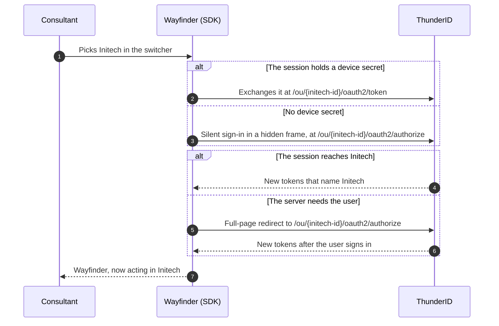

# Switch Organizations

Let a person who belongs to several organizations move between them without signing in again. A Wayfinder Enterprise travel consultant has one account that lives in the platform organization and is shared into Northstar Labs and Initech. They book trips for Northstar in the morning and for Initech in the afternoon, and every token they hold names exactly one of those organizations.

## Prerequisites

- The platform organization and the shared application from [B2B Quick Start with React](../quick-start.mdx).
- A person shared into more than one organization. See [Invite People In](./invite-members.mdx).

## How a Switch Works

Each organization is an organization unit (OU), a node in the hierarchy that owns its own users, groups, and roles. See [Manage Organization Units](../../../guides/organization-units/manage-organization-units.mdx). A sign-in lands in exactly one OU, and its tokens name that OU. A switch is a new sign-in bounded to another OU. <ProductName /> reuses the person's single sign-on session when they can sign in there, so normally no credentials are asked.

In redirect mode, the SDK tries the quietest way first. When it has no device secret, it asks for a sign-in in a hidden frame with `prompt=none`, which tells <ProductName /> to answer at once from the existing session, never by showing a screen:



A session holds a device secret when the sign-in asked for the `device_sso` scope. See [Sign-In With a Device Secret](../../../guides/organization-units/sign-in-to-organization-units.mdx#sign-in-with-a-device-secret). A failed switch leaves the previous session as it was.

## List the Organizations a Person Can Access

`GET /users/me/ous` lists the OUs the signed-in person can access: the one they live in and every one they are shared into. It needs no management permission, only the person's own access token. `current` is the OU the token was issued for.

```bash
curl 'https://localhost:8090/users/me/ous?scope=siblings' \
  -H 'Authorization: Bearer <access-token>'
```

```json
{
  "current": "7b6a5c4d-3e2f-4a1b-8c9d-0e1f2a3b4c5d",
  "totalResults": 2,
  "startIndex": 1,
  "count": 2,
  "organizationUnits": [
    {"id": "7b6a5c4d-3e2f-4a1b-8c9d-0e1f2a3b4c5d", "handle": "northstar", "name": "Northstar Labs"},
    {"id": "9e8d7c6b-5a4f-4e3d-2c1b-0a9f8e7d6c5b", "handle": "initech", "name": "Initech"}
  ],
  "links": []
}
```

Without `scope`, the list also includes the OU the consultant lives in, Wayfinder Enterprise. `scope=siblings` keeps only `current` and the accessible OUs that share its parent, which in Wayfinder Enterprise means the companies.

## Add the Switcher

`OrganizationUnitSwitcher` from `@thunderid/react` lists the person's organizations and switches on a pick:

```jsx title="src/Header.jsx"
import {OrganizationUnitSwitcher, SignedIn, useThunderID} from '@thunderid/react';

export default function Header() {
  const {currentOrganizationUnit} = useThunderID();

  return (
    <SignedIn>
      <span>Working in {currentOrganizationUnit?.name}</span>
      <OrganizationUnitSwitcher scope="siblings" onError={(error) => console.error(error)} />
    </SignedIn>
  );
}
```

| Prop | Description |
|---|---|
| `scope` | `siblings` lists the current organization and the ones that share its parent. Omit it to list every accessible organization. |
| `onSwitch` | Called with the organization and the refreshed user after a switch that completes in place. A switch that leaves the page completes on the callback instead. |
| `onSelect` | Takes over a pick. The switcher calls it with the organization instead of switching, so your application decides what happens. |
| `onError` | Called with the SDK error when a switch or a load fails. The switcher shows the message either way. |
| `switchOptions` | Options passed to `switchOrganizationUnit`, such as `{redirect: false}`. |
| `title`, `className`, `preferences`, `children` | Presentation, and a render prop for a fully custom switcher. |

`currentOrganizationUnit` holds the `id`, `handle`, and `name` read from the `ouId`, `ouHandle`, and `ouName` claims of the ID token. It is for display only. Authorization decisions belong to the server, which reads the access token.

## Switch From Your Own Interface

Call `switchOrganizationUnit` from `useThunderID()` when a menu, a link, or a route change picks the organization:

```jsx title="src/useOpenOrganization.js"
import {OrganizationUnitSwitchErrorCodes, useThunderID} from '@thunderid/react';

export default function useOpenOrganization() {
  const {switchOrganizationUnit} = useThunderID();

  return async (organizationUnitId) => {
    try {
      await switchOrganizationUnit(organizationUnitId, {redirect: false});
    } catch (error) {
      if (error.code === OrganizationUnitSwitchErrorCodes.InteractionRequired) {
        // The person has to sign in again. Ask first, then switch with redirects allowed.
      }
    }
  };
}
```

With `redirect: false`, a switch that needs the person fails with `InteractionRequired` instead of leaving the page. Leave it out to fall back to a full-page redirect.

In a Next.js application, call `switchOrganizationUnit` from `useThunderID()` the same way. The `@thunderid/nextjs` provider runs the switch on the server and sends the browser to the organization's authorization endpoint, and the callback replaces the session. A server cannot switch silently, so `{redirect: false}` always fails with `InteractionRequired`.

## Sign In Straight Into One Organization

When your application already knows the organization, such as from a company-specific link, bound the first sign-in to it. Pass the organization's ID, not its handle:

- **Redirect-based sign-in:** `signIn({organizationUnitId})`, or `<SignInButton signInOptions={{organizationUnitId}} />`. The request goes to `/ou/{ouId}/oauth2/authorize`, and the code is redeemed at `/ou/{ouId}/oauth2/token`.
- **App-native sign-in:** `<SignIn organizationUnitId={organizationUnitId} />`. The SDK sends `ouId` on the request that starts the sign-in flow.

To let people type a handle instead, resolve it in the sign-in flow with a **Resolve OU** step. See [Let the User Pick the Organization Unit First](../../../guides/organization-units/sign-in-to-organization-units.mdx#let-the-user-pick-the-organization-unit-first).

## What Changes After a Switch

The new tokens describe the person in the organization they switched to:

- **Organization claims.** `ouId`, `ouName`, and `ouHandle` name the new organization, not the one the person lives in.
- **Roles.** Only role assignments made in the new organization count, and the `roles` claim lists only those.
- **Groups.** The `groups` claim lists only groups the new organization owns.
- **Refresh.** A refresh token checks permissions again in the organization it was issued for, and is refused once the person can no longer sign in there, for example after their share is removed.

The application's token configuration must include these claims. See [What the Sign-In Carries](../../../guides/organization-units/sign-in-to-organization-units.mdx#what-the-sign-in-carries).

## Handle Switch Errors

`switchOrganizationUnit` fails with a code from `OrganizationUnitSwitchErrorCodes`:

| Code | Cause |
|---|---|
| `UnauthorizedClient` | The organization does not exist, or the application is not shared with it. The server answers both with `unauthorized_client`, so the two cannot be told apart. |
| `InteractionRequired` | The person has to sign in again, and the switch was not allowed to redirect. |
| `InvalidOrganizationUnit` | No organization ID was given. |
| `Failed` | The bounded sign-in failed for another reason. The server's OAuth error is the message. |

On the token endpoint itself, a code or refresh token issued for another OU fails with `invalid_grant`, and a device secret for a person who cannot sign in to that OU fails with `interaction_required`.

## Next Steps

<NextSteps>
  <NextStepsCard
    title="Invite People In"
    description="Share an existing account into another organization, so it shows up in the switcher."
    href="../invite-members"
  />
  <NextStepsCard
    title="B2B SDK Components"
    description="The switcher, the organization context, and every other B2B component."
    href="../../sdk-components"
  />
  <NextStepsCard
    title="Design Decisions"
    description="Choose how a sign-in picks the organization in the first place."
    href="../../architecture-decisions"
  />
</NextSteps>
