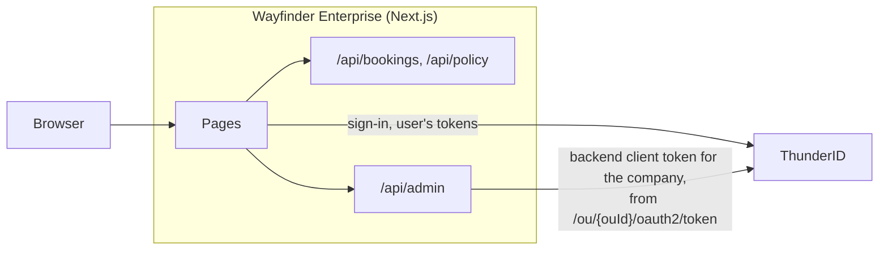

# See It in a Sample App

Wayfinder Enterprise is the reference implementation for [B2B SaaS applications](../overview): a corporate travel app
that runs the journeys of this section against <ProductName />. Companies register themselves, their admins set travel
policies and manage their team, and employees sign in with a password or through their company's own identity
provider to book flights.

<SdkQuickstartDownload packageId="nextjs" sample="b2b/wayfinder-enterprise" icon={<NextLogo size={22} />} />

## The Companies

The walkthroughs use two companies, each an organization unit (OU) beneath the platform organization, Wayfinder
Enterprise:

```text
Wayfinder Enterprise            the platform organization: the app, its roles, flows and user type
├── Northstar Labs              a company whose employees sign in with passwords
└── Initech                     a company whose employees sign in through Initech's own identity provider
```

The application, its two roles (`Wayfinder Admin` and `Wayfinder Member`), and its sign-in flow are defined once in
Wayfinder Enterprise and shared with every company, so a company works the moment it signs up.

## Architecture

The sample is one Next.js app. Its pages sign people in through <ProductName /> with `@thunderid/nextjs`, and its API
routes serve bookings and travel policies keyed by the company in the access token. The admin pages manage
<ProductName /> resources through the app's own `/api/admin` route, which pins every call to the admin's company and
forwards it with a backend client's token for that company.



A user's token carries only the app's own permissions, never a <ProductName /> management permission. See
[Let Organization Admins Manage Teams](../journeys/delegated-administration.mdx) for why the admin calls go through a
backend route.

## Get the Sample

Download the sample above, or copy its source:

```bash
npx degit thunder-id/samples/b2b/wayfinder-enterprise wayfinder-enterprise
cd wayfinder-enterprise
```

## Import the Bundle

The fastest way to create the resources the walkthroughs need. First, [get <ProductName /> running](../../../getting-started/get-thunderid); then import two files through the Console, in this order:

1. Sign in to the Control Plane console at `https://localhost:8095/console`.
2. Choose **Import / Export**, then **Import**. Upload `thunderid-config/organization-unit.yaml` as the configuration
   file. It needs no environment file. Choose **Continue**, and once the import test passes, choose
   **Import configuration**.
3. Choose **Import / Export**, then **Import** again. Upload `thunderid-config/thunderid-config.yaml` as the
   configuration file and `thunderid-config/thunderid.env` as the environment variables file, to provide the variables
   the YAML references. Choose **Continue**, then **Import configuration**.

The Console tests each import before it runs it, and that test only finds an organization unit that already exists. The
second file places every resource in the organization unit the first one creates, so import the first one on its own.

### What the Import Creates

| Resource | Name | What it does |
|---|---|---|
| Organization unit | Wayfinder Enterprise (`wayfinder-enterprise`) | The platform organization, a root organization unit in the Default project. Every company that signs up becomes its child. |
| User type | Wayfinder User (`wayfinder-user`) | The account schema, with self-registration on. Owned by the platform organization, so every company can use it. |
| Resource server | Wayfinder Enterprise API (`urn:wayfinder-enterprise:api`) | The app's own permissions, for bookings, travel policies, and the admin pages |
| Server config | `defaultResourceServer` | Makes the Wayfinder Enterprise API the default resource server |
| Roles | Wayfinder Admin, Wayfinder Member | Shared with every company. An admin manages the company; a member books within its travel policy. |
| Flow | Wayfinder Enterprise Company Sign-up | Creates the company, creates its first admin inside it, and assigns `Wayfinder Admin` |
| Flow | Wayfinder Enterprise Sign-in | Password, enterprise single sign-on (SSO), or company registration. Shared with every company, and each company sets its own `enterpriseIdp`. |
| Theme and layout | Wayfinder, Wayfinder Centered | The look of the sign-in and sign-up screens |
| Application | Wayfinder Enterprise | The app's confidential client, with the organization and role claims in its tokens. Shared with every company. |
| Application and role | Wayfinder Enterprise Backend | A `client_credentials` client for the app's admin route, shared with every company |

The defaults in `thunderid.env` work as they are for a local setup. Change a client secret there before you import,
and set the same value in the app's environment.

## Configure the Sample

Copy the environment template:

```bash
cp .env.example .env.local
```

The defaults match the import. Set `THUNDERID_SECRET` in `.env.local` to a long random string; the SDK encrypts the
session cookie with it. Generate one with:

```bash
openssl rand -base64 32
```

The app calls <ProductName /> from its server. A local <ProductName /> uses a self-signed certificate, so point
`NODE_EXTRA_CA_CERTS` at the certificate the running server uses before you start the app. With the quickstart image,
that is the Data Plane's certificate:

```bash
export NODE_EXTRA_CA_CERTS=<thunderid-home>/dp/config/certs/server.cert
```

## Run the Sample

From the sample directory, install dependencies and start the app:

```bash
npm install
npm run dev
```

The sample opens at `http://localhost:3000`.

## Walkthroughs

After the sample is running, follow a journey through it:

<NextSteps>
  <NextStepsCard
    title="Let Companies Sign Up"
    description="Register Northstar Labs and land in its workspace as its first admin."
    href="../journeys/organization-sign-up"
  />
  <NextStepsCard
    title="Let Organization Admins Manage Teams"
    description="Add people, create groups, and assign the admin or member role, all within Northstar."
    href="../journeys/delegated-administration"
  />
  <NextStepsCard
    title="Plug In an Enterprise IdP"
    description="Connect Initech's own identity provider, then sign in as an Initech employee."
    href="../journeys/enterprise-sso"
  />
</NextSteps>

## Next Steps

- Build a smaller B2B app from scratch with the [React](../../../getting-started/connect-your-b2b-application/react) or
  [Next.js](../../../getting-started/connect-your-b2b-application/nextjs) B2B quickstart, including switching between
  organizations.
- Review the [Design Decisions](../architecture-decisions) behind the pattern.
