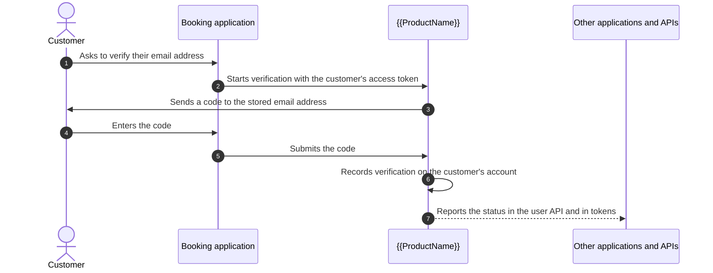

# Confirm Users Control Their Email Address and Mobile Number

A customer of a travel-booking service updates the email address on their profile and mistypes one letter. Their next booking confirmation goes to a stranger's inbox, and so does the receipt after it. The service sent each message to the address it had stored, and nothing on the account said whether the customer had ever received anything there.

## The Problem

A stored email address or mobile number says where to send a message. It does not say whether the user receives what arrives there. Closing that gap brings its own challenges:

- **A typed value proves nothing.** A customer, an administrator, or an import can store any address, including a mistyped one or someone else's.
- **Proof belongs to one value.** A check made last month says nothing about the address saved today, so a changed contact has to lose its verified status at once.
- **The code has to reach the stored contact.** A code sent to an address taken from the request proves control of that address instead.
- **Every application asks the same question.** When each application runs its own confirmation and keeps its own flag, the answers drift apart, and a token cannot carry one trusted answer.

## How It Works

<ProductName /> keeps verification on the user account. An application asks <ProductName /> to verify one attribute, <ProductName /> proves control of the value stored in it, and every application then reads the same result.

The customer from the travel-booking service verifies their corrected email address:



<ProductName /> sends the code to the stored value, never to a value the application supplies. It records verification only if that value is still stored when the code is accepted. Saving a different value clears the record, so a verified status always describes the current address.

:::tip Not Your Pattern?
- If you need to stop repeated sign-in attempts or contain a compromised account, see [Account Protection](../../../guides/account-protection/overview).
- If you are building sign-up, sign-in, and recovery for a consumer application from the start, see [Secure Consumer Access to Your Application](../../b2c/).
:::

## Verify a Contact from the Profile

The customer verifies from the profile page of the booking application. The application starts a `SELF` flow, the [flow type](../../../guides/flows/what-are-flows) for operations a signed-in user performs on their own account. The request carries the customer's [access token](../../../key-concepts/tokens), the flow's handle, which names the flow, and the attribute to verify:

```http
POST /flow/execute
Authorization: Bearer <customer access token>
Content-Type: application/json

{
  "flowType": "SELF",
  "handle": "default-self-attribute-verification-flow",
  "verbose": true,
  "inputs": {
    "attribute": "email"
  }
}
```

<ProductName /> takes the user from the access token, so one customer cannot start verification for another. The shipped flow reads the attribute's type from the customer's [user type](../../../guides/users/user-types), the schema behind their profile. It sends the code by email when the type is `email` and by SMS when it is `mobile`. In the default Person user type, these attributes are `email` and `mobile_number`. Its first response names the channel and a masked destination, such as `c•••@example.com`, so the application can say where the code went.

In the shipped flow, the code stays valid for 5 minutes. After 3 wrong entries it stops working, and the customer asks for a new one. Each new code goes to the address stored at that moment, and a code sent before a contact change records nothing.

A one-time code that proves a contact is not a sign-in. It never counts toward the account's sign-in lock, so a customer whose password sign-in is locked can still verify. A suspended account is refused.

## Keep Verification Current

A month later, the customer moves to a new email address. The moment the new value is saved, <ProductName /> clears the old address's verification in the same write. Every write path behaves the same: the customer's own profile update, an administrator's update, and a flow that collects attributes.

Switching back to the earlier address does not restore its status, because the record belongs to one verification of one value. Removing a contact clears its verification, and changing the user's type clears every verification on the account.

Verification shows that the user received a message at that address at a point in time. [Design Decisions & Alternatives](../architecture-decisions#decide-what-an-unverified-contact-may-do) covers what it leaves to your application.

## Read Verification in Your Applications

The status reaches applications in two places.

### In the User API

`GET /users/me`, `GET /users/{id}`, and `GET /users` include a read-only `verifiedAttributes` field with each verified attribute and the time it was verified:

```json
{
  "verifiedAttributes": {
    "email": { "verifiedAt": "2026-10-14T09:00:00Z" }
  }
}
```

An empty object means nothing is verified. A missing field means the status could not be read, so treat it as unknown. Listings that return identifiers only omit the field too. No request sets this field: only a completed verification adds an entry, and only a change to the contact or the user type removes one.

### In Tokens and UserInfo

An application that releases a user's `email` attribute can also release `email_verified`, a boolean that is `true` when that value is verified. The same rule gives every `email` or `mobile` attribute a `<attribute>_verified` claim, such as `mobile_number_verified` for the default Person user type. The claims reach the ID token and the UserInfo response when the application's scope mapping and attribute lists include them, and the access token when its own attribute list does. Like every other user attribute, they are read at sign-in. See [Claims & Scopes](../../../guides/protocols/oauth-oidc/claims-and-scopes#verified-contact-claims) for the mapping and the lists.

## Verify During Registration, Recovery, and Onboarding

When a registration, recovery, or onboarding flow sends a code or link to the user's contact, it can record verification too. Add the `AttributeVerificationExecutor` [executor](../../../guides/flows/advanced-configurations#executors) in `prepare` mode before the code is generated and in `record` mode after it is checked. A flow that prepares must also record, and a sender node must send to the contact between the two. The shipped flows of these types do not verify contacts.

A registration flow can verify before the account exists. <ProductName /> records the verification on the created user only if that user's stored value is still the one that received the code.

## Next Steps

- [Design Decisions & Alternatives](../architecture-decisions) explains where verification belongs in a journey, which proof to use, where applications read the status, and what to plan for in production.
- [Users](../../../guides/users/manage-users#email-address-and-mobile-number-verification) describes verification status on user records and how a contact change clears it.
- [Claims & Scopes](../../../guides/protocols/oauth-oidc/claims-and-scopes#verified-contact-claims) shows how to release `email_verified` and the other verification claims to an application.
