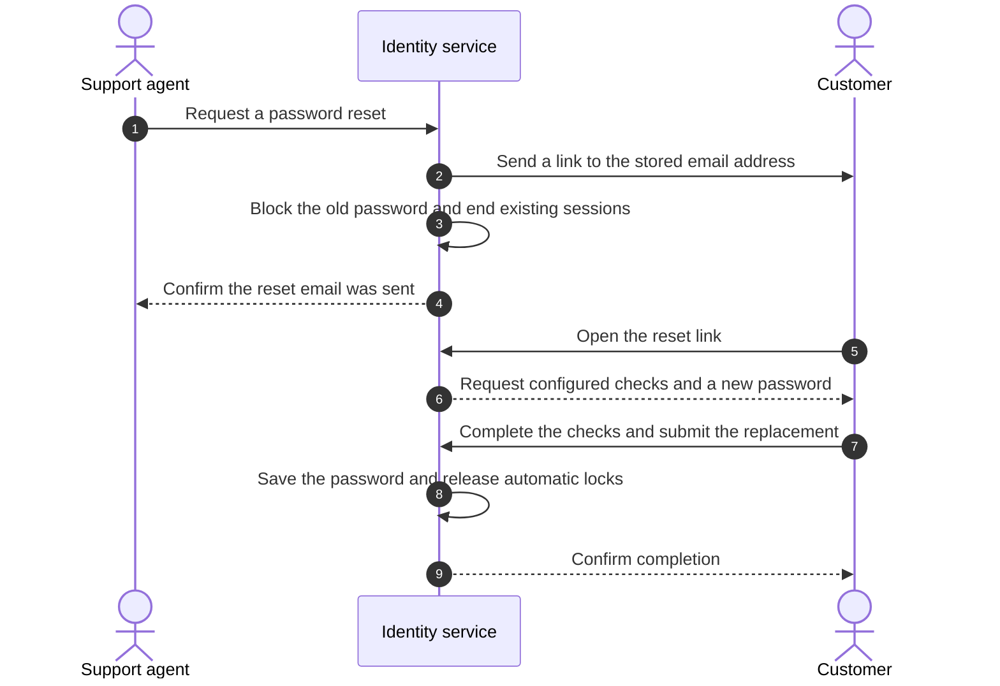

# Help Users Replace Credentials at Support's Request

A customer of a travel-booking service contacts support after losing access to their account. The support agent needs to start a password reset, while the customer chooses the replacement privately. If the password may be compromised, it must stop working as soon as the reset email is sent.

:::info Proposed capability
This page describes the administrator-requested credential reset proposed in <RepoLink path="/issues/2024">issue #2024</RepoLink>. The reset action and default journey require that implementation; they are not available on the current main branch.
:::

## The Problem

Setting a password directly makes the support agent responsible for choosing and sharing it. A reset requested by support has different requirements:

- **The customer chooses the replacement.** Support starts the process but never receives the reset link or the new credential.
- **The old credential stops working promptly.** A suspected compromise cannot wait for the customer to finish the reset.
- **Delivery must succeed first.** A missing email address or failed send must leave the existing credential usable.
- **Verification follows the organization’s rules.** Some services require a text-message code or another check before accepting a replacement.

## How It Works

The identity service emails a link to the customer’s stored profile address before blocking the selected credential. The customer opens the link and completes the configured checks before setting the replacement.



In <ProductName />, a [flow](../../../guides/flows/what-are-flows) defines the reset journey. The default journey includes link verification, credential replacement, and automatic lock release. A customized journey can require more verification before accepting the new value.

:::tip Not Your Pattern?
- For a forgotten password reset that the customer starts, see [Account Recovery](../../b2c/try-it-out/account-recovery).
- To stop access to the whole account during an investigation, see [Account Protection](../../../guides/account-protection/overview).
:::

## Start the Reset from Support

For the booking service, support locates the customer in the Console’s user listing and selects **Send credential reset link**. On the user’s **Credentials** tab, **Send reset link** starts the same operation for a selected credential.

The action lists eligible credentials from the customer’s [user type](../../../guides/users/user-types), which defines their profile and credential fields. When the customer has both a password and a PIN, support selects which one to reset. The PIN must be a string credential so leading zeros remain intact.

The default journey’s **Validate Permission** step requires `system:user:update` or `org:user:update`. The latter confines support to customers within its organization unit. Starting the flow also requires an access token carrying a system permission and a flow owned by or shared with that token’s organization unit. See [Permissions for Administration Flows](../../../guides/users/manage-roles#permissions-for-administration-flows).

The customer’s steps use the initiating administrator’s remaining permissions. Removing those permissions, locking that administrator, or suspending them can prevent completion, even after delivery succeeds.

Declarative users, whose records come from configuration files, cannot change credentials at runtime. Credentials such as passkeys and authenticator applications are outside this reset pattern.

### Reset Start Request

A support application uses the flow execution API instead of setting a replacement credential itself. This request comes from the feature’s proposed API example. Replace the bearer token and `subject` with an authorized administrator’s access token and the customer’s user ID:

```http
POST /flow/execute
Authorization: Bearer <administrator access token>
Content-Type: application/json

{
  "flowType": "ADMIN_INITIATED",
  "handle": "default-admin-credential-reset-flow",
  "verbose": true,
  "inputs": {
    "subject": "019fd0e4-de6c-7ea5-9541-7982f40beeb9",
    "credential": "password"
  }
}
```

`ADMIN_INITIATED` identifies a journey that an administrator starts and the customer continues. The `handle` names the configured flow. For a PIN reset, `credential` names that field instead of `password`.

An accepted request returns `INCOMPLETE` with `additionalData.emailSent` set to the string `"true"`. That confirms the email was sent; the customer has not completed the reset. The response never contains the link, including when sending fails.

## Let the Customer Complete the Reset

After the email is sent and the reset is accepted, the customer’s old password stops working. Existing tokens and sessions are revoked, signing the customer out everywhere. Other sign-in methods retain their existing access rules.

The customer opens the email link in a separate browser, without signing in or using support’s browser session. The journey verifies the link before accepting a new password. A value that fails the credential policy leaves the reset open so the customer can correct it.

The default journey releases automatic locks after successful credential replacement. A custom journey needs its own **Unlock** step to release those locks. Suspension remains an administrator decision: the customer cannot complete the reset while suspended, and a reset never removes suspension.

Each link is single use, expires after the configured lifetime, and belongs to the intended customer and credential. A later reset or credential change makes an earlier link unusable. Expiry does not restore the old password, and reopening a used link does not change the replacement.

## Apply the Booking Service’s Verification Rules

The booking service configures an [email provider](../../../guides/notifications/email-providers) and selects it in the reset journey before offering the action to support. The journey sends to the stored profile address. Support cannot supply a different destination in the reset request or obtain a link for manual sharing.

For higher-risk support requests, the service adds a text-message one-time password (SMS OTP) check after link verification and before collecting the new credential. Other required checks belong in the same part of the journey. The flow builder also controls the reset email template.

Anyone controlling the mailbox can complete the default email-link journey. Extra checks apply only to journeys that include them. A pending administrator-requested reset leaves self-service forgot password available, so equivalent checks must also be configured there when required.

A notification after successful replacement is optional. The service adds it to the journey when needed; the default journey ships no completion notification or template.

## Handle Delivery and Completion Failures

Support needs to distinguish an email failure from an unfinished customer journey:

| Situation | Result and next action |
| --- | --- |
| No stored email, no email provider, or a failed send | The reset is refused, and the credential stays usable. Correct the delivery problem before retrying. |
| The credential cannot be blocked after the email was sent | Support receives a failure, and the emailed link cannot complete. The credential may already be removed; start a new reset. |
| The link expired, was used, or was superseded | The link is refused without disclosing customer or credential details. Support can start a new reset if needed. |
| The customer is automatically locked | The default journey permits recovery and releases automatic locks after replacement succeeds. |
| The customer is suspended | An administrator must restore the account before the reset can proceed. |

For a suspected compromise when delivery fails, support can suspend the account or set the credential directly. Customers without email use the existing direct credential update operation. This pattern does not include bulk resets, standalone reset codes, or automatic link delivery by SMS.

## Trace the Support Request

Initiation records identify the administrator, customer, and credential type. Completion records identify the customer and share the reset’s flow execution ID, so support can connect completion to its initiating administrator. Records exclude credential values, reset tokens, and one-time passwords.

The booking service can therefore distinguish an email sent by support from a reset the customer completed. Its investigation records do not need to contain the customer’s new password or reset link.

## Next Steps

- Follow <RepoLink path="/issues/2024">issue #2024</RepoLink> for the reset implementation and acceptance criteria.
- Review [What Are Flows?](../../../guides/flows/what-are-flows) before customizing the verification journey.
- Configure delivery using [Configure an Email Provider](../../../guides/notifications/email-providers).
