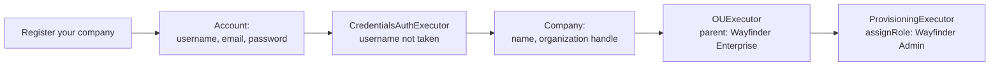
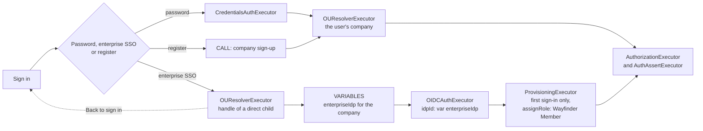

# Wayfinder Enterprise Sample

A B2B travel management app built with Next.js and the ThunderID Next.js SDK. Companies register themselves, their admins set travel policies and manage their team, and employees sign in with a password or with their company's own identity provider to book flights.

Every company is an organization unit (OU) in ThunderID. The app, its two roles and its sign-in flow are defined once and shared with every company, so a new company works the moment it signs up.

```text
Wayfinder Enterprise            a root OU: owns the app, its backend client, the roles, the flows and the user type
├── Northstar Labs              a company: its users, groups and identity provider
├── Initech                     a company
└── ...
```

## What This Demonstrates

| Capability | How the sample does it |
|---|---|
| Two app roles | `Wayfinder Admin` (travel policy, team, enterprise SSO, all bookings) and `Wayfinder Member` (book within policy). The app gates pages on the role and its APIs on the permissions in the access token. |
| App shared with child OUs | The application, both roles and the sign-in flow carry a sharing policy for every child of `Wayfinder Enterprise`. |
| Company sign-up | A registration flow asks for the first admin's account, then for the company. It creates the company OU (`OUExecutor`), creates the user inside it and assigns `Wayfinder Admin` (`ProvisioningExecutor` with `assignRole`). The sign-in flow calls it, so the new admin is signed in to the app when it completes. |
| Password or enterprise SSO | The sign-in flow offers both. Enterprise SSO asks for the organization handle, resolves it to a direct child of `Wayfinder Enterprise` (`OUResolverExecutor` with `directChildrenOnly`), then reads the company's `enterpriseIdp` variable (`VARIABLES` node) and signs in with that connection (`OIDCAuthExecutor`). First-time employees are provisioned into the company as members. A password sign-in, and the admin of a newly registered company, are signed in to the company they belong to. |
| Admin plugs in the company IdP | The SDK's `FlowVariablesForm` sets the company's value of the shared flow's `enterpriseIdp` variable. It shows the label and description the flow declares, and picks from the connections the company owns or was shared. The app lists the company's identity providers, and adds an OpenID Connect one owned by the company from its own form, through the SDK's management request config (`useManagementRequestConfig`). |
| Branded sign-in screens | A Wayfinder theme (blue and yellow, Inter) and layout, assigned to the application, replace ThunderID's own branding on the sign-in and sign-up screens. The flows show the application's logo. |
| SDK everywhere | The sign-in and sign-out buttons, route protection, the user, group and role components, the flow variables form and the management request config all come from `@thunderid/nextjs`, the app's only ThunderID dependency. |
| Declarative provisioning | [`thunderid-config/`](thunderid-config/) creates everything in two imports. |

## Prerequisites

- Node.js 20.9 or later, and pnpm
- A running ThunderID server (default `https://localhost:8090`), with its Gate sign-in pages

## Quick Start

### 1. Import the ThunderID Resources

The defaults in [`thunderid-config/thunderid.env`](thunderid-config/thunderid.env) work as they are for a local setup:

```dotenv
WAYFINDER_ENTERPRISE_CLIENT_ID=WAYFINDER_ENTERPRISE
WAYFINDER_ENTERPRISE_CLIENT_SECRET=wayfinder-enterprise-secret
WAYFINDER_ENTERPRISE_REDIRECT_URIS=["http://localhost:3000"]
WAYFINDER_ENTERPRISE_POST_LOGOUT_REDIRECT_URIS=["http://localhost:3000"]
WAYFINDER_ENTERPRISE_BACKEND_CLIENT_ID=WAYFINDER_ENTERPRISE_BACKEND
WAYFINDER_ENTERPRISE_BACKEND_CLIENT_SECRET=wayfinder-enterprise-backend-secret
```

Import two files through the ThunderID Console (`https://localhost:8090/console`), in this order:

1. [`thunderid-config/organization-unit.yaml`](thunderid-config/organization-unit.yaml), which needs no `.env` file.
2. [`thunderid-config/thunderid-config.yaml`](thunderid-config/thunderid-config.yaml) with `thunderid.env`.

The Console tests each import before it runs it, and that test only finds an organization unit that already exists. The second file places every resource in the organization unit the first one creates, so import the first one on its own.

- **First time**: the welcome screen has an **Open** button to upload the YAML, then the `.env` file.
- **Later**: open the same screen from the user profile menu (top right).

The two imports create these resources, with fixed IDs so the app's configuration works unchanged:

| Resource | Name | Notes |
|---|---|---|
| Organization unit | Wayfinder Enterprise (`wayfinder-enterprise`) | A root OU, the parent of every company. |
| User type | Wayfinder User (`wayfinder-user`) | Self-registration on. Usable in every company. |
| Resource server | Wayfinder Enterprise API (`urn:wayfinder-enterprise:api`) | The app's own permissions: `booking:view`, `booking:create`, `booking:manage`, `policy:view` and `policy:manage` for the travel APIs, and `view` and `manage` on `user`, `group`, `role` and `sso` for the admin pages. |
| Server config | `defaultResourceServer` | Makes the Wayfinder Enterprise API the deployment's default resource server, for authorization requests that name no resource. |
| Role | Wayfinder Admin | Shared with every company. Holds every Wayfinder permission. |
| Role | Wayfinder Member | Shared with every company. Holds `booking:view`, `booking:create` and `policy:view`. |
| Flow | Wayfinder Enterprise Company Sign-up | Registration flow. |
| Flow | Wayfinder Enterprise Sign-in | Authentication flow. Shared with every company, which may set `enterpriseIdp`. |
| Theme and layout | Wayfinder, Wayfinder Centered | The look of the sign-in and sign-up screens. |
| Application | Wayfinder Enterprise | Confidential client with the Wayfinder theme, layout and logo. Shared with every company. |
| Application and role | Wayfinder Enterprise Backend | A `client_credentials` client holding the root `system` permission, for the app backend only. Shared with every company, so it gets a token for the company it acts for. See [Security Design](#security-design). |

### 2. Configure the App

```bash
cp .env.example .env.local
```

The defaults match the import. Set `THUNDERID_SECRET` to a long random string; the SDK encrypts the session cookie with it.

The app calls ThunderID from its server. A local ThunderID uses a self-signed certificate, so let Node trust it when you start the app. Point `NODE_EXTRA_CA_CERTS` at the certificate the running server uses:

```bash
# Started with `make run` from the repository root: the packaged server makes its own certificate.
export NODE_EXTRA_CA_CERTS=<repo-root>/target/dist/thunderid-<version>-<os>-<arch>/dp/config/certs/server.cert

# Started with `make run_backend`:
export NODE_EXTRA_CA_CERTS=<repo-root>/backend/cmd/server/config/certs/server.cert
```

### 3. Run the App

From the repository root:

```bash
pnpm install
pnpm --filter @thunderid/wayfinder-enterprise-sample dev
```

Open `http://localhost:3000`.

## Try It

1. **Register a company.** Choose **Get started** on the landing page, then **Register your company** on ThunderID's sign-in page. Enter a username, a work email and a password, then a company name and an organization handle such as `northstar`. ThunderID creates the company, creates you inside it, makes you its admin and signs you in, so you land in the app's workspace. Admins get the sidebar: **Flight booking**, **Travel policy**, **Team and roles** and **Enterprise SSO**.
2. **Sign in again later.** Choose **Sign in** and use your username and password.
3. **Set the travel policy.** Choose the highest cabin, the fare limit and the approval margin. Members see each flight as in policy, needing approval, or out of policy, and the booking API rejects out-of-policy bookings from members.
4. **Manage the team.** On **Team and roles**, add users, create groups, and give people the admin or member role. Every list and change is limited to your company.
5. **Connect your identity provider.** On **Enterprise SSO**:
   1. Register an OpenID Connect application in your identity provider, with `https://localhost:8090/gate/callback` as the callback URL.
   2. Under **Identity providers**, choose **Add identity provider** and enter that application's client ID, client secret and endpoints.
   3. Under **Enterprise SSO connection**, select it and choose **Save**.
6. **Sign in as an employee.** Sign out, choose **Sign in**, then **Sign in with enterprise SSO**, and enter your organization handle. ThunderID sends you to your company's identity provider. On the first sign-in, ThunderID adds you to the company as a member, and you land on the booking page.

A company that has not set an identity provider sees "The flow is not available for this organization yet" when an employee tries enterprise SSO.

### Using Asgardeo as the Company Identity Provider

1. In the Asgardeo Console of your organization (for example `worklink`), create a **Standard-Based Application** with **OpenID Connect**.
2. On the **Protocol** tab, allow the **Code** grant and add `https://localhost:8090/gate/callback` as an authorized redirect URL. Note the client ID and client secret.
3. On the **User Attributes** tab, request **Email**, **First Name** and **Last Name**.
4. In Wayfinder, add the identity provider with:

| Field | Value |
|---|---|
| Authorization endpoint | `https://api.asgardeo.io/t/worklink/oauth2/authorize` |
| Token endpoint | `https://api.asgardeo.io/t/worklink/oauth2/token` |
| User info endpoint | `https://api.asgardeo.io/t/worklink/oauth2/userinfo` |
| JWKS endpoint | `https://api.asgardeo.io/t/worklink/oauth2/jwks` |
| Issuer | `https://api.asgardeo.io/t/worklink/oauth2/token` |
| Scopes | `openid profile email` |

## How It Works

### Company Sign-up



The user is created in the new company OU, and the shared `Wayfinder Admin` role is assigned to them there. A taken username sends the user back to the account step, and a taken organization handle back to the company step.

The sign-in flow runs this flow through a `CALL` node when the user chooses **Register your company** on the sign-in page, and then finishes sign-in for the new admin. That is what signs the admin in to the app straight away: a sign-up started outside a sign-in request, such as on ThunderID's `/gate/signup` page, has no app to return a signed-in user to. ThunderID has no authorization parameter that opens the sign-in page on its registration option, so the landing page's **Get started** and **Create workspace** buttons start sign-in and the user chooses the option there.

### Sign-in



The app is shared with every company, so a sign-in must decide which company it signs in to before ThunderID issues a token. Enterprise SSO decides it from the handle before the user signs in. A password sign-in and a new company's admin decide it after: a second `OUResolverExecutor` (`resolveFrom: prompt`, `directChildrenOnly`) picks the one company under `Wayfinder Enterprise` the user belongs to, and asks the user to choose when there are several.

The flow declares `enterpriseIdp` as a `CONNECTION_SELECT` variable with no default, and its sharing policy lets every company set it (`variables.enterpriseIdp: {editable: true}`). The OIDC executor reads the connection from `{{var(enterpriseIdp)}}`, so one flow serves every company with that company's own identity provider.

### Branding

The application carries the Wayfinder theme and layout, so ThunderID shows its sign-in and sign-up screens in Wayfinder's colors and without ThunderID's own branding. Each flow prompt starts with an image of the application's `logoUrl`.

The sign-in screens load images only from ThunderID itself or from `data:` URIs, so the application's `logoUrl` is the Wayfinder logo ([`public/wayfinder-logo.svg`](public/wayfinder-logo.svg)) as a `data:` URI. Layout stylesheets cannot load images at all, so the layout paints its background with CSS gradients.

### Tokens

The app requests its tokens for the `urn:wayfinder-enterprise:api` resource server. The access token carries the user's `roles`, the company in `ouId`, `ouHandle` and `ouName`, and the permissions the user's role grants. The app's API routes verify the token and key every booking and travel policy by `ouId`, so one company never sees another's data.

### Security Design

A user's token is issued for the app's resource server and carries only the app's own permissions. It is never sent to the ThunderID management API, so it needs no ThunderID permission, and the app keeps working when a deployment checks the audience of management API tokens (`server.security.rest.audience`). The SDK reads the signed-in user's profile from the ID token (`fetchUserProfile: false`) instead of `/users/me` for the same reason.

The admin components still manage ThunderID resources. The app passes `endpoints` for `users`, `groups`, `roles`, `connections`, `flows` and `userTypes` that point at its own [`/api/admin`](src/app/api/admin/[...path]/route.ts) route. That route:

1. Verifies the caller's access token and requires the Wayfinder permission for the call: `view` to read and `manage` to change, on `user` for users and the user type, `group` for groups and their members, `role` for role assignments, and `sso` for identity provider connections and the sign-in flow's variables. Only `Wayfinder Admin` grants them.
2. Lets through only the calls the admin pages make: the company's users and groups, group members, the two Wayfinder roles and their assignments, listing and adding the company's identity provider connections, the sign-in flow as the company sees it, what the company may set on it and its `enterpriseIdp` value, and the Wayfinder user type.
3. Replaces the OU in every request with the caller's own `ouId`.
4. Forwards the call with a token of the `Wayfinder Enterprise Backend` client issued for the caller's company.

The backend client is shared with every company. For each call, the app requests its token at the company's own token endpoint, `POST /ou/{ouId}/oauth2/token` with the `client_credentials` grant, and caches one token per company. The token names the company in its `ouId`, `ouHandle` and `ouName` claims. It carries `system` through the `Wayfinder Enterprise Backend` role, which is assigned in the client's own organization unit: only those roles count when it gets a token for a company. A company the client is not shared with gets no token (`400 unauthorized_client`).

The ThunderID server still checks the rest, such as that a role assignee or a group member belongs to the company and that a connection is one the company owns or was shared.

## Project Structure

```text
wayfinder-enterprise-sample/
├── thunderid-config/                 Declarative resources and their variables
├── public/                           Wayfinder logos
└── src/
    ├── proxy.ts                      Session refresh and route protection (thunderIDProxy)
    ├── app/
    │   ├── layout.tsx                ThunderIDProvider, with the admin endpoints
    │   ├── page.tsx                  Landing page
    │   ├── workspace/                Bookings, travel policy, team, enterprise SSO
    │   └── api/
    │       ├── admin/[...path]/      Company-scoped proxy for the ThunderID management API
    │       ├── bookings/             Bookings, checked against the travel policy
    │       ├── flights/              Flight search
    │       └── policy/               Travel policy
    ├── components/                   Workspace shell and page components
    └── lib/
        ├── auth.ts                   Access token verification and the signed-in user
        ├── management.ts             Backend client token and management API calls
        ├── store.ts                  Bookings and policies in data/wayfinder.json
        └── travel.ts                 Travel policy evaluation, shared by browser and server
```

The app keeps bookings and travel policies in `data/wayfinder.json` so it needs no database. Each change reads and rewrites the whole file, so two changes made at the same moment can overwrite each other. Use a database in a real app.
