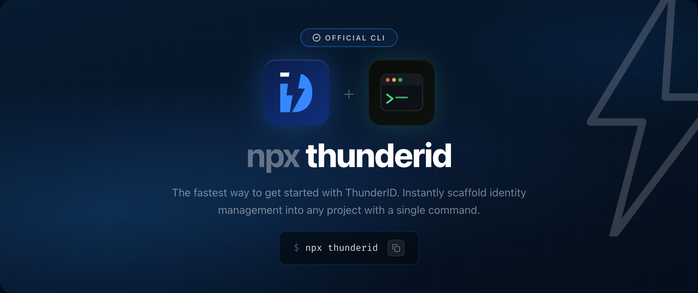

# ThunderID



Run ThunderID instantly — no manual download or setup required.

## Quick Start

```bash
npx thunderid
```

On first run this downloads the latest ThunderID release, initializes the platform, and starts it. Later runs reuse
the cached installation and start immediately.

## Commands

| Command            | Description                                        |
| ------------------ | -------------------------------------------------- |
| _(none)_           | Install (if needed) and start ThunderID            |
| `upgrade`          | Upgrade to the latest release                      |
| `try <use-case>`   | Download and launch a use-case sample app          |
| `integrate <tech>` | Configure a technology integration _(coming soon)_ |

## Flags

| Flag                | Description                                                      |
| ------------------- | ---------------------------------------------------------------- |
| `--plane`           | Install the `quickstart` or the Data Plane alone (`dp`)          |
| `--product-version` | Install a specific release, or read releases from another source |
| `--setup`           | Force re-run setup                                               |
| `--verbose`, `-v`   | Show detailed output                                             |
| `--version`, `-V`   | Show the CLI version                                             |
| `--help`, `-h`      | Show help                                                        |

## Choosing a Version

By default ThunderID installs the latest release. `--product-version` takes either a version or a
manifest URL, so you can pin a release or point at your own mirror.

```bash
# Install and run a specific release instead of the latest.
npx thunderid --product-version 1.1.0

# Read releases from somewhere other than thunderid.dev, such as an internal mirror.
npx thunderid --product-version https://releases.example.com/releases.json

# Both: that version, from that mirror.
npx thunderid --product-version https://releases.example.com/releases.json --product-version 1.1.0
```

A GitHub release page works as a source too, so a build published on any repository, such as a
fork's test build, can be tried before it is released:

```bash
# That release, read from the GitHub API. The pack is picked from its files as usual.
npx thunderid --product-version https://github.com/<owner>/<repo>/releases/tag/v2.0.0-m1

# The latest release of that repository.
npx thunderid --product-version https://github.com/<owner>/<repo>/releases/latest
```

To try a prerelease such as a milestone, use the `next` channel. It installs the newest release,
prereleases included, where `npx thunderid` installs the newest stable one:

```bash
npx thunderid@next
```

The same value can be given as `THUNDERID_PRODUCT_VERSION` for scripted runs. Flags win over the
environment.

A few things worth knowing:

- A version that is already installed starts straight away; nothing is downloaded again.
- A version the manifest does not carry is an error listing the ones it does, rather than
  quietly installing something else.
- Pinning suppresses the upgrade notice, and `upgrade` refuses to run while pinned, so it cannot
  move you off the release you asked for.
- A custom source is used on its own: ThunderID will not fall back to the public releases behind
  your back, and it prints the source it is reading so a stray environment variable is never
  silent.
- Releases are executable, so a custom source must be `https`, except on `localhost`.

## Choosing a Plane

From 2.0, a release ships two packs: the quickstart (`thunderid-<version>`), which runs the Control
Plane and the Data Plane it manages, already connected, and the Data Plane on its own
(`thunderid-gateway-<version>`). `npx thunderid` installs the quickstart by default. `--plane`
picks the other pack:

```bash
# The quickstart: the Control Plane, the Data Plane it manages, and auth-dp, the Control Plane
# console's sign-in. This is the default.
npx thunderid

# The Data Plane on its own.
npx thunderid --plane dp
```

A 1.x release ships only the Data Plane, so it installs that without `--plane`. Some differences
from a single plane:

- The quickstart runs on fixed ports: 8095 (Control Plane console), 8090 (Data Plane) and 8091
  (auth-dp). If one is taken, you can stop what holds it or abort; the quickstart cannot move.
- Setup creates two accounts and shows both: the admin, who signs into the Control Plane console,
  and the Service Desk Admin, who signs into the Data Plane's Admin Console. Set
  `THUNDERID_SERVICE_DESK_USERNAME` and `THUNDERID_SERVICE_DESK_PASSWORD` to choose the second.
- Sample apps (`try`) need a Data Plane install for now. Run them with `--plane dp`.
- Each version is installed as one plane. To switch a version that is already installed to
  another plane, remove its directory under `./thunderid` first.

## Requirements

- **Node.js** `>= 22.23.1`

## Supported Platforms

| OS      | Architectures  |
| ------- | -------------- |
| macOS   | `x64`, `arm64` |
| Linux   | `x64`, `arm64` |
| Windows | `x64`          |

## About

- **npm:** [`thunderid`](https://www.npmjs.com/package/thunderid)
- **source:** <https://github.com/thunder-id/thunderid>
- **docs:** <https://thunderid.dev>

## License

[Apache License 2.0](https://github.com/thunder-id/thunderid/blob/main/LICENSE)
